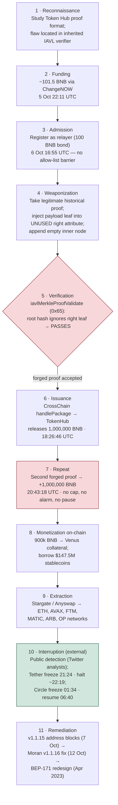
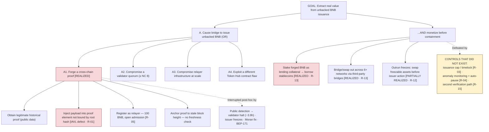
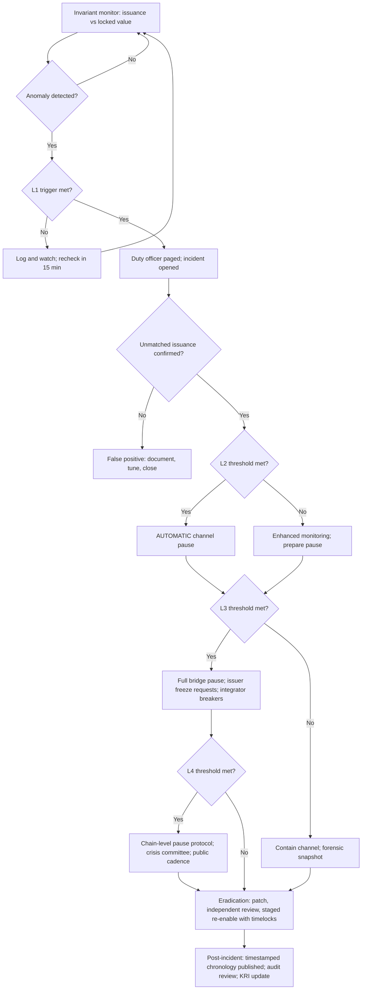

# Project BLACKSWAN

## Enterprise Cyber Risk & GRC Assessment of the 2022 BNB Chain Bridge Exploit

**A Post-Incident Security Governance, Risk Assessment, Control Effectiveness and Remediation Engagement**

| | |
|---|---|
| **Engagement type** | Independent cybersecurity risk assessment (post-incident review) |
| **Prepared by** | Lead GRC Engineer |
| **Subject incident** | BSC Token Hub cross-chain bridge exploit, 6 October 2022 |
| **Assessment frameworks** | NIST CSF 2.0 · NIST SP 800-53 Rev. 5 · ISO/IEC 27001:2022 · COBIT 2019 · CIS Controls v8 · SOC 2 TSC (by analogy) |
| **Evidence basis** | Public sources only: operator statements, independent technical analyses, release records. Full index: `evidence/evidence-and-sources.md` |
| **Companion artefacts** | Risk register, control-gap matrix, framework crosswalk, remediation roadmap (`data/`), internal audit test plan (`audit/`), board briefing (`board/`), methodology (`methodology/`) |

> **Scope note.** This assessment concerns the BSC Token Hub, the native bridge between BNB Beacon Chain and BNB Smart Chain. This is BNB Chain *protocol* infrastructure. It is not an assessment of Binance's centralised exchange, and no exchange user funds were involved in the incident. Maintaining that distinction is itself one of the assessment's governance findings (risk R-16).

---

# Project BLACKSWAN

## Enterprise Cyber Risk & GRC Assessment of the 2022 BNB Chain Bridge Exploit

**Sections 1 to 4: Executive Summary · Organizational and Technological Background · Incident Reconstruction and Technical Root Cause · Threat Modeling and Security Analysis**

| | |
|---|---|
| **Engagement type** | Independent post-incident cybersecurity risk assessment (portfolio engagement) |
| **Prepared by** | Lead GRC Engineer: independent assessor |
| **Subject incident** | BSC Token Hub cross-chain bridge exploit, 6 October 2022 |
| **Assessment frameworks referenced** | NIST Cybersecurity Framework 2.0 · NIST SP 800-53 Rev. 5 · ISO/IEC 27001:2022 · COBIT 2019 · CIS Controls v8 |
| **Evidence basis** | Public primary and reputable secondary sources only, cited inline as (Source, date, URL). No non-public information was available to, or used by, this assessment. |
| **Status** | Sections 1 to 4 of the full engagement report (Sections 5 to 15 follow separately) |

> **A note on attribution, stated once and applied throughout.** This was a **BNB Chain protocol incident**, not a breach of the Binance centralized exchange. The compromised component, the BSC Token Hub, is native BNB Chain infrastructure: a set of genesis system contracts in BNB Smart Chain, maintained by the BNB Chain core development community and secured by its validator set. No Binance exchange accounts, custody wallets, or user deposits were involved, and the operator's settled position is that "the loss is on BNB Chain" and no user funds were affected (BNB Chain, 11 Oct 2022, https://www.bnbchain.org/en/blog/bnb-chain-a-decentralized-response). Binance the exchange's role was that of originator and sponsor and, through its CEO, the public face of the response. Conflating the protocol with the exchange is the single most common analytical error in commentary on this incident, and this assessment avoids it deliberately: correctly identifying *who owned the control environment that failed* is the first act of competent GRC work.

---

## Section 1: Executive Summary

### 1.1 Incident overview

On **6 October 2022 (UTC)**, an unidentified attacker exploited a proof-verification flaw in the **BSC Token Hub**, the native cross-chain bridge between **BNB Beacon Chain** and **BNB Smart Chain (BSC)**, and caused the bridge to release **2,000,000 BNB in two transactions of 1,000,000 BNB each** (18:26:46 UTC and 20:43:18 UTC) against no corresponding deposit on the Beacon Chain side (Coinbase Threat Intelligence, 31 Oct 2022, https://www.coinbase.com/en-gb/blog/bsc-token-hub-compromise-investigation-and-analysis-8). This was an **unbacked issuance (minting) event**, not a theft from a custodial pool: the bridge's verification logic was deceived into treating a forged cryptographic proof as evidence of a legitimate cross-chain transfer. The incident was limited to the bridge; the underlying blockchain was not compromised (BNB Chain, 11 Oct 2022, https://www.bnbchain.org/en/blog/bnb-chain-a-decentralized-response).

Validators coordinated the first-ever synchronized pause of BSC on the evening of 6 October, roughly 3.9 hours after the first exploit transaction. The chain resumed on the morning of 7 October with cross-chain transfers still disabled; the bridge itself remained out of service for six days, until the **Moran hard fork (BSC v1.1.16)** re-enabled it on 12 October 2022 (bnb-chain/bsc, Oct 2022, https://github.com/bnb-chain/bsc/releases/tag/v1.1.16).

### 1.2 Financial exposure: three numbers, never one

Most public reporting lumps three different quantities into one headline figure. They are not the same thing, and this report keeps them apart:

| Measure | Figure | Basis |
|---|---|---|
| **Gross minted exposure** | 2,000,000 BNB, valued contemporaneously at **~$566M-$586M** depending on the BNB price used; the operator's own figure is "nearly $570 million" | 2M BNB is unanimous across sources. USD spread is a pricing artifact: $566M (Chainalysis figure reported by CoinDesk, 13 Oct 2022, https://www.coindesk.com/tech/2022/10/13/october-becomes-worst-month-for-crypto-hacks-with-two-weeks-to-go); "nearly $570M" (BNB Chain, 11 Oct 2022, https://www.bnbchain.org/en/blog/bnb-chain-a-decentralized-response); ~$586M (Coinbase Threat Intelligence, 31 Oct 2022, URL above) |
| **Value moved off BSC before containment** | **~$100M-$127M, sources conflict** | BNB Chain's first estimate was $70-80M, revised to $100-110M the same night (CoinDesk, 6 Oct 2022, https://www.coindesk.com/business/2022/10/06/binance-linked-bnb-price-falls-close-to-4-on-hack-rumors); Coinbase estimated ~$110M taken off BSC (31 Oct 2022); SlowMist tracked $127M sent to other chains (The Block, 7 Oct 2022, https://www.theblock.co/news/regulation/2022-10-07-biance-bnb-chain-is-back-up-after-bridge-exploit-175437) |
| **Operator's final unrecovered figure** | **~$100M "remain unrecovered and moved off chain"** | BNB Chain, 11 Oct 2022; restated by CZ to CNBC (24 Oct 2022, https://www.cnbc.com/2022/10/24/binance-narrowing-down-identity-of-hacker-behind-bnb-crypto-hack-ceo.html) as 80-90% frozen, actual loss ~$100M |

Two other figures belong next to those. Approximately **$429M remained stranded on BSC** in the attacker's address, immobilized by the pause (SlowMist data reported by The Block, 7 Oct 2022, URL above), and **$33.5M was frozen by Tether and Circle** at the address level on Ethereum (Elliptic, 9 May 2023 republication of Oct 2022 analysis, https://www.elliptic.co/insights/attack-mints-569-million-worth-of-bnb-tokens-in-bsc-bridge-exploit/). Separately, the attacker converted part of the on-chain position into **$147.5M of borrowed stablecoins** (62.5M BUSD + 50M USDT + 35M USDC) by staking 900,000 BNB as collateral on Venus Protocol (Coinbase Threat Intelligence, 31 Oct 2022), a figure that overlaps the off-chain movement numbers and must not be added to them. Whether sources count the Venus borrowing inside "moved off-chain" is one reason the $100M-$127M range cannot be responsibly collapsed. No audited final funds-flow statement was located in the public record; the operator's ~$100M figure is a settled management representation, not an independently verified loss number, and is treated as such throughout this report.

### 1.3 Operational impact

- **BSC downtime of approximately 8 hours** (halt announced ~22:19 UTC 6 October; resumption ~06:40 UTC 7 October), consistent with Coinbase's characterization that BNB Chain "halted operations for approximately 8 hours" (Coinbase Threat Intelligence, 31 Oct 2022). BNB Chain's own statement that the coordinated response "still took around 5 hours" refers to validator coordination time, not downtime, and the two figures should not be interchanged.
- **Bridge outage of six days** (6-12 October), ending only with the Moran hard fork (The Block, 12 Oct 2022; Decrypt, 12 Oct 2022, https://decrypt.co/111773/bnb-chain-upgrade-restores-cross-chain-transfers-following-binance-bridge-hack).
- **Contagion into downstream protocols within minutes:** the forged BNB was immediately usable as collateral in BSC lending markets and routable through third-party bridges, converting a single-protocol verification failure into a multi-chain, multi-protocol exposure (risk R-13).
- **No user funds lost**, per the operator, and no rollback of the chain was performed (BNB Chain, 11 Oct 2022).

### 1.4 Attack classification

**Class:** Cryptographic proof-forgery against a cross-chain bridge verification function, resulting in unauthorized asset issuance. **Root weakness class:** improper verification of a cryptographic proof due to a logic flaw in a shared upstream library (Cosmos IAVL), compounded by the absence of any issuance limit, anomaly detection, or secondary verification path on the bridge itself. **Actor:** unknown; Coinbase stated the "responsible actor(s) are still unknown" (31 Oct 2022), and no regulator attribution for this specific incident was found, a material contrast with the March 2022 Ronin bridge theft, which the FBI publicly attributed to North Korea's Lazarus Group (Chainalysis, 2 Aug 2022, https://www.chainalysis.com/blog/cross-chain-bridge-hacks-2022/).

### 1.5 Principal control weaknesses: stated with evidentiary discipline

A good assessor has to separate what the evidence *proves* from what it only *suggests*. The split matters, so here it is:

**Confirmed by technical evidence (findings):**
- **F-1: Proof verification was defeatable (R-01).** The `iavlMerkleProofValidate` precompile computed a root hash that ignored the right leaf when the left leaf was defined, allowing an attacker-controlled payload to be injected into a legitimate proof without changing its root hash. Independently confirmed at code level by Coinbase and Immunefi (17 Mar 2023, https://immunefi.com/blog/bug-fix-reviews/hack-analysis-binance-bridge-october-2022/).
- **F-2: No issuance bound or circuit breaker (R-03).** The bridge honored two 1M BNB release instructions, each individually exceeding any plausible routine transfer pattern, within 2 hours 17 minutes, with no per-transaction cap, velocity limit, timelock, or automatic pause trigger. The outcome itself shows that no rate-limiting control was in place.
- **F-3: Single-path trust model (R-15).** One library, one proof format, one verification path stood between an anonymous relayer and unbounded issuance. No independent secondary verification existed to fail against.

**Evidenced by the observed response (findings, with limits noted):**
- **F-4: Detection and escalation depended on public, informal channels (R-04, R-07).** Detection was public and community-driven on social media (PeckShield, SlowMist, and independent analysts including samczsun), in parallel with the operator's "irregular activity" messaging; no source reliably establishes a single first detector, and BNB Chain has not published a detection timeline. The halt was executed by "contacting community validators one by one" across time zones (BNB Chain Ecosystem Update, 7 Oct 2022). It worked, but it was an improvised coordination mechanism, not a rehearsed emergency protocol, and the pause still took roughly 3.9 hours from the first mint.
- **F-5: Relayer admission control was minimal (R-05).** Any party depositing 100 BNB could register as a relayer and submit cross-chain packages. This was a documented design choice, not the vulnerability itself, but it removed any allow-list barrier to presenting the forged proof. (The risk was accepted by design at launch and re-rated after the incident. Moran then replaced it with genesis-candidate whitelisting.)

**Assessment limitations (explicitly NOT findings of failure):**
- **Assurance evidence gap (R-08).** No published audit report scoped to the BSC Token Hub, its system contracts, or the IAVL verifier precompile was located for the pre-incident period, despite targeted research. A secondary source (Callisto Network, undated, https://docs.callisto.network/hack-investigation-dept./binance-bridge-hack) asserts the system was not audited, but that claim is unverified. **The correct GRC conclusion is narrow:** if an audit occurred, its report is not public, so the control is *insufficiently evidenced*, a governance and transparency weakness in itself for infrastructure of this value, without proving the control was absent. Commonly cited nearby audits (CertiK's 2021 assessment of the separate ETH-BSC Swap contracts; the 2020 PeckShield/CertiK ecosystem partnership) are **not** Token Hub audits and must not be represented as such.
- **Bug bounty scope ambiguity (R-09).** The 2021 Priority ONE fund ($10M, with Immunefi) targeted *projects building on BSC*, and no published evidence was found that the core bridge/client was in scope of any public bounty before the incident (BNB Chain, 30 Sept 2021, https://www.bnbchain.org/en/blog/belt-finance-pays-the-biggest-bug-bounty-1million-under-immunefi-and-bscs-priority-one). Whether the core protocol was deliberately out of scope or simply never enrolled cannot be determined from public evidence.

### 1.6 Lessons learned

1. **A bridge is a mint with extra steps, and must be governed like one.** Any component that can create assets on the strength of a proof is, in risk terms, a money-issuance system. It warrants the control rigor of a payment switch: issuance caps, dual verification, and a tested kill switch.
2. **Inherited code inherits the risk register.** The flaw was in upstream Cosmos IAVL code adopted by BSC; it affected other projects and required a Cosmos emergency patch (Coinbase, 31 Oct 2022). You need to know which consensus-critical libraries you run, and who checks them. That is a governance control, not an engineering detail (R-02).
3. **Foreseeability was established before the fact.** By August 2022, Chainalysis had counted $2 billion stolen across 13 cross-chain bridge hacks, 69% of all crypto funds stolen that year, including Wormhole (~$320M, February) and Ronin (~$625M, March). The BNB Token Hub exploit was the fourth nine-figure bridge failure in eight months (Chainalysis, 2 Aug 2022). A risk team paying attention to that pattern would have rated bridge verification failure as a top-tier, *expected* scenario, not a tail event.
4. **Detection by the public is not a monitoring strategy.** The response succeeded because skilled external analysts happened to be watching. That is luck dressed up as process (R-04).
5. **Containment worked, and revealed the governance trade-off honestly.** A 26-active-validator Proof-of-Staked-Authority set (Nakamoto coefficient 8) could be coordinated to halt within hours; the operator itself acknowledged BNB Chain is "less decentralized than Ethereum now" (BNB Chain, 11 Oct 2022). Emergency capability and decentralization are a governed trade-off, not a slogan (R-06, R-07).

### 1.7 Strategic recommendations (summary; full roadmap in Section 11)

- **SR-1.** Treat all asset-issuing verification paths as critical infrastructure: independent dual verification, per-transaction and velocity issuance caps, and automatic pause on forged-proof detection. (BEP-171 later implemented this in substance in April 2023, with ICS23 proof verification, timelocks on massive transfers, and an automatic channel pause. See Section 3.7.)
- **SR-2.** Establish a **public assurance baseline** for consensus-critical components: published audit scope and reports for bridge and verification code, and a bug-bounty scope that clearly covers the core protocol.
- **SR-3.** Formalize emergency governance: documented halt authority, pre-authorized validator coordination procedures, and published detection/escalation timelines after incidents.
- **SR-4.** Maintain a dependency risk register for consensus-critical third-party libraries, with tracked upstream security advisories and patch-service-level expectations.
- **SR-5.** Publish a complete post-incident accounting standard: detection time, halt time, downtime, and final funds-flow reconciliation. The lack of that accounting is itself a recurring finding in this assessment.

### 1.8 Executive risk statement

> The BNB Chain bridge exploit shows what can go wrong in cross-chain infrastructure. **A single defective verification function in a shared library can convert directly into nine-figure enterprise loss, because nothing behind it limited, questioned, or independently re-checked the issuance it authorized.** The technical vulnerability has been fixed; the governance pattern it exposed (unbounded issuance, single-path trust, informal emergency authority, and unpublished assurance) is not specific to BNB Chain. It recurs across the digital-asset industry. Any enterprise that operates, integrates with, or holds exposure through cross-chain bridges should treat proof-verification integrity, issuance containment, and evidenced independent assurance as board-visible risks with named owners, not as implementation details delegated to engineering. The residual question for every such operator is the one this report applies throughout: *if your bridge's core proof check failed silently tonight, what exactly, in measurable terms and by name, would stop the loss, and how long would it take?*

---

## Section 2: Organizational and Technological Background

### 2.1 The entities, correctly separated

**Binance (the centralized exchange).** A commercial cryptocurrency exchange and custodian for its own customers. Binance originated the BNB Chain concept and contributed early code; BNB Chain's own account is that Binance "introduced the idea and some code for BNB Chain" and "now remains solely as a sponsor," adding that "Binance is part of the BNB ecosystem, not the other way around" (BNB Chain, 11 Oct 2022, https://www.bnbchain.org/en/blog/bnb-chain-a-decentralized-response). That statement serves Binance's interests, and readers should keep that in mind. The operational facts still support the narrower claim that matters here: the exchange did not operate the Token Hub as an exchange product, and no exchange accounts or deposits were touched. Contemporaneous reporting nonetheless uniformly described BNB Chain as "a blockchain closely linked to the crypto exchange Binance" (CoinDesk, 7 Oct 2022), and the halt was publicly announced by Binance's CEO in the first person, "we have asked all validators to temporarily suspend BSC" (CZ, 6 Oct 2022, quoted in CoinDesk and Gadgets360, 7 Oct 2022, https://www.gadgets360.com/cryptocurrency/news/bnb-chain-hacked-usd-100-million-binance-coin-stolen-changpeng-zhao-3410184). For risk purposes, Binance therefore carries **sponsor, reputational, and crisis-communications exposure (R-16)** rather than operational responsibility for the bridge control environment. (A separate point: the *exchange* later suspended BSC deposits and withdrawals around the Moran fork to support the upgrade. That was an exchange operations decision, not part of the protocol halt.)

**BNB Chain (the protocol ecosystem).** At the time of the incident, a dual-chain architecture:

- **BNB Beacon Chain**: the governance and staking chain (Tendermint-based), launched with 11 validators, hosting the BEP2 token standard and validator elections.
- **BNB Smart Chain (BSC)**: the EVM-compatible execution chain where smart contracts and DeFi protocols (including Venus, and the Token Hub system contracts) run, launched with 21 validators and secured by **Proof-of-Staked-Authority (PoSA)** consensus.

All figures in this paragraph are from BNB Chain (11 Oct 2022, URL above).

**Validators.** At the incident, BSC had **44 validators in total, of which 26 were active**, plus inactive "candidate" validators introduced under the Euler hard fork (BEP-131); the operator's own stated **Nakamoto coefficient was 8**, i.e., collusion or coordination among a small number of entities could determine chain behavior. The 11 October post names infrastructure operators including Coinbase Cloud and Figment among those who executed the synchronized pause. Stated (pre-incident, May 2022 roadmap) targets were 41 active / 80-100 total BSC validators under BEP-131 and a path toward 100 Beacon Chain validators under BEP-159 (BNB Chain Tech Roadmap 2022, 31 May 2022, https://www.bnbchain.org/en/blog/bnb-chain-tech-roadmap-2022). Critics alleged the validator set was effectively Binance-controlled (an allegation reported by Cointelegraph, 17 Oct 2022); BNB Chain denied that anyone could control validator decisions. This assessment records the allegation as **unverified**, and the operator's own, sufficient concession as the finding: a validator set small and coordinated enough to halt the chain within hours is, in governance terms, a concentrated control point whether or not any single company directs it (R-06).

### 2.2 The BSC Token Hub: how the bridge was supposed to work

Cross-chain bridges exist because assets cannot natively move between independent chains. The Token Hub implemented a lock-and-release model between Beacon Chain and BSC:

1. A user locks/transfers BNB on the Beacon Chain side.
2. A **relayer**, a registered off-chain/on-chain actor, observes the Beacon Chain event and submits a **cross-chain package** to BSC's **CrossChain system contract** (`0x0000…2000`, method `handlePackage`). Only registered relayers could call it; registration required a **100 BNB deposit** and was open to anyone.
3. The package carries an **IAVL Merkle proof** purporting to demonstrate that the transfer exists in Beacon Chain state.
4. The CrossChain contract invokes the **`iavlMerkleProofValidate` precompiled contract (address 0x65)**, verification logic compiled into the BSC node client itself, derived from the Cosmos IAVL (IAVL+ tree) implementation, to validate the proof.
5. On successful validation, the **TokenHub system contract (`0x0000…1004`)** releases (in effect, issues) the corresponding BNB on BSC.

(System contract addresses and call chain: Coinbase Threat Intelligence, 31 Oct 2022; Immunefi, 17 Mar 2023.) The critical architectural fact is step 4: the bridge's entire safety property reduced to the correctness of a single inherited library routine verifying a single proof. There was no independent second check, no separate light-client verification, no issuance accounting reconciliation against observed Beacon Chain lock totals, no human or automated value threshold. Section 4 analyzes this as the single-path trust model (R-15).

### 2.3 IAVL proofs and the trust they carry

An IAVL tree is a versioned Merkle tree (from the Cosmos ecosystem) used to commit to key-value state. A proof for a key consists of a path of inner nodes from leaf to root; each inner node commits to the hashes of its **left** and **right** children. Verification recomputes the root hash from the leaf and the path and compares it against a trusted root. The security assumption is total: *if the recomputed root matches, the key-value pair is in the committed state.* The Token Hub extended that assumption one step further, *the claimed cross-chain transfer therefore occurred*, and acted on it by issuing assets. Cryptographic proofs of this kind fail in only two ways: the cryptography is broken, or the verification code does not correctly implement it. This incident was the second: the cryptography (SHA-256) was never in doubt; the implementation of the root-hash computation in one branch condition was wrong (detailed in Section 3.2).

### 2.4 Trust assumptions inventory

| # | Assumption embedded in the design | Status after the incident |
|---|---|---|
| T-1 | The IAVL verification implementation correctly binds every proof element into the root hash | **Violated**: right leaf excluded from root computation when left leaf defined (R-01) |
| T-2 | Shared upstream library code (Cosmos IAVL) is safe to embed in consensus-critical paths without independent re-verification | **Violated in effect**: the flaw was inherited and industry-wide (R-02) |
| T-3 | Open relayer registration (100 BNB bond) is a sufficient admission control for actors who can trigger issuance | **Failed as a barrier**: the attacker registered routinely (R-05) |
| T-4 | Proofs anchored to old block heights are as acceptable as recent ones | **Violated**: both forged proofs referenced block height 110217401, ~2 years old (samczsun, 6 Oct 2022) |
| T-5 | Release volume needs no independent limit because proofs cannot be forged | **Violated**: T-5 is T-1 restated as an operational control decision (R-03) |
| T-6 | Validators can be reached and coordinated ad hoc quickly enough to contain an incident | **Held, barely**: containment took ~3.9 hours and one-by-one outreach (R-07) |
| T-7 | Downstream protocols (lending markets, third-party bridges) will treat bridged BNB as sound collateral/liquidity | **Held operationally, harmfully**: that is exactly what enabled rapid value extraction (R-13) |

### 2.5 Critical assets

In descending order of loss potential: (1) the **integrity of the proof-verification path**, the asset whose failure caused everything else; (2) **bridge issuance authority** embodied in the TokenHub system contract; (3) **BNB supply integrity** on BSC (2M unbacked BNB entered circulation); (4) **validator coordination capability**, which proved to be the only effective containment asset; (5) **downstream protocol collateral integrity** (Venus and third-party bridges); (6) **the operator's and sponsor's credibility**, damaged in part by the attribution blur itself (R-16).

### 2.6 System context diagram

Trust boundaries are shown explicitly: the relayer boundary (anonymous, bond-only), the verification boundary (single precompile), and the downstream boundary (protocols that accepted BSC state at face value).

```mermaid
flowchart LR
    subgraph EXT["External actors"]
        USER["Ordinary users"]
        REL["Relayers<br/>(open registration: 100 BNB bond)"]
        ATK["Attacker<br/>(funded via ChangeNOW)"]
    end
    subgraph BC["BNB Beacon Chain (BEP2)"]
        BSTATE["Beacon Chain state<br/>(locked transfers)"]
        BVAL["Beacon validators (11 at launch)<br/>elections & staking"]
    end
    subgraph BSC["BNB Smart Chain (EVM, PoSA)"]
        CC["CrossChain contract<br/>0x0000...2000 · handlePackage"]
        VER["iavlMerkleProofValidate<br/>precompile 0x65<br/>(Cosmos IAVL library)"]
        TH["TokenHub contract<br/>0x0000...1004 · issues/releases BNB"]
        SVAL["BSC validators<br/>44 total / 26 active · NC = 8"]
    end
    subgraph DOWN["Downstream (accepts BSC state at face value)"]
        VEN["Venus lending<br/>900k BNB collateral"]
        TB["Stargate / Anyswap<br/>third-party bridges"]
        OTHER["Ethereum · Avalanche · Fantom<br/>Polygon · Arbitrum · Optimism"]
        ISS["Tether / Circle<br/>address freezes"]
    end
    USER -->|"lock / transfer BNB"| BSTATE
    REL -->|"submit cross-chain package + IAVL proof"| CC
    ATK -->|"registers as relayer; submits FORGED proof"| CC
    BSTATE -.->|"proof purports to evidence this state"| VER
    CC -->|"validate proof"| VER
    VER -->|"root hash 'verified'"| CC
    CC -->|"release instruction"| TH
    TH -->|"2 × 1M BNB, no deposit"| ATK
    ATK -->|"stake 900k BNB, borrow $147.5M stables"| VEN
    VEN --> TB --> OTHER
    ISS -.->|"USDT freeze 21:24 UTC · USDC freeze 01:34 UTC"| OTHER
    SVAL -->|"coordinated pause ~22:19 UTC 6 Oct"| BSC
    BVAL --- SVAL
```

**Reading the diagram as a risk document.** Every defensive failure in this incident is visible as a missing edge: there is no edge from any independent monitor to the TokenHub (no anomaly detection on issuance volume), no second verification edge into the CrossChain contract (single-path trust, R-15), no limit on the TokenHub→attacker edge (no issuance cap, R-03), and the only control that ultimately fired, validator coordination, is drawn where it belongs: outside the system, improvised, and slow. In other words, the components worked as designed. The problem was the design. It put catastrophic authority in one verification function and built no containment around it.

---

## Section 3: Incident Reconstruction and Technical Root Cause

### 3.1 Chronological narrative

**Preparation (5-6 October).** The attacker funded an address with approximately 101.5 BNB via the ChangeNOW exchange service on 5 October at 22:11:04 UTC, and on 6 October at 16:55:06 UTC registered as a bridge relayer by posting the standard 100 BNB deposit, the registration that entitled the address to call `handlePackage` and present cross-chain proofs to the Token Hub (Coinbase Threat Intelligence, 31 Oct 2022, https://www.coinbase.com/en-gb/blog/bsc-token-hub-compromise-investigation-and-analysis-8). Neither step broke any rule the system had. That is the point. The attack used the design's normal operating surface.

**Exploit (6 October, 18:26 and 20:43 UTC).** At 18:26:46 UTC the attacker submitted the first forged-proof package and the Token Hub released **1,000,000 BNB** to attacker address `0x489a8756c18c0b8b24ec2a2b9ff3d447f79bec`. Within five minutes the extraction machinery was running: between roughly 18:31 and 18:37 UTC the attacker deposited 900,000 BNB into Venus Protocol and drew a first wave of stablecoin loans totaling **$147.5M** (62.5M BUSD, 50M USDT, 35M USDC), and began routing value off BSC through Stargate and Anyswap (Multichain) toward Ethereum, Avalanche, Fantom, Polygon, Arbitrum, and Optimism (Coinbase, 31 Oct 2022; corroborated on Venus amounts by Elliptic, https://www.elliptic.co/insights/attack-mints-569-million-worth-of-bnb-tokens-in-bsc-bridge-exploit/). At 20:43:18 UTC, 2 hours 17 minutes after the first mint, a second forged proof released a **second 1,000,000 BNB**. (Coinbase's text says "four hours after", but its own timestamps show ~2h 17m, and those are the figures used here.)

**Detection (6 October, evening).** Detection was public before it was official. PeckShield alerted that "two huge reward claims with each claiming 1M BNB and in total ~$586M rewards are claimed from its token hub"; SlowMist tracked the attacker spreading funds across networks; independent analyst samczsun, tipped by ZachXBT, published the decisive technical observation the same evening (PeckShield via Cointelegraph, 6 Oct 2022; samczsun, 6 Oct 2022, https://threadreaderapp.com/scrolly/1578167198203289600). One outlet (FXStreet, 7 Oct 2022) claims PeckShield notified Binance first; that claim is single-sourced and uncorroborated, and this assessment does not adopt it. The operator's first public message framed the event as "irregular activity."

**Containment (6 October, 21:24 UTC to 7 October, 06:40 UTC).** Third parties moved first at the asset level: **Tether froze the attacker's USDT address on Ethereum at 21:24:59 UTC** (Coinbase, on-chain timestamp). The attacker's last bridging transaction on BSC was at 21:43:59 UTC. At approximately **22:19 UTC** BNB Chain announced the halt, Coinbase timestamps the halt/blocklist announcement at 22:19:00, after validators were contacted individually across time zones and agreed a synchronized pause, the first in BSC's history, executed without a rollback (BNB Chain, 11 Oct 2022, https://www.bnbchain.org/en/blog/bnb-chain-a-decentralized-response). CZ's public message the same evening confirmed the exploit and that validators had been asked to suspend BSC. **Circle froze the attacker's USDC address at 01:34:34 UTC on 7 October**, by which time most USDC had already been swapped (Coinbase). BSC validators restarted the network on the morning of 7 October, resumption at approximately **06:40 UTC**, with cross-chain transfers still disabled, yielding total chain downtime of roughly 8 hours (CoinDesk, 7 Oct 2022, https://Www.coindesk.com/markets/2022/10/07/bnb-smart-chain-resumes-operations-after-100m-exploit).

**Disclosure and remediation (7-12 October).** BNB Chain published its first official post, "BNB Chain Ecosystem Update," on 7 October, acknowledging 2M BNB withdrawn through "a sophisticated forging of the low level proof into one common library" and proposing governance votes on freezing funds, auto-burn coverage, a $1M-per-bug white-hat program, and a hacker-catcher bounty. A hotfix release (v1.1.15, 7 October) blocked attacker addresses (Messari, "State of BNB Chain Q4 2022," 5 Feb 2023, https://app.blockworks.com/report/state-of-bnb-chain-q4-2022). The substantive account, "BNB Chain: A Decentralized Response," followed on 11 October. On **12 October at ~08:00 UTC, at mainnet block 22,107,423, the Moran hard fork (v1.1.16)** re-enabled cross-chain transfers with the IAVL fix in place (The Block, 12 Oct 2022; Decrypt, 12 Oct 2022, https://decrypt.co/111773/bnb-chain-upgrade-restores-cross-chain-transfers-following-binance-bridge-hack). Neither official post gives exact halt clock times or a detection timeline. Independent analysis has noted the same gap (sheng.page, checked 2 Nov 2026, https://sheng.page/en/posts/who-can-press-the-stop-button/). This report treats that as a finding about reporting quality, not about the response itself.

### 3.2 The vulnerability, precisely

The Token Hub's safety rested on the `iavlMerkleProofValidate` precompile (0x65) correctly verifying IAVL Merkle proofs. Two independent code-level analyses (Coinbase Threat Intelligence and Immunefi) agree on the defect. That agreement is the strongest technical evidence in this record:

- In the library's root-hash computation (`computeRootHash` / `Hash`), **when the left leaf of a node was already defined, the resulting hash ignored whether the right leaf was also defined.** The root hash of a proof was therefore identical with or without a right leaf (Coinbase, 31 Oct 2022).
- Immunefi's formulation is equivalent: "the right attribute of the node was not used to calculate the root hash of the tree. Since the proof was user-controllable, the hacker was able to pass the malicious right attributes, which is the hash of the malicious payload, and the proof would be considered valid" (Immunefi, 17 Mar 2023, https://immunefi.com/blog/bug-fix-reviews/hack-analysis-binance-bridge-october-2022/).

**Exploit construction.** The attacker began from a *legitimate* historical proof (per Immunefi, the proof of the very first cross-chain transaction; Coinbase demonstrates the same technique against an earlier legitimate transaction) and **appended a new leaf carrying the malicious payload, plus an empty inner node to compensate for length, and placed the malicious leaf's hash in the unused `right` attribute.** Because the right attribute did not participate in root computation, the recomputed root still matched the trusted root: check one (root valid) passed. A second check, that the payload's hash appears in the proof tree, also passed, because the injected hash *was* in the tree: in the slot the verifier declined to bind into the root. The bridge therefore accepted a transfer instruction for a deposit that never existed, twice.

Two forensic signatures made the forgery identifiable in hindsight, and both were spotted by samczsun within hours (6 Oct 2022, URL above): both attack proofs referenced **the same, roughly two-year-old block height, 110217401**, where legitimate withdrawals referenced far higher heights (e.g., 270822321); and the attacker's proof was **significantly shorter** than a legitimate proof. His conclusion is worth quoting because it sets out the real blast radius: the bug "could have allowed attackers to forge arbitrary messages", the 2M BNB taken was what the attacker *chose* to forge in the window available, not a ceiling imposed by the system. Absent the public detection and halt, nothing in the architecture limited further issuance.

**A correction this assessment insists on.** Some low-quality secondary explainers claim the bridge "did not verify proofs against a trusted root at all." That is false on the Coinbase and Immunefi code analyses: root verification was performed and passed. It was defeated because the injected leaf did not participate in the root computation. The distinction matters for remediation (fix the binding, don't merely "add verification") and for control classification in Section 7: this was a control that was **present but ineffective by design defect**, not an absent control.

**The fix.** Moran (v1.1.16) made three changes (bnb-chain/bsc release notes, https://github.com/bnb-chain/bsc/releases/tag/v1.1.16): **(1)** fixed the vulnerability in the IAVL hash check (per Immunefi, transactions now revert if both left and right attributes are set), with a stated eventual migration to the ICS23 specification; **(2)** added a block-header in-sequence check in the CrossChain contract (addressing stale-height proof reuse of the kind seen at height 110217401); **(3)** restricted relayers to a whitelist of genesis candidates, an effective move and explicitly a centralizing interim trade-off against R-05. The longer-term redesign arrived in **BEP-171** (proposed 28 Oct 2022; implemented in the Planck hard fork, 12 Apr 2023): ICS23 proof verification, timelocks on massive cross-chain transfers, automatic channel pause on forged-proof detection, and authority for any validator to pause a channel in an emergency (BNB Chain, Planck Upgrade Announcement, 2023, https://www.bnbchain.org/tr-TR/blog/bnb-smart-chain-mainnet-planck-upgrade-announcement). Go through BEP-171 item by item and it matches the control set whose absence this report records. That is the strongest validation available for the gap analysis.

### 3.3 Detailed timeline (all times UTC, 2022)

| Time | Event | Source |
|---|---|---|
| 5 Oct, 22:11:04 | Attacker funded with ~101.5 BNB via ChangeNOW | Coinbase, 31 Oct 2022 |
| 6 Oct, 16:55:06 | Attacker registers as bridge relayer (100 BNB deposit) | Coinbase, 31 Oct 2022 |
| **6 Oct, 18:26:46** | **Exploit #1: Token Hub releases 1,000,000 BNB to attacker address 0x489a…bec** | Coinbase, 31 Oct 2022 |
| 6 Oct, 18:31-18:37 | 900,000 BNB staked into Venus; $147.5M stablecoins borrowed (62.5M BUSD / 50M USDT / 35M USDC); bridging out via Stargate and Anyswap begins | Coinbase, 31 Oct 2022; Elliptic |
| **6 Oct, 20:43:18** | **Exploit #2: second 1,000,000 BNB released** | Coinbase, 31 Oct 2022 |
| 6 Oct, evening | Public detection on social media: PeckShield alert (~$586M claimed), SlowMist fund-flow tracking, samczsun technical thread identifying stale block height 110217401 and abnormally short proof | PeckShield via Cointelegraph, 6 Oct 2022; samczsun, 6 Oct 2022 |
| 6 Oct, 21:24:59 | Tether freezes attacker's USDT address on Ethereum | Coinbase, 31 Oct 2022 (on-chain) |
| 6 Oct, 21:43:59 | Attacker's last bridging transaction on BSC | Coinbase, 31 Oct 2022 |
| 6 Oct, ~22:19 | BNB Chain announces halt ("irregular activity" → potential exploit confirmed); validators execute synchronized pause: first in BSC history, no rollback | BNB Chain tweets via CoinDesk, 6 Oct 2022; Coinbase timeline |
| 6 Oct, evening (US) | CZ tweet confirms exploit and validator suspension request; BNB Chain developer update: $100-110M taken off BSC, ~$7M frozen | CZ via CoinDesk/Gadgets360, 7 Oct 2022 |
| 7 Oct, 01:34:34 | Circle freezes attacker's USDC address on Ethereum (most USDC already swapped) | Coinbase, 31 Oct 2022 |
| 7 Oct, 05:02 | Restart of BSC validators announced | Coinbase timeline |
| 7 Oct, ~06:40 | BSC resumes operations with cross-chain transfers still disabled (~8 hours downtime) | CoinDesk, 7 Oct 2022 |
| 7 Oct | Official post #1: "BNB Chain Ecosystem Update"; v1.1.15 hotfix blocks attacker addresses | BNB Chain, 7 Oct 2022; Messari, 5 Feb 2023 |
| 11 Oct | Official post #2: "BNB Chain: A Decentralized Response": final operator figure ~$100M unrecovered; no user funds affected | BNB Chain, 11 Oct 2022 |
| **12 Oct, ~08:00 (block 22,107,423)** | **Moran hard fork (v1.1.16)**: IAVL hash-check fix, block-header sequence check, relayer whitelisting; cross-chain transfers re-enabled | bnb-chain/bsc release; The Block, 12 Oct 2022 |
| 28 Oct 2022 / 12 Apr 2023 | BEP-171 proposed / implemented in Planck fork (ICS23, transfer timelocks, auto-pause on forged proof, validator emergency pause) | Messari, 5 Feb 2023; BNB Chain, 2023 |

### 3.4 Attack-flow diagram

### 3.5 Attack-surface analysis

| Surface | Exposure | Assessment |
|---|---|---|
| **Proof-verification precompile (0x65)** | Consensus-critical, inherited library code on the issuance path; callable indirectly by any relayer-submitted package | The decisive surface. A single implementation defect converted directly into unbounded issuance (R-01, R-02) |
| **Relayer admission** | Open registration, 100 BNB bond, no allow-list, no behavioral probation | Removed all friction from presenting a forged proof; bond (~$28k) was trivial against the value at risk (R-05) |
| **CrossChain / TokenHub system contracts** | Genesis contracts with issuance authority; no per-transaction or velocity limits; proofs accepted for ~2-year-old block heights | Authority without containment (R-03); missing freshness/sequence validation until Moran (R-10) |
| **Validator coordination channel** | Off-protocol, human, cross-time-zone, one-by-one outreach | The only containment mechanism, and it was procedural improvisation (R-07) |
| **Downstream composability** | Venus collateral acceptance; third-party bridges (Stargate, Anyswap) | Instant monetization and multi-chain dispersal within minutes; converted a BSC-local defect into ecosystem exposure (R-13) |
| **Stablecoin issuer freeze functions** | Tether/Circle address blacklists on Ethereum | Effective but third-party, discretionary, and outside the operator's control (R-12); Tether acted at 21:24 UTC, Circle at 01:34 UTC after most USDC had moved |
| **Public information surface** | Social media served as the de facto detection and broadcast channel | Detection credit belongs to external analysts; the sponsor's CEO became the authoritative crisis voice, compounding attribution blur (R-04, R-11, R-16) |

### 3.6 Root-cause analysis

**Immediate (technical) cause.** A logic defect in the Cosmos IAVL proof-verification implementation embedded in BSC's `iavlMerkleProofValidate` precompile: the root-hash computation did not bind the right leaf when the left leaf was defined, so a forged proof carrying an injected payload verified as authentic (Coinbase, 31 Oct 2022; Immunefi, 17 Mar 2023). *Classification: a defective control. It was present and operating as coded, but incorrectly designed at the implementation level.*

**Contributing causes.**
1. **Single-path verification (R-15):** no independent second verification, reconciliation, or sanity check stood behind the precompile; its output was dispositive.
2. **No containment layer (R-03):** no issuance cap, timelock, or anomaly-triggered pause meant a verification failure could turn into unlimited money at once. It did so twice.
3. **Stale-proof acceptance:** proofs anchored to a two-year-old block height were accepted without a freshness or sequence check (remediated in Moran).
4. **Open relayer admission (R-05):** the actor entitled to invoke the defective verifier was anyone with 100 BNB.
5. **Monitoring gap (R-04):** two 1M BNB issuances and a nine-figure collateralization event produced no operator-side automated interruption; detection came from the public.
6. **Dependency assurance gap (R-02):** the defective code was an upstream library; its assurance status within BSC's own control environment is not publicly evidenced (R-08).

**Systemic causes.** The bridge, by 2022 the industry's highest-loss component class, with $2B stolen across 13 bridge hacks by August of that year (Chainalysis, 2 Aug 2022, https://www.chainalysis.com/blog/cross-chain-bridge-hacks-2022/), was operated without the control architecture its risk class demanded: no published independent assurance over the verification path (R-08), no clearly scoped public bug bounty over the core protocol (R-09), emergency authority that existed in practice but not in documented form (R-07), and a governance model in which the ability to halt depended on a validator set concentrated enough to coordinate by telephone-tree (R-06). None of these is alleged as a *proven* internal failure. Internal documentation was unavailable to this assessment. But each is a place where the public record shows either an absent artifact (audit report, bounty scope, halt procedure, detection timeline) or an outcome inconsistent with the control having operated effectively. In GRC terms: the incident was a **control-design failure at the verification layer, amplified by control-absence at the containment layer, inside a governance framework whose assurance evidence cannot be inspected.**

### 3.7 Five Whys

1. **Why did the bridge release 2M BNB with no deposit?** Because it accepted two forged IAVL proofs as evidence of Beacon Chain transfers that never occurred.
2. **Why did the forged proofs pass verification?** Because the IAVL verifier's root-hash computation ignored the proof's right leaf when the left leaf was defined, letting the attacker inject a payload leaf whose hash sat outside the root computation while still satisfying the payload-membership check.
3. **Why was defective verification code on the issuance path?** Because BSC embedded the Cosmos IAVL implementation as a trusted precompile, and no public evidence shows independent assurance (audit, formal review, or differential testing) applied to that component before the incident (assessment limitation R-08 applies: absence of a *public* report is what is established).
4. **Why did one defective check produce nine-figure exposure instead of a contained error?** Because the design had no defense in depth: no second verification path (R-15), no issuance limits or timelocks (R-03), acceptance of proofs for two-year-old block heights, and monitoring that did not interrupt two 1M BNB releases (R-04).
5. **Why did those layers not exist for the industry's highest-risk component class?** Because bridge risk was governed as an engineering feature rather than as asset-issuance infrastructure: assurance was unpublished, bounty scope over the core protocol was unevidenced, emergency authority was informal, and the foreseeability signal from Wormhole and Ronin earlier in 2022 had not been converted into a bridge-specific control baseline (R-07, R-09, R-14). *This fifth point is an inference from the public record, and should be read as one. Internal governance documents that could confirm or rebut it were not available.*

### 3.8 MITRE ATT&CK: applicability, honestly bounded

Enterprise ATT&CK describes adversary behavior against enterprise IT. Parts of this incident map; the decisive part does not, and forcing it would mislead.

| Incident phase | ATT&CK applicability | Comment |
|---|---|---|
| Reconnaissance of bridge mechanics | Partial: TA0043 Reconnaissance is a loose fit | The "recon" was reading public protocol code, not enterprise discovery |
| Funding via an exchange service; relayer registration | Weak: resembles TA0001 Initial Access only by analogy | Both were *legitimate, designed* system functions used as intended; ATT&CK has no clean technique for "abuse of open admission by design" |
| Forged-proof submission | **No adequate technique** | The closest enterprise analogues (T1133 External Remote Services, T1078 Valid Accounts, T1556 tampering) all misdescribe it. The act is a *cryptographic verification bypass in a consensus-adjacent precompile*: a protocol-semantics attack, not endpoint/network intrusion. ATT&CK for ICS and the emerging DeFi-specific matrices address fragments, none authoritatively |
| Value extraction (Venus borrowing, third-party bridging) | No fit | These are financial-transaction behaviors on public ledgers; the relevant lens is funds-flow analysis (Elliptic/Coinbase), not ATT&CK |
| Defensive timeline (detection, halt) | Not an ATT&CK matter | Belongs to incident-response frameworks (NIST SP 800-61 lifecycle), used in Section 10 |

**Assessor's position:** ATT&CK is used in this report only where it genuinely fits (the surrounding enterprise and operational context, in later sections) and is explicitly *not* used to dress the core exploit in enterprise vocabulary. The primary analytical frames for the exploit itself are the protocol's own threat model (Section 4) and funds-flow reconstruction. A portfolio or report that tags this incident with a confident string of ATT&CK technique IDs, without disclosing the mapping strain, does not show senior judgment.

---

## Section 4: Threat Modeling and Security Analysis

### 4.1 Method and scope

The threat model covers the cross-chain value-transfer system as it existed on 6 October 2022: the Beacon Chain state commitment, the relayer network, the CrossChain and TokenHub system contracts, the IAVL verification precompile, the BSC validator set and, because value exited through them within minutes, the immediately downstream lending and bridging protocols. The model builds on the architecture in Section 2 and is checked against what actually happened in Section 3. A threat model that would not have surfaced the real incident is not much use, so each failure below is traced back to the part of the model that should have caught it.

**Critical assets** (from §2.5): proof-verification integrity; TokenHub issuance authority; BNB supply integrity; validator coordination capability; downstream collateral integrity; operator/sponsor credibility.

**Threat actors.** (i) *Unaffiliated financially motivated attackers*, the realized case; identity unknown, capability high (protocol-level research, custom proof construction), the timing shows patience (funding and registration preceded the exploit by ~19 hours and ~1.5 hours respectively). (ii) *State-linked actors*, not attributed here, but the class was active against bridges in 2022: the FBI attributed Ronin to North Korea's Lazarus Group (Chainalysis, 2 Aug 2022, https://www.chainalysis.com/blog/cross-chain-bridge-hacks-2022/). (iii) *Malicious or compromised relayers*, structurally identical access to the realized attacker. (iv) *Validator collusion/compromise*, with a Nakamoto coefficient of 8, a bounded but real scenario (R-06). (v) *Insider / supply-chain compromise of upstream libraries*, realized in effect, if not by intent, through the IAVL dependency (R-02).

**Entry points.** Relayer package submission to `handlePackage` (the realized entry); any future caller path to system contracts; validator key operations; upstream library ingestion into the BSC client; downstream protocol integrations that accept BSC state.

**Trust boundaries.** TB-1: anonymous internet ↔ relayer role (crossed with only a 100 BNB bond). TB-2: relayer-supplied data ↔ consensus-adjacent verification (the proof crosses from untrusted input to dispositive evidence at the precompile). TB-3: verification result ↔ issuance authority (no human or systemic checkpoint). TB-4: BSC state ↔ downstream protocols (Venus, third-party bridges accept BSC state as ground truth). TB-5: protocol ↔ public communication channels (detection and crisis messaging occurred off-protocol, on social media).

### 4.2 STRIDE, applied per component

| Component | S: Spoofing | T: Tampering | R: Repudiation | I: Information disclosure | D: Denial of service | E: Elevation of privilege |
|---|---|---|---|---|---|---|
| **IAVL verifier precompile (0x65)** | **Realized:** forged proof accepted as genuine Beacon Chain state: the canonical spoofing of a state commitment | **Realized:** proof contents manipulated (injected leaf) without detection by root check | Proof anchored to 2-year-old height accepted; origin state never existed, yet non-repudiation of "transfer occurred" was manufactured | Library defect publicly inferable from client source; no evidence of obfuscation reliance | Verifier DoS not at issue in this incident | Injected payload elevated a data field into an issuance instruction |
| **CrossChain / TokenHub contracts** | Any registered relayer could present packages; origin assurance rested entirely on the proof | **Realized:** issuance state altered (2M BNB) without corresponding lock | Post-incident accounting depended on external analysts; no operator detection timeline published | N/A (public chain) | **Realized (defensive):** full bridge disablement for 6 days was the only containment lever | **Realized:** a 100 BNB-bonded role could trigger unbounded issuance: privilege vastly disproportionate to admission cost (R-05, R-03) |
| **Relayer network** | Open registration = identity is a deposit, not a vetting | Relayer could submit arbitrary packages for verification | Relayer actions are on-chain (good audit trail, this aided reconstruction) | N/A | Malicious-relayer spam not observed | See CrossChain row; Moran's whitelist was the corrective |
| **Validator set (PoSA, 26 active, NC 8)** | Validator identity is stake-based; no incident involvement | Collusion of ~8 entities could theoretically alter chain behavior: not realized | Halt decision-making was off-chain and undocumented in real time (R-07) | Coordination occurred over private channels, then announced publicly | **Realized (defensive):** coordinated halt = deliberate total DoS of the chain as a containment tool | Emergency halt authority existed in practice without published authorization framework |
| **Monitoring & response apparatus** | Attacker did not need to spoof monitoring: it did not interrupt | N/A | **Gap:** operator cannot evidence detection time from its own publications (R-04) | Public analysts had the same visibility as the operator, and used it first | N/A | N/A |
| **Downstream (Venus, Stargate, Anyswap, issuers)** | Downstream accepted BSC state at face value (TB-4) | Attacker's borrowed positions and swaps were valid transactions under each protocol's rules | Freeze actions by Tether/Circle are discretionary and reversible by the issuer only (R-12) | N/A | Venus retained 900k BNB collateral exposure post-incident | Attacker converted forged assets into senior claims (stablecoin borrows) across 6+ networks within minutes (R-13) |

**Model validation note.** STRIDE puts the realized incident cleanly in two places: Spoofing and Tampering at the verifier, and Elevation of Privilege at the bridge contracts. That is where a pre-incident model should have concentrated control investment. The model's blind spot, shared by STRIDE generally, is *compositional* risk: no single component's STRIDE row predicts that forged BNB becomes multi-chain stablecoin debt in five minutes. That required the scenario analysis below.

### 4.3 Blockchain-specific threat scenarios (supplementing STRIDE)

| ID | Scenario | Realized? | Governing risks |
|---|---|---|---|
| TS-1 | Forged or replayed cross-chain proof accepted (verification defect, stale height, or cross-domain proof reuse) | **Yes: both forgery and ~2-year-old height** | R-01, R-10 |
| TS-2 | Issuance without limit converts a verification error into unbounded supply inflation | **Yes: 2 × 1M BNB, no cap intervened** | R-03 |
| TS-3 | Forged assets instantly monetized as lending collateral, laundering the defect into third-party liabilities | **Yes: $147.5M Venus borrows** | R-13 |
| TS-4 | Multi-hop dispersal across third-party bridges outruns freeze capability | **Yes: 6+ networks; Circle's freeze lagged the swaps** | R-12, R-13 |
| TS-5 | Shared-library defect propagates across every chain embedding the same code | **Yes in potential**: Coinbase confirmed other IAVL users affected; Cosmos issued an emergency patch | R-02 |
| TS-6 | Containment requires sacrificing the chain's core neutrality claim (emergency halt by a small validator set) | **Yes: first BSC pause; operator conceded limited decentralization** | R-06, R-07 |
| TS-7 | Sponsor/protocol attribution confusion misdirects stakeholder, regulatory, and media response | **Yes: coverage framed a protocol incident as an exchange hack** | R-16 |
| TS-8 | Assurance theater: nearby audits and ecosystem bounty funds create unearned confidence in an unaudited core component | **Consistent with the public record** (no Token Hub audit located; Priority ONE scoped to ecosystem projects) | R-08, R-09 |

### 4.4 Evaluation against security principles

| Principle | What conformance would have required | Observed state (evidence-based) | Verdict |
|---|---|---|---|
| **Cryptographic Verification** | Every element of a proof bound into the verified root; verification independently implemented or formally reviewed | Defective binding in the single implementation; no independent second path | **Failed** (R-01) |
| **Defense in Depth** | Verification + issuance limits + anomaly monitoring + rehearsed pause, any one of which contains a failure of the others | None of the compensating layers was shown to be present or effective on the day | **Failed** (R-15, R-03, R-04) |
| **Zero Trust** | Relayer submissions treated as hostile input; continuous verification of claims against independent state | A bonded-but-anonymous actor's data structure was dispositive evidence of another chain's state | **Not implemented** at TB-2/TB-3 |
| **Least Privilege** | Relayer role able to *propose*, not effectively *effect*, unbounded issuance; issuance authority scoped and capped | 100 BNB admission controlled unlimited issuance; privilege/cost asymmetry extreme | **Failed** (R-05, R-03) |
| **Separation of Duties** | Submission, verification, and release under independent control or independent code paths | One actor submits; one library verifies; release is automatic: no independent duty exists to separate | **Not implemented** |
| **Secure by Design** | Freshness checks on proof anchor height; fail-closed parsing of proof structure | Proofs for ~2-year-old heights accepted; ambiguous proof structure resolved in the attacker's favor (the unchecked attribute) | **Failed**: the parser failed *open* |
| **Fail Secure** | On any verification ambiguity, revert; on anomalous issuance, auto-pause | Post-fix behavior (revert when both attributes set; BEP-171 auto-pause on forged-proof detection) is fail-secure in practice. Its later adoption confirms its prior absence | **Failed pre-incident; remediated after** |
| **Continuous Monitoring** | Operator-side alerting on issuance volume, stale-height proofs, and collateralization velocity, with rehearsed escalation | Detection was public and external; escalation was improvised one-by-one validator outreach | **Failed as designed control; succeeded as improvisation** (R-04, R-07) |

The pattern across eight principles is the report's central analytical finding: **the failures are not eight failures. They are one architectural decision (dispositive trust in a single verification function) seen from eight directions.** Fixing the IAVL line of code without changing that decision leaves the system one library defect away from doing this again. BEP-171 matters because it changes the decision, not just the code: a new proof specification (ICS23), timelocks, automatic pause, and distributed emergency authority.

### 4.5 Attack tree

### 4.6 Control interruption points: where the chain could have been broken

For an attack that has already happened, the useful GRC question is a disciplined counterfactual. Where would a specific, workable control have broken the sequence, and what kind of control would it be? The controls below are stated concretely. "Monitor the bridge" is not a control.

| # | Attack stage | Preventive control (breaks the chain) | Detective / responsive control (bounds the loss) | Risk IDs |
|---|---|---|---|---|
| 1 | Relayer admission | Allow-listed relayers with identity vetting and per-relayer issuance quotas (implemented post-incident as genesis-candidate whitelisting in Moran) | New-relayer probation: heightened logging and delayed package processing for first N days | R-05 |
| 2 | Proof construction & submission | **Independent dual verification:** second, separately implemented proof check (different library/spec, as later adopted via ICS23 in BEP-171), so one library defect cannot be dispositive | Proof-structure anomaly rules: reject proofs materially shorter than the distribution for their claimed height; alert on first-seen proof shapes | **R-15**, R-01, R-02 |
| 3 | Proof freshness | Block-header sequence/freshness validation: proofs must anchor to recent, sequentially consistent Beacon Chain headers (added in Moran) | Alert on any proof referencing a header older than a defined window (the realized proofs were ~2 years stale) | R-01, R-10 |
| 4 | **Issuance (TokenHub release)** | **Per-transaction and rolling-window issuance caps with mandatory timelock above threshold**: a single control that converts *any* verification failure, known or unknown, from unbounded loss to a bounded, reviewable event | Real-time reconciliation of cumulative BSC issuance against observed Beacon Chain locks; automatic bridge pause on divergence | **R-03**, **R-15** |
| 5 | Repeat exploitation (second 1M BNB, +2h 17m) | Same as #4: a cap or timelock makes the second transaction impossible or pending while the first is reviewed | **Issuance-velocity alerting with a staffed, pre-authorized pause path:** two nine-figure releases within hours is a page-one alert in any monitored system; the realized gap between mint #1 (18:26) and the halt (~22:19) is the measurable size of the monitoring failure | **R-04**, R-07 |
| 6 | Collateralization (Venus, +5 minutes) | None available to the bridge operator: downstream risk acceptance is Venus's governance decision (an honest boundary of this report's control claims) | Cross-protocol anomaly signals (a fresh address collateralizing 900k BNB) are detectable on-chain in near-real time; operator monitoring should consume them as bridge-incident indicators | R-13, **R-04** |
| 7 | Cross-chain dispersal | None at the source bridge | Pre-agreed issuer/law-enforcement escalation runbooks to compress freeze latency (Tether acted in ~3h; Circle in ~7h, after most USDC moved) | R-12 |
| 8 | Systemic recurrence | Assurance baseline: published audits and bounty scope over the verification path, plus dependency register with upstream patch SLAs (converts unknown defects into hunted defects) | Periodic adversarial review: scheduled forged-proof exercises against staging bridges ("chaos testing" for verification) | R-08, R-09, R-02, R-14 |

**Assessor's emphasis.** Rows 2, 4, and 5 are the ones that matter most: dual verification (R-15), issuance caps with timelock (R-03), and monitored, pre-authorized interruption (R-04). They are *failure-agnostic*. Each one works even if the underlying vulnerability is one nobody has found yet. Put plainly, the October 2022 incident shows that a system protected only by the correctness of its most complex component is not protected at all. BEP-171's eventual design (a new proof specification, timelocks on massive transfers, automatic pause on forged-proof detection, and any-validator emergency pause) implements rows 2, 4, and 5 in recognizable form. The remediation history also backs up this threat model's priorities, and Section 11 builds the roadmap on the same three interruption points for any enterprise operating comparable infrastructure.

---

*End of Sections 1 to 4. Sections 5 to 15 (governance assessment, quantified risk register, control gap analysis, framework crosswalk, regulatory implications, incident response review, remediation roadmap, audit testing program, KRI/KPI dashboard, board briefing, and consultant conclusion) build directly on the findings (F-1 to F-5), assessment limitations (R-08, R-09), and risk identifiers (R-01 to R-16) established above.*

---

# Project BLACKSWAN: Enterprise Cyber Risk and GRC Assessment of the 2022 BNB Chain Bridge Exploit

## Sections 5 to 8: Governance Assessment · Risk Assessment · Control Gap Analysis · Framework Mapping

**Role:** Lead GRC Engineer, independent cybersecurity risk assessment
**Engagement type:** Post-incident security governance, risk assessment, control effectiveness and remediation assessment
**Subject incident:** BSC Token Hub cross-chain bridge exploit, 6 October 2022

**How evidence is handled in these sections.** Every material factual claim comes from the engagement evidence base and carries an inline citation (source, date, URL). For each governance and control area, we keep three things separate. Post-incident commentary often mixes them up. They are: (i) what the public evidence shows, (ii) what public evidence cannot establish, and (iii) the control that should exist either way. If there is no public evidence for something, we record an *assurance-evidence gap*. That alone does not prove a control was missing internally. But the reverse matters too. Absence of evidence is not assurance. If a component securing several hundred million dollars of value cannot show independent review, that failure to demonstrate it is a governance condition worth reporting in its own right.

**Organizational boundary.** The BSC Token Hub is native BNB Chain infrastructure. It consists of built-in system contracts deployed at BSC genesis (CrossChain, TokenHub, RelayerHub) plus a proof-verification precompile in the BSC node client. The BNB Chain core development community maintains it, and the validator set secures it. It is not a Binance centralized-exchange product. No Binance CEX accounts, custody wallets, or user deposits were involved (Coinbase Threat Intelligence, 31 Oct 2022, https://www.coinbase.com/en-gb/blog/bsc-token-hub-compromise-investigation-and-analysis-8; BNB Chain, 11 Oct 2022, https://www.bnbchain.org/en/blog/bnb-chain-a-decentralized-response). So in these sections, responsibility sits mainly with the BNB Chain protocol, its core development function, and its validator governance. Binance the exchange is treated as sponsor and communications actor, not as the operator of the control that failed.

---

# SECTION 5: GRC GOVERNANCE ASSESSMENT

## 5.1 Governance structure

**What the evidence shows.** BNB Chain describes its own governance as community and validator based. In its post-incident statement the operator said that "while Binance introduced the idea and some code for BNB Chain, it now remains solely as a sponsor," that "Binance is part of the BNB ecosystem, not the other way around," and that "nobody can control the decisions taken here, least of all Binance" (BNB Chain, 11 Oct 2022, https://www.bnbchain.org/en/blog/bnb-chain-a-decentralized-response). In practice the chain runs Proof-of-Staked-Authority consensus, with validator elections on BNB Beacon Chain. Protocol changes go through the BEP (BNB Chain Evolution Proposal) process. That process was later used for the substantive bridge redesign, BEP-171 (BNB Chain, 2023, https://www.bnbchain.org/tr-TR/blog/bnb-smart-chain-mainnet-planck-upgrade-announcement). During the crisis itself, though, coordination did not visibly pass through a standing governance body. Validators were contacted one by one to halt the chain (see §5.10), and the public instruction to suspend the chain came from the sponsor's chief executive (see §5.11).

**What cannot be established.** We found no charter, membership list, meeting cadence, or decision-rights document in public evidence for any standing security or risk governance body at BNB Chain. So we cannot confirm that a governance forum existed with authority over bridge risk, or that bridge risk was ever put in front of one.

**The control that should exist.** A chartered Protocol Risk & Security Committee. It needs documented decision rights over cross-chain infrastructure, members from core development, validator operations, security engineering, and assurance, at least one member independent of the core development team, and a published decision log. Decentralized operation does not remove the need for an accountable forum. It changes the forum's legal form. Its function stays the same.

## 5.2 Accountability and ownership

**What the evidence shows.** After the incident, BNB Chain as an organization accepted the financial consequence. The incident was "limited to the bridge," the blockchain itself was not compromised, and "the loss is on BNB Chain" with users unaffected (BNB Chain, 11 Oct 2022, https://www.bnbchain.org/en/blog/bnb-chain-a-decentralized-response). That is ownership at ecosystem level. At component level the picture is thinner. No named accountable owner, whether a person or a role, appears in any public statement before or after the incident for the Token Hub, the CrossChain contract, or the proof-verification precompile. Separately, a critic alleged that validators were chosen by a committee controlled by Binance (Justin Bons, as reported by Cointelegraph, 17 Oct 2022, https://cointelegraph.com/news/bnb-chain-responds-with-next-steps-for-cross-chain-security-after-network-exploit). BNB Chain expressly denied that anyone could control validator decisions. The allegation is **unverified**. We record it here for one reason only: unresolved claims about accountability are themselves a governance exposure (risk R-16).

**What cannot be established.** Who owned bridge security risk before the incident. Whether a RACI or equivalent existed. Whether any individual had a defined duty to assure the proof-verification path.

**The control that should exist.** One named accountable role for cross-chain infrastructure risk, backed by a published RACI. The RACI should cover design, review, operation, monitoring, and incident authority for each value-moving component (see the accountability model at §5.12).

## 5.3 Risk appetite and tolerance

**What the evidence shows.** We found no risk appetite statement, risk tolerance, or quantified exposure limit for the bridge in public evidence. What we can see is the appetite the system *behaved* as if it had. A single accepted proof could release value without limit, and two releases of 1,000,000 BNB each were executed on 6 October 2022 (Coinbase Threat Intelligence, 31 Oct 2022, https://www.coinbase.com/en-gb/blog/bsc-token-hub-compromise-investigation-and-analysis-8). That unbounded exposure sat in a risk class whose severity was already plain. By August 2022, cross-chain bridges had lost $2 billion across 13 hacks, representing 69% of all funds stolen that year (Chainalysis, 2 Aug 2022, https://www.chainalysis.com/blog/cross-chain-bridge-hacks-2022/), including Wormhole (~$320 to 325M, February 2022) and Ronin (~$625M, March 2022).

**What cannot be established.** Whether anyone ever quantified bridge value at risk and put it in front of a decision-maker. Whether the lack of issuance limits was a considered acceptance or simply a default nobody examined. The evidence points to the second reading as more plausible, but plausible is not proof, so we record this as an assessment limitation.

**The control that should exist.** A quantified risk appetite for cross-chain infrastructure: a maximum tolerable loss per event and per epoch, approved by the risk committee. Issuance limits and timelocks should be built to keep worst-case loss inside that appetite, and key risk indicators should escalate when exposure gets close to it (risk R-03).

## 5.4 Security policy management

**What the evidence shows.** No public security policy framework governing protocol development or bridge operations was located. Security activity did exist at ecosystem level. AvengerDAO, a community security initiative with partners including CertiK and SlowMist, launched on 20 September 2022, before the incident (CoinDesk, 20 Sep 2022, https://www.coindesk.com/business/2022/09/20/bnb-chain-blockchain-security-firms-start-avengerdao-to-protect-users). AvengerDAO shows the ecosystem was spending on security. It does not show a policy regime over the core bridge, and the two should not be conflated.

**What cannot be established.** Whether any security policy set applied to consensus-critical code, monitoring, or incident response, or what its scope, approval route, or exception handling looked like.

**The control that should exist.** A maintained policy suite for the protocol. It should cover secure development and inherited code, cryptographic verification standards, monitoring and detection, privileged protocol roles, and incident management. Each policy needs an owner, a review cycle, and a tracked exception register.

## 5.5 Technology change management

**What the evidence shows.** Release mechanics are visible, and at the level of publication they look disciplined. BSC v1.1.15 (7 Oct 2022) blocked several attacker addresses. The Moran hard fork (v1.1.16, mainnet block 22,107,423, ~08:00 UTC 12 Oct 2022) fixed the IAVL hash check, added a block-header sequence check to the CrossChain contract, and whitelisted relayers to the genesis candidates. It had a public changelog ("vm: add four proof verifier to fix the vulnerability in `KeyValueMerkleProof`") (bnb-chain/bsc, GitHub release v1.1.16, Oct 2022, https://github.com/bnb-chain/bsc/releases/tag/v1.1.16; Messari, 5 Feb 2023, https://app.blockworks.com/report/state-of-bnb-chain-q4-2022). Two governance points follow. First, the Moran relayer whitelist was a *centralizing* control adopted as an emergency patch. That was a legitimate incident decision, but it is exactly the sort of decision that should get retrospective governance review. Second, the durable fix went through the BEP route (BEP-171, proposed 28 Oct 2022), which shows the proposal process works as the change-governance vehicle for protocol upgrades.

**What cannot be established.** Whether any change advisory review, testing gate, testnet soak criterion, or independent sign-off applied to bridge code changes before the incident. That includes the original decision to adopt the inherited IAVL implementation.

**The control that should exist.** Formal change control for consensus-critical components: independent review and testnet gates for standard changes, plus an emergency-change path with mandatory retrospective approval and publication (risk R-10).

## 5.6 Smart contract and system-component governance

**What the evidence shows.** The components that failed were genesis system contracts (CrossChain at `0x0000…2000`, TokenHub at `0x0000…1004`) and the `iavlMerkleProofValidate` precompile (address 0x65) embedded in node software (Coinbase Threat Intelligence, 31 Oct 2022, https://www.coinbase.com/en-gb/blog/bsc-token-hub-compromise-investigation-and-analysis-8). Because these components are deployed at genesis and upgraded only by hard fork, their governance *is* the hard-fork and BEP process. For the pre-incident period, we found no evidence of a security gate specific to value-moving system components. No mandatory independent audit, public review period, or formal verification requirement is evidenced.

**What cannot be established.** Whether system-contract changes historically got any security review beyond core developer review, and whether the precompile was ever treated as in scope for the ecosystem's audit partnerships. The evidence indicates it was not (see §5.9).

**The control that should exist.** A security gate inside the BEP process for any change to value-moving components. Independent audit and a defined public review period should be preconditions. They could be waived only under the emergency-change path, with retrospective completion.

## 5.7 Validator governance

**What the evidence shows.** At the time of the incident BSC had 44 validators in total, of whom 26 were active, under Proof-of-Staked-Authority consensus, with a Nakamoto coefficient of 8. Those figures come from the operator itself, which also acknowledged that BNB Chain is "less decentralized than Ethereum now" (BNB Chain, 11 Oct 2022, https://www.bnbchain.org/en/blog/bnb-chain-a-decentralized-response). The pause was synchronized among validators including infrastructure providers Coinbase Cloud and Figment and 24 others. It was the first pause in BSC's existence, and it was executed without rollback (BNB Chain, 11 Oct 2022). Expansion was already policy. The May 2022 roadmap targeted 41 active and 80 to 100 total BSC validators under BEP-131, and Beacon Chain growth toward 100 under BEP-159, and those commitments were reaffirmed after the incident (BNB Chain, 31 May 2022, https://www.bnbchain.org/en/blog/bnb-chain-tech-roadmap-2022).

**What cannot be established.** Validator admission criteria, key-management requirements, incident-duty obligations, or any performance and accountability records for validators. We also cannot tell from public evidence whether validators had any *pre-agreed* duty to halt on request, rather than cooperating ad hoc.

**The control that should exist.** A published validator governance framework. It should set out admission and diversity criteria, a key-management standard with attestation, defined incident duties including response-time obligations, and standing publication of decentralization metrics. The Nakamoto coefficient should be treated as a governed risk indicator, not a marketing statistic (risk R-06).

## 5.8 Third-party and dependency risk

**What the evidence shows.** This one incident brought out three separate dependency exposures. First, a *code dependency*. The defective verification logic was the Cosmos IAVL implementation incorporated by BSC. The flaw affected other projects using the same library, and remediation required an emergency patch from Cosmos (Coinbase Threat Intelligence, 31 Oct 2022, https://www.coinbase.com/en-gb/blog/bsc-token-hub-compromise-investigation-and-analysis-8). Second, a *containment dependency*. Limiting the loss depended on Tether, which froze the attacker's USDT address at 21:24:59 UTC on 6 Oct, and Circle, which froze USDC at 01:34 UTC on 7 Oct, after most USDC had already been swapped. Issuer freezes totalled $33.5M (Elliptic, 2023 republication of Oct 2022 analysis, https://www.elliptic.co/insights/attack-mints-569-million-worth-of-bnb-tokens-in-bsc-bridge-exploit/). Third, an *ecosystem dependency*. Forged BNB moved within minutes into Venus Protocol ($147.5M of stablecoins borrowed against 900,000 BNB) and out through Stargate and Anyswap to at least six other networks (Coinbase Threat Intelligence, 31 Oct 2022).

**What cannot be established.** Whether a dependency inventory, criticality tiering, or upstream advisory monitoring existed for the IAVL library. Whether any contact or procedure had been arranged with stablecoin issuers before it was needed.

**The control that should exist.** A third-party risk programme sized to actual criticality: a software bill of materials with tiered assurance for consensus-critical dependencies (risk R-02), and escalation procedures with issuers and major lending markets that are arranged in advance and rehearsed (risks R-12, R-13).

## 5.9 Security assurance

**What the evidence shows.** This is the governance area where the gap is clearest, and it needs to be stated precisely. Targeted research located **no published audit report, by any firm, scoped to the BSC Token Hub, the CrossChain/TokenHub system contracts, or the `iavlMerkleProofValidate` precompile** for the pre-incident period. Three nearby facts should not be mistaken for such an audit. (i) BSC's September 2020 security partnerships with PeckShield and CertiK provided audit and security services *to ecosystem projects*, not to the core bridge. (ii) CertiK's 30 March 2021 security assessment covered the ETH-BSC Swap agent contracts, a different, exchange-related bridge, not the Beacon Chain↔BSC Token Hub (CertiK, 30 Mar 2021, https://gh.zcca.site/extermundos/eth-bsc-swap-contracts/raw/refs/heads/master/SecurityAssessment.pdf). (iii) Roadmap messaging referenced Verichains auditing major mainnet updates beginning with BEP-153, BEP-131 and BEP-126, none of which is the Token Hub proof verifier. The flagship assurance-adjacent programme, Priority ONE (launched July 2021 with Immunefi as a $10M fund), was published as boosting bounties for *projects building on BSC*, and no published evidence places the core bridge or client in bounty scope (BNB Chain, 30 Sep 2021, https://www.bnbchain.org/en/blog/belt-finance-pays-the-biggest-bug-bounty-1million-under-immunefi-and-bscs-priority-one). The first independent technical examinations of the failed component in the public record came after the incident and were not commissioned assurance: Coinbase Threat Intelligence (31 Oct 2022) and Immunefi's hack analysis (17 Mar 2023, https://immunefi.com/blog/bug-fix-reviews/hack-analysis-binance-bridge-october-2022/).

**What cannot be established.** Whether any private, unpublished audit or review of the bridge code took place. All we can state is the absence of a *public* report. A secondary source (Callisto Network, undated, https://docs.callisto.network/hack-investigation-dept./binance-bridge-hack) asserts the contract system "was not audited or at least there is no publicly available audit report". We treat that as an unverified claim that matches our own finding, not as primary evidence.

**The control that should exist.** Mandatory, published independent audits of all consensus-critical and value-moving components, before deployment and after material change, recorded in a public assurance register (risk R-08). And an explicit core-protocol bug bounty scope (risk R-09). For infrastructure holding this much value, assurance that cannot be shown to stakeholders should be treated by governance as assurance not obtained.

## 5.10 Incident escalation procedures

**What the evidence shows.** Escalation worked in outcome and failed in design. Detection was public and community driven. PeckShield, SlowMist and independent analysts raised the alarm on Twitter while the attack was in progress, and the operator's first communication cited "irregular activity" (CoinDesk, 6 Oct 2022, https://www.coindesk.com/business/2022/10/06/binance-linked-bnb-price-falls-close-to-4-on-hack-rumors). No source reliably establishes a single first detector, and BNB Chain has published no detection timeline. From the first exploit (18:26 UTC) to the halt announcement (~22:19 UTC) was about 3.9 hours. The chain was down about 8 hours, and the bridge stayed disabled for six days until Moran. The operator's own account of the mechanism says more about governance than anything else in the record: "decentralized chains are not designed to be stopped, but by contacting community validators one by one, we were able to stop the incident from spreading," slowed by 26 active validators across time zones (BNB Chain Ecosystem Update, 7 Oct 2022, as reported by Cointelegraph, 17 Oct 2022, https://cointelegraph.com/news/bnb-chain-responds-with-next-steps-for-cross-chain-security-after-network-exploit). A reporting gap sits on top of the design gap. Neither official post-incident post states the exact halt time, a deficiency noted in independent analysis (sheng.page, checked 2 Nov 2026, https://sheng.page/en/posts/who-can-press-the-stop-button/). After the incident, BEP-171 formalized exactly the authorities that had been missing: automatic pause on forged-proof detection, and the ability of *any* validator to pause a cross-chain channel in an emergency (BNB Chain, 2023, https://www.bnbchain.org/tr-TR/blog/bnb-smart-chain-mainnet-planck-upgrade-announcement).

**What cannot be established.** Whether any escalation matrix, on-call structure, or pause playbook existed before the incident. The improvisation we can see fits with their absence, but it does not prove it.

**The control that should exist.** Pre-authorized escalation. That means defined thresholds for moving from detection to declaration, a named incident commander with pause authority delegated in advance, forged-proof auto-pause, timed objectives validated by exercise, and mandatory publication of an exact incident timeline (risk R-07).

## 5.11 Executive oversight and board-level cyber risk reporting

**What the evidence shows.** The most senior public figure in the response was not a protocol governance body. It was the sponsor's chief executive. CZ's statement, "An exploit on a cross-chain bridge, BSC Token Hub, resulted in extra BNB. We have asked all validators to temporarily suspend BSC. The issue is contained now. Your funds are safe." (CZ, 6 Oct 2022, as reported by Gadgets360, 7 Oct 2022, https://www.gadgets360.com/cryptocurrency/news/bnb-chain-hacked-usd-100-million-binance-coin-stolen-changpeng-zhao-3410184), was in practice the executive communication of the incident. CZ later gave the definitive loss framing in a broadcast interview, stating the chain had frozen "about 80% to 90% of it, so the actual loss… was much smaller" (~$100M) and that Binance was working with law enforcement globally (CNBC, 24 Oct 2022, https://www.cnbc.com/2022/10/24/binance-narrowing-down-identity-of-hacker-behind-bnb-crypto-hack-ceo.html). BNB Chain is not a conventional corporation with a board. That is a reason to *design* an oversight equivalent, not a reason oversight does not apply. Contemporaneous reporting framed the incident throughout as a Binance event. CoinDesk described BNB Chain as "a blockchain closely linked to the crypto exchange Binance" (CoinDesk, 7 Oct 2022). That is what an oversight vacuum looks like from outside: accountability defaults to the most visible executive (Blockworks, 7 Oct 2022, https://blockworks.com/news/after-bnb-chain-hack-operators-must-face-question-of-decentralization).

**What cannot be established.** Whether any oversight body received cyber risk reporting on the bridge before the incident, in any form at all.

**The control that should exist.** An oversight equivalent with board-committee characteristics: quarterly bridge risk reporting against the risk register and its KRIs, authority to require remediation and to accept or reject residual risk in writing, and a standing rule that incident communications come from the accountable protocol organization, not from a sponsor's executive personally (risks R-11, R-16).

## 5.12 Proposed governance accountability model

The model below is a *recommendation*. It was built for a decentralized protocol, and it assigns the functions this assessment found missing or invisible. It uses role titles rather than named individuals.

| Body / Role | Accountabilities | Standing outputs | Cadence |
|---|---|---|---|
| Protocol Risk & Security Committee | Owns risk appetite for cross-chain infrastructure; approves residual risk; can mandate remediation and pause authority delegations | Risk appetite statement; decision log; residual-risk acceptances | Monthly; extraordinary session on incident declaration |
| Accountable Executive, Cross-Chain Infrastructure | Single-point accountability for bridge risk end-to-end (risks R-01 to R-15 as they relate to the bridge) | Bridge risk report against the register and KRIs | Monthly to the Committee |
| Core Development Lead | Secure delivery of protocol code, including inherited components; change control operation | Change records with review evidence; SBOM | Per release |
| Protocol Security Engineering Lead | Correctness of verification and other security-critical implementations; differential testing and fuzzing | Verification assurance reports; test coverage metrics | Per release and quarterly |
| Head of Security Assurance | Independent audit programme and public assurance register; bounty scope for core protocol | Published audit register; assurance plan execution report | Quarterly |
| Validator Governance Lead | Validator admission, diversity and key-management standards; incident-duty compliance | Validator governance report; Nakamoto coefficient and diversity metrics | Quarterly |
| Incident Commander (pre-delegated) | Incident declaration, pause execution, timeline publication | Incident log with exact timestamps; after-action report | On incident; exercises semi-annually |
| Third-Party / Dependency Risk Manager | Critical dependency register; issuer and ecosystem containment arrangements | Dependency assurance report; tested escalation contacts | Quarterly; contact tests semi-annually |
| Internal Audit (independent of delivery) | Verifies remediation closure and governance operation; reports to the Committee, not to delivery management | Audit plan and reports; closure verification | Annual plan; per-remediation verification |
| Communications Lead (Protocol) | Single authoritative incident channel; attribution-accurate statements | Incident statements; published incident log | On incident |

---

# SECTION 6: RISK ASSESSMENT AND QUANTIFICATION

## 6.1 Methodology

The register (data/risk-register.csv) is scenario based. Each of the 16 risks is a failure mode that the incident either *demonstrated*, *directly implicated* in its response, or *evidenced* in the public record around it. Generic bridge risks with no link to this incident were excluded. Risks R-01, R-03 and R-15 are kept separate on purpose, although they describe the same event from three angles: implementation correctness, architecture, and loss bounding. They have different owners, different controls, and different remediation paths. Collapse them into one and an organization can end up fixing code while leaving untouched the architecture that made the code fatal.

**Scoring.** Likelihood and impact are each scored 1 to 5; risk score = L × I. Bands: **1-4 Low · 5-9 Moderate · 10-16 High · 17-25 Extreme**. *Inherent* scores are assessed as at 5 October 2022, before the incident, with no credit for controls whose existence cannot be evidenced. They use base rates for the asset class (bridges were the dominant loss category of 2022: $2B across 13 hacks by August 2022, Chainalysis, 2 Aug 2022, https://www.chainalysis.com/blog/cross-chain-bridge-hacks-2022/). *Residual* scores assume the recommended controls in the register are implemented *and independently tested*. They are not credits for intentions or announcements.

*Likelihood criteria (12-month horizon, infrastructure of this class and profile):* **1 Rare**, no known occurrence in comparable systems; **2 Unlikely**, isolated occurrences; requires exceptional attacker capability or multiple preconditions; **3 Possible**, has occurred in comparable systems within three years; **4 Likely**, occurred in this incident, or repeatedly in comparable systems within three years; **5 Almost certain**, expected to recur in essentially every incident of this type.

*Impact criteria (worst of the financial, disruption, and trust dimensions):* **1 Minimal**, under $1M, negligible disruption; **2 Minor**, $1 to 10M or localized disruption; **3 Moderate**, $10 to 50M, multi-hour disruption, or material reputational/regulatory attention; **4 Major**, $50 to 250M, multi-day disruption, or ecosystem-wide effects; **5 Catastrophic**, over $250M gross exposure or a platform-confidence event.

**Discipline rules applied.** Residual impact comes down only where a control mechanically bounds loss (issuance caps bound R-03), never just because detection improves. No residual rating sits more than two bands below its inherent rating. The only two-band reductions are R-03 (caps and timelocks bound impact directly) and R-15 (layered, mutually independent verification and containment controls), and both justifications are stated in the register itself. Where a dependency is structural, as with containment reliance on third-party issuers (R-12), the residual likelihood is held at 3 however good the runbook is.

## 6.2 Register summary

| ID | Risk | Inherent L×I | Inherent | Residual L×I | Residual |
|---|---|---|---|---|---|
| R-01 | Cryptographic proof-verification implementation flaw (IAVL precompile) | 4×5 = 20 | Extreme | 2×5 = 10 | High |
| R-02 | Single shared-library dependency without independent verification path | 4×4 = 16 | High | 2×4 = 8 | Moderate |
| R-03 | Unbounded bridge issuance: no value caps, rate limits, or circuit breakers | 4×5 = 20 | Extreme | 3×3 = 9 | Moderate |
| R-04 | Inadequate monitoring and detection of anomalous issuance | 4×4 = 16 | High | 2×3 = 6 | Moderate |
| R-05 | Weak admission control for the privileged relayer role | 4×3 = 12 | High | 2×3 = 6 | Moderate |
| R-06 | Validator concentration and governance centralization | 3×4 = 12 | High | 2×4 = 8 | Moderate |
| R-07 | Informal emergency-halt authority and untested crisis procedures | 4×4 = 16 | High | 2×3 = 6 | Moderate |
| R-08 | Assurance evidence gap: no published independent audit of critical bridge components | 4×4 = 16 | High | 2×3 = 6 | Moderate |
| R-09 | Bug bounty scope ambiguity for core protocol infrastructure | 3×3 = 9 | Moderate | 2×3 = 6 | Moderate |
| R-10 | Change and configuration management for consensus-critical code | 3×4 = 12 | High | 2×4 = 8 | Moderate |
| R-11 | Crisis communications concentrated in sponsor channels | 4×3 = 12 | High | 2×3 = 6 | Moderate |
| R-12 | Dependence on third-party issuers for containment (stablecoin freezes) | 4×3 = 12 | High | 3×3 = 9 | Moderate |
| R-13 | Cross-chain contagion via lending markets and downstream bridges | 4×4 = 16 | High | 3×3 = 9 | Moderate |
| R-14 | Remediation follow-through governance (proposals without evidenced completion) | 3×3 = 9 | Moderate | 2×3 = 6 | Moderate |
| R-15 | Single-path trust model: absence of defense-in-depth around verification | 4×5 = 20 | Extreme | 2×4 = 8 | Moderate |
| R-16 | Ecosystem attribution confusion: reputational and regulatory exposure | 5×3 = 15 | High | 4×2 = 8 | Moderate |

## 6.3 Risk heat map (inherent positions)

| Impact ↓ / Likelihood → | 1 Rare | 2 Unlikely | 3 Possible | 4 Likely | 5 Almost certain |
|---|---|---|---|---|---|
| **5 Catastrophic** | | | | R-01, R-03, R-15 | |
| **4 Major** | | | R-06, R-10 | R-02, R-04, R-07, R-08, R-13 | |
| **3 Moderate** | | | R-09, R-14 | R-05, R-11, R-12 | R-16 |
| **2 Minor** | | | | | |
| **1 Minimal** | | | | | |

The shape of the map is itself a finding. The register clusters in the high-likelihood region because most of these risks are no longer hypothetical. They are the incident, broken into parts. A register built before October 2022, with this asset-class base rate available, should have looked much like this one. That none was published is R-14's governance point in quantitative form.

## 6.4 The risks that matter most

**The Extreme triad (R-01, R-15, R-03).** The loss needed three separate conditions to hold at once: a verification implementation that did not bind the injected payload into the root hash (R-01, Coinbase Threat Intelligence, 31 Oct 2022; Immunefi, 17 Mar 2023); a trust architecture in which that single check was the *only* barrier between a submitted package and issuance (R-15); and no value bound at all, so the barrier's failure turned straight into 2,000,000 BNB of issuance (R-03). Take away any one of the three and the event becomes a rejected transaction, a contained anomaly, or a bounded loss. Remediation that deals with R-01 alone, by patching the bug, leaves the organization one library defect away from doing it all again. That is why the register scores R-15's residual on the strength of *independent* layers, not on the quality of any single fix.

**The detection and response pair (R-04, R-07).** The cost of missing monitoring and pre-authorized halt authority is there in the timeline. Exploit transactions at 18:26 and 20:43 UTC, about 2h 17m apart, with the second mint, the Venus borrowing ($147.5M), and most cross-chain dispersion happening inside that window (Coinbase Threat Intelligence, 31 Oct 2022). Detection came from the public. Containment came from improvisation. Both worked eventually. Neither was a control.

**The meta-risk (R-08).** Every technical failure above passed through an assurance system that left no public evidence of having looked at the component. R-08 is scored High rather than Extreme only because it causes loss indirectly. In governance terms it is the first risk to fix, because until assurance can be demonstrated, the residual scores of every other risk in this register are assertions, not conclusions.

**The certainty (R-16).** R-16 carries the register's only likelihood of 5. Attribution confusion did not just threaten to occur. It is the documented state of the contemporaneous record, where the incident was uniformly reported as a "Binance hack" although no Binance exchange system was involved. It is also the risk that costs least to mitigate relative to its exposure: a published responsibility matrix and disciplined incident attribution language.

## 6.5 Financial exposure: four numbers that must not be merged

Public discussion of this incident usually quotes a single dollar figure. The record supports four different ones, and this assessment keeps them apart. **(i) Gross minted value:** 2,000,000 BNB, valued at the time between **$566M** (Chainalysis figure, as reported by CoinDesk, 13 Oct 2022, https://www.coindesk.com/tech/2022/10/13/october-becomes-worst-month-for-crypto-hacks-with-two-weeks-to-go) and **~$586M** (Coinbase Threat Intelligence, 31 Oct 2022; PeckShield's alert of 6 Oct 2022), with the operator stating "nearly $570M" (BNB Chain, 11 Oct 2022). The spread is only the BNB price at each author's valuation time. No single figure in this range is "the" value. **(ii) Value moved off BSC:** estimates conflict by source and by definition: $70 to 80M (operator's first estimate, 6 Oct 2022, as reported by CoinDesk, 6 Oct 2022), revised to $100 to 110M (operator's developer update), ~$110M (Coinbase), and $127M (SlowMist data, as reported by The Block, 7 Oct 2022, https://www.theblock.co/news/regulation/2022-10-07-biance-bnb-chain-is-back-up-after-bridge-exploit-175437). They differ mainly in cut-off time and in how they treat the stablecoins borrowed from Venus Protocol against the forged collateral. **(iii) Frozen or stranded:** $33.5M frozen by Tether and Circle (Elliptic); approximately $429M remained stranded in the attacker's address on BSC (SlowMist, via The Block). The "$7M already frozen" figure in the operator's 6 Oct communications is an interim number inside this story, not an addition to it. **(iv) Operator's final position:** **$100M "remain unrecovered and moved off chain,"** with the majority of the minted funds immobilized, no user funds affected, and the loss borne by BNB Chain (BNB Chain, 11 Oct 2022). So minted value is *exposure*, not loss, and the $100M is the operator's *unrecovered* figure, not an independently audited loss statement. No audited final funds-flow accounting was located. Any account that calls this either a "$570M theft" or a "$100M hack" without separating these measures should be treated as unreliable.

---

# SECTION 7: CONTROL GAP ANALYSIS

Fifteen control domains were assessed. The full matrix is at data/control-gap-matrix.csv, with the control objective, evidence, design and operating-effectiveness assessments, business impact, remediation, owner, and a testing procedure for every domain. This section explains the classification taxonomy the matrix uses, summarizes the outcome, and discusses the gaps that carried the loss.

## 7.1 Gap classification taxonomy

| Classification | Definition | Applied when |
|---|---|---|
| **Absent** | The control did not exist in any evidenced form at the time of the incident. | The mechanism itself was missing. For example, no issuance cap or circuit breaker existed to operate. |
| **Ineffective** | The control existed but did not achieve its objective, in design, in operation, or both. | A mechanism was present and the incident shows it failing. For example, proof verification was performed and was defeated. |
| **Insufficiently Evidenced** | A control plausibly existed, but the available evidence is insufficient to conclude on its design or effectiveness. | Artifacts exist at the surface (for example, versioned releases) but the governance behind them is not visible. |
| **Cannot Be Established** | No basis in public evidence to determine whether the control existed at all. | Recorded as an assessment limitation, never as a finding of failure, and never as assurance. |

The difference between *Ineffective* and *Absent* matters for remediation. An ineffective control needs redesign and testing; an absent control needs building. The difference between the two evidence classifications matters for governance. They mark where the organization's problem is not (yet) a failed control but an inability to demonstrate one. For a component of this value, that has to be escalated as a condition in its own right, not noted and filed.

**Outcome across the 15 domains:** Absent: 2 (Identity and Access Management admission control; Security Architecture compensating controls). Ineffective: 6 (Smart Contract Security; Vulnerability Management; SIEM; Threat Detection and Monitoring; Incident Response design; Third-Party Risk Management). Insufficiently Evidenced: 4 (Secure SDLC; Change and Configuration Management; Business Continuity and Disaster Recovery; Security Governance and Oversight). Cannot Be Established: 3 (Privileged Access Management; Cryptographic Key Management; Network and Infrastructure Security, the last being the one domain the incident does not implicate at all).

## 7.2 The consequential gaps

**Smart Contract Security: Ineffective (root cause).** Verification was not missing. It was *wrong*. Root-hash verification was performed on every package, and the computation ignored the right leaf when the left leaf was defined, so the check certified proofs it should have rejected (Coinbase Threat Intelligence, 31 Oct 2022, https://www.coinbase.com/en-gb/blog/bsc-token-hub-compromise-investigation-and-analysis-8; Immunefi, 17 Mar 2023, https://immunefi.com/blog/bug-fix-reviews/hack-analysis-binance-bridge-october-2022/). Ineffective is the most dangerous classification in this taxonomy for a simple reason: from a distance it looks like a control. It appears in architecture diagrams, it is named in documentation, and it fails silently. The remediation test is just as concrete. The historical forged proof must be replayed against current code and rejected. (The Moran fix, reverting transactions where both left and right attributes are set, addresses the specific mechanism. The ICS23 migration under BEP-171 addresses the class.)

**Security Architecture: Absent (loss multiplier).** No cap, timelock, rate limit, or automatic pause existed around issuance. That absence is what turned a code defect into a ~$570M gross exposure event. It is also why BEP-171's eventual design (ICS23 verification, a timelock on massive transfers, forged-proof auto-pause, any-validator emergency pause) reads as a point-by-point concession of the gaps in the pre-incident architecture (BNB Chain, 2023, https://www.bnbchain.org/tr-TR/blog/bnb-smart-chain-mainnet-planck-upgrade-announcement).

**SIEM and Threat Detection: Ineffective (the lost window).** The incident presented at least three anomalies that could each have been detected on their own: releases of 1M BNB with no corresponding deposit, proofs referencing a block height roughly two years old (110217401, the tell identified publicly by samczsun, 6 Oct 2022, https://threadreaderapp.com/scrolly/1578167198203289600), and a package submitted by a relayer registered the same day. No evidenced operator control acted on any of them. The second mint followed the first by about 2h 17m. The raw material for detection was complete and public. Every event was on-chain. What was missing was not data. It was a staffed function accountable for turning bridge telemetry into a page.

**Incident Response: Ineffective in design, partially effective in outcome.** Containment was achieved (about 80 to 90% of funds frozen or stranded; no rollback; orderly resumption), and the assessment records that as a real operational accomplishment under pressure. It was still improvisation. Authority had to be assembled during the incident by contacting 26 validators individually across time zones (BNB Chain, 7 Oct 2022). A control that works because specific people improvise well is not yet a control. BEP-171's any-validator pause is the right institutional version of what those people did by hand.

**Vulnerability Management: Ineffective for the component that mattered.** Assurance energy existed in the ecosystem: partnerships, a $10M bounty fund, AvengerDAO. None of it demonstrably touched the core bridge (Section 5.9). So the gap is not effort. It is *aim*. The vulnerability management system covered the ecosystem's periphery while its centre, a component class already responsible for $2B of industry losses in 2022, carried no evidenced audit, bounty, or testing coverage.

**A necessary caution on the un-evidenced domains.** Privileged Access Management and Cryptographic Key Management are classified *Cannot Be Established*, and that classification should not be read as comfort. The year's other defining bridge loss, Ronin (~$625M), was a validator-key compromise at a 5-of-9 threshold. At a Nakamoto coefficient of 8, the same class of exposure exists here in principle, entirely unilluminated by public evidence. When a critical control "cannot be established," the right governance response is to demand evidence: attestation, inventory, review records. Not to assume adequacy.

---

# SECTION 8: FRAMEWORK MAPPING

The full crosswalk is at data/framework-crosswalk.csv (35 rows). This section explains how it was built, what each framework contributes, and, with equal emphasis, what the mapping does not claim.

## 8.1 Approach: mechanics first, framework second

Every row in the crosswalk started from an incident mechanic. We then asked which control, in each framework, speaks to *that* mechanic. We did not walk a framework from top to bottom and attach the incident to whatever it happened to contain. Five mechanics drive the mapping: **(1) forged proof acceptance** (the bridge's authorization decision was defeated); **(2) unbounded issuance** (no value control bounded the consequence); **(3) detection failure** (anomalies existed and were public, yet outsiders acted on them first); **(4) improvised containment** (halt authority, issuer freezes, and ecosystem response were assembled in real time); and **(5) assurance absence** (no evidenced independent examination of the component beforehand, and no evidenced completion record for commitments afterward). Any candidate row that could not be tied to one of these five was excluded. That is why the crosswalk has no generic rows on topics such as physical security or media handling, and why four register risks (R-06 validator concentration, R-11 communications concentration, R-13 contagion, R-16 attribution) are carried mainly by Sections 5 to 7 rather than by control-framework language that fits them poorly.

## 8.2 What each framework contributes

**NIST CSF 2.0 (8 rows)** provides the governance spine. Its Govern function captures the two failures that purely technical frameworks tend to miss in this incident: GV.RM-02 (no evidenced risk appetite against a ~$570M single-event exposure) and GV.SC (an inherited library treated as code, not as a supplier relationship). ID.RA-06 maps the follow-through failure, proposals communicated but outcomes unrecorded, which pure control catalogues have no language for.

**NIST SP 800-53 Rev. 5 (9 rows)** provides precision at the point of failure. SI-10 (Information Input Validation) is the single most exact mapping in the crosswalk: the bridge accepted an invalid input as valid, and the control's objective is literally that systems check the validity of inputs. SI-7 extends the point to the integrity of the checking software itself. CA-2 and RA-5 carry the assurance failure in a form that can be assessed.

**ISO/IEC 27001:2022 (6 rows)** provides the management-system view. A.8.24 frames the root cause as a failure of cryptographic governance rather than merely of code. A.5.35 (independent review) states, as a standing management obligation, exactly the assurance whose absence defines R-08. A.5.24 addresses the planning and preparation whose absence the response exposed.

**COBIT 2019 (5 rows)** provides the enterprise-governance translation. APO12 and APO13 are the rows a board risk committee will probably find most legible. They frame the incident not as a bug but as risk that was not under continuous management, and a security plan that did not demonstrably cover the asset that mattered most.

**CIS Critical Security Controls v8 (4 rows)** provides operational testability. Control 16's life-cycle safeguards for acquired software and Control 8's log-management practices translate directly into the lab tests specified in the gap matrix (replay the incident pattern; confirm the alert fires).

**SOC 2 Trust Services Criteria (3 rows)** is included because CC7.2's anomaly-monitoring criterion comes closest of any framework to specifying the detection obligation this incident breached, and because bridge counterparties increasingly ask operators for SOC 2-style assurance. It is applied **by analogy** to the operating entity. No SOC 2 report on BNB Chain exists in evidence, and none is implied.

## 8.3 Coverage summary

| Framework | Rows | Principal mechanics addressed |
|---|---|---|
| NIST CSF 2.0 | 8 | Risk appetite, supply chain, detection, response, follow-through |
| NIST SP 800-53 Rev. 5 | 9 | Input validation, integrity, monitoring, assessments, change control |
| ISO/IEC 27001:2022 | 6 | Cryptography governance, supplier risk, independent review, incident preparation |
| COBIT 2019 | 5 | Risk management, security planning, vendors, changes, security services |
| CIS Controls v8 | 4 | Software life cycle, service providers, logging, access life cycle |
| SOC 2 TSC | 3 | Vulnerability detection, anomaly monitoring, logical access |

Coverage concentrates where the incident concentrated. Monitoring and detection attracts more mappings than any other weakness (R-04 is addressed by seven rows spanning all six frameworks). That reflects something simple: every framework tradition in the crosswalk independently specifies the capability whose absence cost the response its first two hours.

## 8.4 What this mapping does not establish

This crosswalk is an analytical device for organizing remediation and audit testing. It does **not** establish that BNB Chain, its development entities, or its validators were subject to, certified against, audited under, or in violation of any framework named here. NIST CSF, SP 800-53, ISO/IEC 27001, COBIT and the CIS Controls are, in this context, voluntary frameworks and control catalogues. SOC 2 is an attestation regime that applies only where an organization has engaged it. No regulatory violation, certification failure, or compliance breach is asserted anywhere in Sections 5 to 8. Whether any *binding* obligation applied to any entity in this ecosystem is a separate question, about entity structure and jurisdiction, and it is addressed in Section 9. The public record reviewed for this assessment contains no statement by the FBI, SEC, OFAC, or any other regulator concerning this incident, and no public attribution of the attacker (Coinbase Threat Intelligence, 31 Oct 2022: the "responsible actor(s) are still unknown").

---

*End of Sections 5 to 8. Companion deliverables: data/risk-register.csv (16 risks, fully scored), data/control-gap-matrix.csv (15 domains), data/framework-crosswalk.csv (35 mappings).*

---

# Project BLACKSWAN: Enterprise GRC Assessment of the 2022 BNB Chain Bridge Exploit
## Sections 9 to 15

*Assessment role: Lead GRC Engineer (independent assessment). Subject entity: BNB Chain and the BSC Token Hub cross-chain bridge. Throughout these sections, "BNB Chain" means the decentralised protocol, its core development community and its validator set. It does not mean Binance, the centralised exchange (CEX). The bridge was native BNB Chain infrastructure, made up of genesis system contracts on BNB Smart Chain (BSC), and no Binance CEX accounts, custody wallets or user deposits were involved (Coinbase Threat Intelligence, 31 Oct 2022, https://www.coinbase.com/en-gb/blog/bsc-token-hub-compromise-investigation-and-analysis-8; BNB Chain, "BNB Chain: A Decentralized Response," 11 Oct 2022, https://www.bnbchain.org/en/blog/bnb-chain-a-decentralized-response). Where a statement is an analytical interpretation rather than a sourced fact, it is labelled **[Interpretation]**.*

---

## SECTION 9: REGULATORY AND COMPLIANCE IMPLICATIONS

### 9.1 Purpose and evidentiary posture

This section looks at the kinds of regulatory and compliance questions an incident like this raises. It does **not** conclude that any law or regulation was breached. That restraint is not a stylistic choice. The evidence does not support more. Research for this assessment found **no statement by the FBI, the SEC, OFAC, or any other regulator specifically about this incident**, and **no public attribution of the attacker**. Coinbase Threat Intelligence stated that the "responsible actor(s) are still unknown" (Coinbase Threat Intelligence, 31 Oct 2022, https://www.coinbase.com/en-gb/blog/bsc-token-hub-compromise-investigation-and-analysis-8). The only law-enforcement-adjacent public statement identified is Changpeng Zhao's comment to CNBC on 24 October 2022 that Binance was "working with law enforcement around the globe" and that "in this particular instance, law enforcement gave us some tips of who they think it might be" (CNBC, 24 Oct 2022, https://www.cnbc.com/2022/10/24/binance-narrowing-down-identity-of-hacker-behind-bnb-crypto-hack-ceo.html). No arrest, indictment, seizure or sanctions action relating to this specific incident was found in the sources reviewed. On this record, claiming a regulatory violation would mean inventing a finding.

### 9.2 The binding / supervisory / voluntary distinction

Regulatory analysis of an incident like this goes wrong when three different kinds of obligation are lumped together. They are kept separate here:

| Obligation class | Meaning | Relevance to this incident |
|---|---|---|
| **Legally binding requirements** | Statute, regulation or licence condition enforceable against an identified legal person | Cannot be assessed without knowing which legal persons, if any, are regulated, and in which jurisdictions (see §9.4). No violation is asserted. |
| **Supervisory expectations** | Guidance, thematic reviews and "sound practice" expectations that regulators apply to supervised firms (e.g., operational-resilience and ICT-risk expectations in financial services) | Relevant as a benchmark for how a supervised firm operating comparable infrastructure *would* be examined after such an event; not directly enforceable against a protocol with no identified licence-holder. |
| **Voluntary frameworks and industry practice** | NIST CSF 2.0, ISO/IEC 27001:2022, COBIT 2019, CIS Controls v8, bug-bounty and coordinated-disclosure norms | These are the operative benchmark for this assessment (Section 8). Non-adoption is a governance gap, not a legal breach. |

### 9.3 Category-by-category evaluation

**Financial-services cybersecurity expectations.** Supervised financial firms are generally expected to maintain board-approved cyber risk governance, tested incident-response capability, and timely regulator notification after material incidents. **[Interpretation]** Had infrastructure of this economic significance (gross forged issuance of 2,000,000 BNB, valued contemporaneously at roughly $566M to $586M depending on the price source used) been operated by a supervised firm, the public-first detection pattern and the absence of a published detection timeline would be likely to draw supervisory criticism of monitoring and escalation. That is a statement about supervisory practice, not about this protocol's legal position.

**Digital-asset governance.** The incident sits in a recognised, foreseeable risk class: Chainalysis reported on 2 August 2022, two months before this exploit, that $2 billion had been stolen across 13 cross-chain bridge hacks in 2022, representing 69% of all funds stolen that year (Chainalysis, 2 Aug 2022, https://www.chainalysis.com/blog/cross-chain-bridge-hacks-2022/). **[Interpretation]** Foreseeability matters to governance assessment: after Wormhole (February 2022) and Ronin (March 2022), bridge proof-verification was a known critical-risk surface, and a governance regime that could not show it had prioritised assurance over that surface would be hard to defend to any oversight body, regardless of formal regulatory status.

**Operational resilience.** The response did show one resilience capability: a coordinated validator pause executed roughly 3.9 hours after the first exploit transaction (18:26:46 UTC, 6 Oct 2022) with BSC resuming at ~06:40 UTC on 7 October 2022, approximately eight hours of chain downtime (Coinbase Threat Intelligence, 31 Oct 2022, https://www.coinbase.com/en-gb/blog/bsc-token-hub-compromise-investigation-and-analysis-8). The bridge itself remained disabled until the Moran hard fork on 12 October 2022 (bnb-chain/bsc, Release v1.1.16, Oct 2022, https://github.com/bnb-chain/bsc/releases/tag/v1.1.16). **[Interpretation]** A resilience framework would ask whether an ~8-hour full-chain halt and a 6-day bridge outage fell within pre-agreed impact tolerances. No public evidence was found that such tolerances had been defined in advance; the halt was, by the operator's own account, improvised by "contacting community validators one by one" (BNB Chain, "BNB Chain Ecosystem Update," 7 Oct 2022, as reported in Cointelegraph, 17 Oct 2022, https://cointelegraph.com/news/bnb-chain-responds-with-next-steps-for-cross-chain-security-after-network-exploit).

**Cyber incident reporting.** The operator communicated publicly and quickly via social channels (BNB Chain tweets, 6 Oct 2022, via CoinDesk, 6 Oct 2022, https://www.coindesk.com/business/2022/10/06/binance-linked-bnb-price-falls-close-to-4-on-hack-rumors). Neither of the operator's two post-incident publications states exact halt clock times, though, and no consolidated, timestamped incident chronology was published. Post-incident commentary picked up the same reporting quality gap (sheng.page, "Who can press the stop button?", checked 2 Nov 2026, https://sheng.page/en/posts/who-can-press-the-stop-button/). **[Interpretation]** Voluntary public communication is not a substitute for the structured, timestamped incident record that incident-reporting regimes (and credible self-governance) require; the absence of that record is recorded in this assessment as a documentation finding, not a legal one.

**Third-party risk.** Loss limitation depended heavily on third parties outside the protocol's control: Tether froze the attacker's USDT address at 21:24:59 UTC on 6 October 2022 and Circle froze USDC at 01:34:34 UTC on 7 October 2022, with approximately $33.5M frozen by the two issuers combined (Elliptic, republished 9 May 2023, https://www.elliptic.co/insights/attack-mints-569-million-worth-of-bnb-tokens-in-bsc-bridge-exploit/; freeze timestamps per Coinbase Threat Intelligence, 31 Oct 2022). **[Interpretation]** Dependence on discretionary third-party action for loss limitation is a third-party risk concentration (risk R-12). The freezes worked. But they were favours of architecture, properties of centralised stablecoins. The protocol did not own those controls, and it could not compel them.

**Internal audit expectations.** Under mainstream internal-audit practice (and the voluntary frameworks used in Section 8), an incident of this severity should trigger an independent post-incident review with tracked remediation. The operator published two detailed public posts (7 and 11 October 2022) and a later technology update listing fixes. However, the detailed post-mortem promised on 7 October, which was to include a full incident timeline, was not located in the public record, and the 8 November 2022 technology update is a list of fixes rather than a post-mortem narrative (BNB Chain, 7 Oct 2022 and 11 Oct 2022, as cited above; Messari, "State of BNB Chain Q4 2022," 5 Feb 2023, https://app.blockworks.com/report/state-of-bnb-chain-q4-2022). The gap between announced and delivered post-incident accountability is tracked as risk R-14.

### 9.4 Facts required to determine actual applicability

Public sources alone cannot support a defensible applicability determination. A future engagement would need the organisational and jurisdictional facts below before it could give a view on compliance:

1. **Legal-entity map:** which legal persons (foundation, development company, validator operators, relayer operators) develop, govern or profit from the protocol, and their places of incorporation.
2. **Regulated-activity analysis:** whether any such entity performs a regulated activity (exchange operation, custody, money transmission, e-money issuance) in any jurisdiction in its own right. That is a separate question from the well-known regulatory position of the Binance CEX, which is not the operator of this bridge.
3. **User and market nexus:** where affected users, integrators (e.g., lending protocols that accepted the forged BNB as collateral) and listing venues are located, which determines which consumer-protection and market-integrity regimes could be engaged.
4. **Data-protection nexus:** whether any personal data was processed or exposed. On the public record this was an asset-integrity incident, not a data breach; no evidence of personal-data compromise was found, so data-protection notification analysis cannot be completed and should not be assumed either way.
5. **Contractual undertakings:** commitments made to ecosystem partners, auditors or insurers that could convert voluntary standards into contractual obligations.

### 9.5 Section conclusion

The regulatory conclusion the evidence supports is narrow: this incident exposes the assessed governance arrangements to supervisory-style criticism under well-established expectations for monitoring, escalation, documentation and assurance. It also creates reputational and attribution-confusion exposure (risk R-16), because contemporaneous reporting uniformly described BNB Chain as "a blockchain closely linked to the crypto exchange Binance" (CoinDesk, 7 Oct 2022, https://Www.coindesk.com/markets/2022/10/07/bnb-smart-chain-resumes-operations-after-100m-exploit). It does not, on the available evidence, establish a violation of any identified law or regulation, and this report makes no such claim.

---

## SECTION 10: INCIDENT RESPONSE AND CRISIS MANAGEMENT REVIEW

### 10.1 Evaluation method

The response is assessed against the NIST SP 800-61 incident response lifecycle, which has four phases: **Preparation; Detection & Analysis; Containment, Eradication & Recovery; Post-Incident Activity**. Only timestamped public evidence is used. All times are UTC, October 2022.

### 10.2 Phase-by-phase evaluation

**Phase 1: Preparation: inadequate (assessment based on absence of public evidence).**
There is no public evidence of a bridge compromise playbook prepared in advance, of halt authority agreed beforehand, or of defined escalation thresholds. The operator's own account is the strongest evidence: "decentralized chains are not designed to be stopped, but by contacting community validators one by one, we were able to stop the incident from spreading," a process slowed by 26 active validators across time zones (BNB Chain, "BNB Chain Ecosystem Update," 7 Oct 2022, via Cointelegraph, 17 Oct 2022, https://cointelegraph.com/news/bnb-chain-responds-with-next-steps-for-cross-chain-security-after-network-exploit). Relayer admission was open to anyone depositing 100 BNB. The attacker registered at 16:55:06 UTC on 6 October, roughly 90 minutes before the first forged withdrawal (Coinbase Threat Intelligence, 31 Oct 2022, https://www.coinbase.com/en-gb/blog/bsc-token-hub-compromise-investigation-and-analysis-8). Preparation gaps map to risks R-05 (weak relayer admission) and R-07 (informal halt authority).

**Phase 2: Detection & Analysis: weak detection; strong public analysis.**
Detection was public and community-driven. PeckShield alerted that "two huge reward claims with each claiming 1M BNB" (approximately $586M) had been claimed from the Token Hub; SlowMist flagged the attacker's cross-chain fund movements; independent analyst samczsun published the observation that mattered most: both attack transactions cited the same historical block height, 110217401, and the attacker's proof was significantly shorter than a legitimate proof (PeckShield alert as quoted in Cointelegraph, 6 Oct 2022; samczsun, Twitter thread, 6 Oct 2022, https://threadreaderapp.com/scrolly/1578167198203289600). No source reliably establishes a single first detector, and BNB Chain has not published a detection timeline; the operator's public framing began with "irregular activity" (CoinDesk, 6 Oct 2022, https://www.coindesk.com/business/2022/10/06/binance-linked-bnb-price-falls-close-to-4-on-hack-rumors). The first exploit transaction executed at 18:26:46 UTC and the second at 20:43:18 UTC. In other words, a second one-million-BNB forgery succeeded more than two hours after the first, which is the single clearest evidence that no automated control detected or interrupted the attack pattern in real time (Coinbase Threat Intelligence, 31 Oct 2022). This maps to risks R-03 (no circuit breaker) and R-04 (inadequate anomaly monitoring).

**Phase 3: Containment, Eradication & Recovery: effective outcome, informal mechanism.**
Once mobilised, containment was fast, and it worked. Tether froze the attacker's USDT at 21:24:59 UTC (6 Oct); the validator-coordinated halt was announced at approximately 22:19 UTC (6 Oct), ~3.9 hours after the first exploit; Circle froze USDC at 01:34:34 UTC (7 Oct); approximately eight hours after the halt announcement, BSC resumed at ~06:40 UTC (7 Oct) with cross-chain transfers still disabled (Coinbase Threat Intelligence, 31 Oct 2022; CoinDesk, 7 Oct 2022, https://Www.coindesk.com/markets/2022/10/07/bnb-smart-chain-resumes-operations-after-100m-exploit). The result: of roughly $566M to $586M in forged value, the majority, approximately $429M, never left BSC, and the operator's settled figure for unrecovered funds moved off-chain was approximately $100M (BNB Chain, 11 Oct 2022, https://www.bnbchain.org/en/blog/bnb-chain-a-decentralized-response; SlowMist figures as reported by The Block, 7 Oct 2022, https://www.theblock.co/news/regulation/2022-10-07-biance-bnb-chain-is-back-up-after-bridge-exploit-175437). Eradication was properly conservative: the bridge stayed down until the Moran hard fork (v1.1.16, 12 Oct 2022) fixed the IAVL hash check, added a block-header sequence check, and temporarily restricted relayers to genesis candidates (bnb-chain/bsc, Release v1.1.16, https://github.com/bnb-chain/bsc/releases/tag/v1.1.16). The weaknesses were structural, not a lack of effort: halt authority was exercised through personal outreach and a CEO tweet: "we have asked all validators to temporarily suspend BSC" (CZ, 6 Oct 2022, as reported by CoinDesk, 7 Oct 2022). That is an escalation path that depends on specific individuals and a concentrated validator set (26 active validators; Nakamoto coefficient of 8 per BNB Chain's own figures, 11 Oct 2022). Risks R-06, R-07, R-11, R-12.

**Phase 4: Post-Incident Activity: partial.**
Two detailed public posts within five days (7 and 11 October), candid admissions (first-ever BSC pause; "less decentralized than Ethereum now"), governance proposals (fund freeze, auto-burn cover, a $1M-per-bug white-hat programme, a hacker-catcher bounty of up to 10% of recovered funds), and a long-term technical remediation in BEP-171, proposed 28 October 2022 and implemented in the Planck hard fork on 12 April 2023, upgrading proof verification to the ICS23 specification, adding timelocks on massive transfers, automatic channel pause on forged-proof detection, and emergency pause authority for any validator (BNB Chain, "BNB Smart Chain Mainnet Planck Upgrade Announcement," 2023, https://www.bnbchain.org/tr-TR/blog/bnb-smart-chain-mainnet-planck-upgrade-announcement; proposal date per Messari, 5 Feb 2023, https://app.blockworks.com/report/state-of-bnb-chain-q4-2022). Against that: the promised detailed post-mortem timeline was not located; the outcomes of the 7 October governance votes were not located in the sources reviewed; and neither official post records exact halt timestamps. There was real follow-through, but the evidence for it is incomplete (risk R-14).

### 10.3 Improved playbook: cross-chain bridge compromise

The following playbook is a **design recommendation** of this assessment. Threshold values are proposed calibration points for governance approval, not historical facts.

**Standing pre-conditions (Preparation)**
- Pre-authorised pause authority: named incident commander plus a defined validator quorum reachable under a tested 24×7 contact protocol; authority documented *before* an incident, not negotiated during one.
- Automated invariant monitoring: continuous reconciliation of bridge issuance on the destination chain against locked value on the source chain, with alerting independent of social-media channels.
- Pre-drafted issuer liaison pack: standing contacts and pre-agreed request formats for major stablecoin issuers and major integrators (lending markets, wrapped-asset custodians).
- Pre-approved communication templates and a designated spokesperson roster that does not depend on a single individual (addresses R-11).

**Escalation thresholds (proposed)**

| Level | Trigger (any one) | Automatic action | Human decision required |
|---|---|---|---|
| L1: Investigate | Single cross-chain release > USD 5M equivalent without a matching source-chain lock event in the same package window; OR proof-verification anomaly alert; OR issuance rate > 3 standard deviations above the 30-day baseline for 15 minutes | Page bridge duty officer; open incident record; snapshot state | Duty officer confirms or clears within 15 minutes |
| L2: Channel pause | Confirmed issuance > USD 10M equivalent unmatched by deposits; OR any proof that fails post-hoc ICS23 re-verification; OR two L1 triggers within 60 minutes | **Automatic pause of the affected cross-chain channel** (no human approval required); notify validator set and integrators | Incident commander decides on wider measures within 30 minutes |
| L3: Bridge pause & freeze liaison | Confirmed unauthorised issuance > USD 25M equivalent; OR forged proofs on more than one channel; OR attacker actively bridging/lending out proceeds | Full bridge pause; issuer freeze requests dispatched; integrator circuit-breakers requested (e.g., pause markets accepting the asset as collateral) | Crisis committee convenes within 1 hour; public holding statement within 1 hour of confirmation |
| L4: Chain-level crisis | Confirmed unauthorised issuance > USD 100M equivalent; OR consensus/validator integrity in doubt; OR contagion to a systemically important integrator | Validator coordination for chain-level pause under pre-agreed protocol; regulator/partner notifications per counsel; continuous public updates at defined cadence | Executive committee owns external posture, recovery criteria, and resumption approval |

**Decision flow**

**Recovery criteria (all required before re-enablement):** root cause identified and independently reproduced; fix deployed via governed hard-fork process with published release notes (the Moran fork of 12 October 2022 is the positive historical example, bnb-chain/bsc, Release v1.1.16, https://github.com/bnb-chain/bsc/releases/tag/v1.1.16); forged-proof regression tests passing; staged re-enablement beginning with timelocked, capped transfers; a timestamped public chronology committed to at resumption, closing the documentation gap observed in this incident.

---

## SECTION 11: REMEDIATION AND SECURITY IMPROVEMENT ROADMAP: NARRATIVE

The full roadmap sits, as structured data, in `data/remediation-roadmap.csv` (22 recommendations, REC-01 to REC-22). This section explains how the items were prioritised. For owners, steps and evidence, the CSV is the controlling artefact.

**Prioritisation principle.** Sequencing is by *risk reduction per unit of time*, not by ease. The incident showed a complete attack chain: open relayer admission (R-05), a proof-verification flaw in shared library code (R-01, R-02), unbounded issuance with no interruption mechanism (R-03), no automated detection (R-04), and containment that worked only because of informal authority and third-party goodwill (R-07, R-12). Remediation therefore front-loads controls that *break the chain automatically*, then controls that *prove the fix*, then structural governance change.

**Phase 1 (0 to 30 days): stop the same attack happening again tomorrow.** REC-01 deploys the corrected proof verification (the historical Moran fix addressed the IAVL hash check on 12 October 2022; a modern equivalent must be ICS23-conformant from the outset). REC-02 installs the control whose absence cost the most in this incident: an automatic circuit breaker that pauses a cross-chain channel on anomalous unmatched issuance (R-03). REC-03 stands up invariant monitoring with a paged duty officer (R-04). REC-04 restricts relayer admission to an allow-list with admission criteria (R-05). The Moran fork's own genesis-candidate restriction showed that this is an interim, centralising control, and it needs a Phase 3 exit path. REC-05 documents and pre-authorises emergency halt authority (R-07). REC-06 converts the improvised Tether/Circle cooperation into a standing freeze-liaison protocol (R-12).

**Phase 2 (31 to 90 days): prove it, and widen the safety net.** REC-07 commissions an independent audit of the proof-verification path and bridge system contracts *with a published report*, addressing the assurance evidence gap (R-08): no public audit report scoped to the Token Hub or the `iavlMerkleProofValidate` precompile was found for the pre-incident period. REC-08 places the core client and bridge explicitly in a public bug-bounty scope with critical-tier rewards (R-09). Before the incident, the $10M Priority ONE fund's published purpose was bounties for projects building *on* BSC, not the core bridge itself (BNB Chain, 30 Sep 2021, https://www.bnbchain.org/en/blog/belt-finance-pays-the-biggest-bug-bounty-1million-under-immunefi-and-bscs-priority-one). REC-09 institutes dependency governance for shared cryptographic libraries (R-02). The flaw was inherited Cosmos IAVL code that, per Coinbase, affected other projects and required an upstream emergency patch (Coinbase Threat Intelligence, 31 Oct 2022). REC-10 adds timelocks and rate limits to massive transfers (R-03, R-13). REC-11 formalises crisis communications (R-11). REC-12 gates consensus-critical code changes behind mandatory independent review (R-10).

**Phase 3 (3 to 6 months): fix the structure, not just the code.** REC-13 pursues validator-set expansion against a published decentralisation target. The operator had already committed to 41 active validators under BEP-131 in its May 2022 roadmap and reaffirmed it post-incident (BNB Chain, "BNB Chain Tech Roadmap 2022," 31 May 2022, https://www.bnbchain.org/en/blog/bnb-chain-tech-roadmap-2022; BNB Chain, 11 Oct 2022). Meeting the target would reduce the concentration that made both the attack surface and the halt mechanism depend on few parties (R-06). REC-14 implements any-validator emergency channel pause with regular drills (R-07, R-03). This is the design later embodied in BEP-171 (implemented 12 Apr 2023). REC-15 establishes an entity-separation and incident-attribution communications standard so a protocol incident is not publicly conflated with the affiliated exchange (R-16). REC-16 introduces cross-chain exposure limits and contagion stress testing covering integrator lending markets (R-13). The attacker converted forged BNB into $147.5M of borrowed stablecoins on Venus Protocol within minutes (Coinbase Threat Intelligence, 31 Oct 2022). REC-17 creates a remediation tracking function with quarterly public attestation (R-14).

**Phase 4 (6 to 12 months): defence in depth as the steady state.** REC-18 engineers a second, independent verification path so no single proof implementation is a single point of trust failure (R-15). REC-19 converts one-off audit into continuous assurance, including formal verification of proof code (R-08, R-01). REC-20 institutionalises incident-response exercises with published performance metrics (R-07, R-14). REC-21 evaluates long-term architectures that retire the single-bridge trust path (R-15, R-13). This is recorded as an evaluation commitment only; no source reviewed presents any later architecture change as a direct, announced response to this exploit, and none is claimed here. REC-22 establishes an independent security governance committee with a public risk-reporting cadence (R-16, R-14).

Every risk rated High or Extreme in the register (Section 6) is addressed by at least one recommendation; the CSV's "Related Risk IDs" column provides the traceability, and Section 12 defines how completion claims are independently tested rather than accepted on management assertion.

---

## SECTION 12: INTERNAL AUDIT AND CONTROL TESTING PROGRAM: NARRATIVE SUMMARY

The detailed program is at `audit/audit-test-plan.md`. This section sets out the approach, and the reasoning a Chief Audit Executive would expect to see defended.

**Objective.** The audit program exists to answer one question with evidence: *would the controls that failed in October 2022, and the controls installed since, actually work under attack conditions?* It is an assurance engagement over control design and operating effectiveness. It runs on a risk-based cycle and reports to a governance body independent of the engineering organisation being audited.

**Scope philosophy.** Testing concentrates where the incident showed the damage concentrates: the proof-verification path, shared cryptographic dependencies, privileged admission (relayers, validators), consensus-critical change management, monitoring, and incident-response readiness. Lower-risk administrative controls are tested on a rotational basis; the seven areas in the test plan are tested at least annually, and the proof-validation and change-management tests are repeated after any consensus-critical release.

**Sampling philosophy.** For high-volume automated controls (proof verification, invariant monitoring), sampling is attribute-based over the full population of relevant transactions in the period, with 100% inspection of items above defined value thresholds (e.g., every cross-chain release above USD 1M equivalent) and statistical samples below them. For low-frequency governance controls (halt-authority drills, access reviews), the population is small enough that 100% examination is expected and sampling would be a red flag. Exceptions are never netted: a single forged-proof acceptance in any sample is a critical exception by definition, because the October 2022 incident required only two.

**Penetration testing vs GRC control testing: the distinction that matters.** A penetration test asks *"can a skilled adversary break this today?"* and produces point-in-time, exploit-focused findings. GRC control testing asks *"is the control, as designed, capable of preventing or detecting the defined risk, and is there evidence it operated throughout the period?"* The October 2022 incident illustrates why both are needed and neither substitutes for the other: the vulnerable IAVL code path could plausibly have survived years of conventional penetration testing scoped to application contracts, because the flaw lived in an inherited library's hash computation; conversely, no amount of control documentation would have caught it without adversarial technical testing of the proof path itself. The audit plan therefore pairs every critical control test with a defined *technical validation dependency* (e.g., independent re-verification of sampled proofs, forged-proof regression suites) while keeping the assurance conclusion (design adequacy and operating effectiveness over time) with Internal Audit.

**Reporting discipline.** Every test in the plan carries pre-agreed exception criteria and reporting lines, so that findings cannot be negotiated after the fact. Critical exceptions (any accepted forged proof; any unreviewed privileged admission; any consensus-critical change deployed without the mandated review) escalate to the governance body within five business days, not at cycle end.

---

## SECTION 13: KEY RISK INDICATORS AND KEY PERFORMANCE INDICATORS

All targets, warning thresholds and critical thresholds below are **PROPOSED** by this assessment for governance approval. They are not historical values, and no historical performance against them is implied. Baselines should be set in the first two reporting cycles, and the thresholds re-approved after that.

| # | Metric | Definition | Calculation | Target (PROPOSED) | Warning Threshold (PROPOSED) | Critical Threshold (PROPOSED) | Reporting Frequency | Owner |
|---|---|---|---|---|---|---|---|---|
| 1 | Unresolved critical findings in consensus-critical code | Count of open findings rated Critical affecting proof verification, system contracts or consensus code | Open critical findings at period end | 0 | 1 open > 14 days | Any open > 30 days, or ≥ 2 open | Monthly | Head of Protocol Security |
| 2 | Independent audit coverage of critical components | Share of consensus-critical components (bridge, proof verifier, system contracts) with an independent audit completed in the trailing 12 months | Audited components ÷ total critical components × 100 | 100% | 80 to 99% | < 80% | Quarterly | Chief Audit Executive |
| 3 | Mean time to detect anomalous issuance (MTTD) | Elapsed time from an unmatched-issuance event to a confirmed internal alert | Mean of event-to-alert intervals in period (exercises included, flagged separately) | ≤ 15 minutes | 16 to 60 minutes | > 60 minutes, or any event detected first by a public/third-party channel | Monthly | Head of Security Operations |
| 4 | Mean time to contain (MTTC) | Elapsed time from confirmed forged-proof incident to channel pause | Mean of confirm-to-pause intervals (incidents and drills) | ≤ 30 minutes | 31 to 120 minutes | > 120 minutes | Per incident + quarterly drill report | Incident Response Lead |
| 5 | Privileged access review completion | Share of relayer and validator privileged entitlements reviewed and re-certified in the quarter | Reviewed entitlements ÷ total privileged entitlements × 100 | 100% | 90 to 99% | < 90%, or any unreviewed relayer admission | Quarterly | IAM Governance Lead |
| 6 | Bug bounty scope coverage | Share of consensus-critical components explicitly listed in the published public bug-bounty scope | In-scope components ÷ total critical components × 100 | 100% | Core client in scope but bridge component missing | Any period with no published core-scope bounty | Quarterly | Security Assurance Manager |
| 7 | Consensus-critical change exceptions | Count of consensus-critical changes deployed without the full mandated review gate | Exceptions per quarter | 0 | 1 (with documented emergency justification) | ≥ 2, or any without justification | Monthly | Head of Engineering Governance |
| 8 | Validator concentration (Nakamoto coefficient) | Minimum number of validators whose collusion/compromise could halt or control consensus, as publicly computed | Published coefficient at period end | Rising trend toward approved target (e.g., ≥ 15) | Flat for 2 consecutive quarters | Declining, or active validator count below approved floor | Quarterly | Head of Ecosystem Governance |
| 9 | Timelock coverage of massive transfers | Share of cross-chain transfers above the "massive transfer" threshold that executed under timelock | Timelocked transfers ÷ transfers above threshold × 100 | 100% | 95 to 99% | < 95% | Monthly | Head of Protocol Security |
| 10 | Upstream dependency vulnerability SLA | Share of critical vulnerabilities disclosed in inventoried shared libraries (proof, cryptography, consensus dependencies) assessed for applicability within 14 days | Assessed within SLA ÷ critical disclosures × 100 | ≥ 95% | 85 to 94% | < 85%, or any applicable critical unpatched > 30 days | Monthly | Dependency Risk Owner (TPRM) |
| 11 | Incident response exercise performance | Share of objectives met in scheduled bridge-compromise tabletop/functional exercises | Objectives met ÷ objectives tested × 100 | ≥ 90% | 75 to 89% | < 75%, or no exercise held in 2 consecutive quarters | Semi-annual | Incident Response Lead |
| 12 | Remediation attestation currency | Share of accepted remediation actions with in-date, evidence-backed status attestation from the control owner | Current attestations ÷ total accepted actions × 100 | 100% | 90 to 99% | < 90%, or any Phase 1 action unattested | Quarterly | GRC Programme Lead |

*Reading note:* Metric 3's critical threshold deliberately includes the qualitative trigger "detected first by a public channel." In October 2022, detection was public and community-driven while a second forged withdrawal succeeded over two hours after the first (Coinbase Threat Intelligence, 31 Oct 2022, https://www.coinbase.com/en-gb/blog/bsc-token-hub-compromise-investigation-and-analysis-8; samczsun, 6 Oct 2022, https://threadreaderapp.com/scrolly/1578167198203289600). A dashboard that cannot turn red on that fact is decoration, not governance.

---

## SECTION 14: BOARD AND EXECUTIVE REPORTING

A standalone board briefing for this incident is maintained at `board/board-briefing.md`. This section addresses the reporting discipline itself: what the board or risk committee of the responsible governance structure should have been told, when, and what it should be asked to decide. Board reporting quality is itself a control. In this incident, it is also one of the things that cannot be evidenced from the public record at all.

### 14.1 What the board should have been told, and when

Within 24 hours of confirmation: the nature of the event in one paragraph a non-technical director can repeat accurately (unauthorised issuance through forged proofs, not a custody breach and not a loss of user funds); the three-number financial picture, kept permanently separate (gross forged value ~$566M to $586M; value moved off-chain, estimated $70M to $127M across sources; operator's settled unrecovered figure ~$100M, with ~$33.5M frozen by stablecoin issuers) (BNB Chain, 11 Oct 2022, https://www.bnbchain.org/en/blog/bnb-chain-a-decentralized-response; Elliptic, https://www.elliptic.co/insights/attack-mints-569-million-worth-of-bnb-tokens-in-bsc-bridge-exploit/); the containment status and what remained unknown (attribution unknown; Coinbase Threat Intelligence, 31 Oct 2022, https://www.coinbase.com/en-gb/blog/bsc-token-hub-compromise-investigation-and-analysis-8); and the explicit statement that **no user funds were affected and the loss sits with the chain** (BNB Chain, 11 Oct 2022). Within seven days: root cause, the control failures in Sections 5 to 7, the remediation phases, and the residual-risk position. Quarterly thereafter: KRI dashboard (Section 13) and attested remediation status (risk R-14). The public record shows the substance of the first two communications was handled publicly and candidly; what cannot be evidenced is whether any equivalent structured reporting reached a governing body. There is no public evidence of a board-level risk reporting line for the protocol at all, which this assessment records as a governance design gap (R-16, R-14), not as a proven failure of a specific meeting.

### 14.2 The three risks to escalate first

**1. R-01 / R-15: The proof-verification trust path can fail again in a new form.** Business framing: the entire economic integrity of cross-chain transfers rested on one verification implementation of inherited library code; the attacker needed only two transactions to create ~$570M of value from nothing, and the same code lineage was used by other projects (Coinbase Threat Intelligence, 31 Oct 2022). A repeat, in any component with a single-path trust model, is an existential event for the ecosystem, not an operational one. This is escalated first because no other risk on the register can produce nine-figure losses in under three hours.

**2. R-03 / R-04: Nothing automatic stands between detection and loss.** Business framing: the difference between the ~$570M gross figure and the ~$100M final figure was produced by human improvisation and third-party goodwill over roughly four hours, while a second forged withdrawal succeeded mid-incident. The organisation was one unavailable CEO, one asleep validator set, or one uncooperative issuer away from a much worse outcome. Boards understand single points of failure; this is one, and it is removable by engineering (circuit breakers, invariant monitoring, any-validator pause, the design later adopted in BEP-171, implemented 12 Apr 2023, BNB Chain, https://www.bnbchain.org/tr-TR/blog/bnb-smart-chain-mainnet-planck-upgrade-announcement).

**3. R-16 / R-08: Assurance and attribution exposure compounds the technical risk.** Business framing: no public audit report for the bridge code could be produced after the fact, and the incident was publicly absorbed into the reputation of an affiliated exchange that did not operate the bridge. Contemporaneous coverage described BNB Chain as "closely linked to the crypto exchange Binance," and the exchange's CEO was the public face of a protocol incident (CoinDesk, 7 Oct 2022, https://Www.coindesk.com/markets/2022/10/07/bnb-smart-chain-resumes-operations-after-100m-exploit). The business consequence is simple. The next incident, anywhere in the ecosystem, will be priced by markets, partners and regulators against an assurance record the organisation currently cannot evidence.

### 14.3 Decisions required of executives

1. **Approve and fund** the four-phase remediation programme (Section 11), including the automatic circuit breaker and invariant monitoring as non-deferrable Phase 1 items.
2. **Accept or reject, explicitly and on the record,** the residual risk of operating cross-chain infrastructure before Phase 3 structural controls (validator expansion, multi-path verification design work) complete, including whether bridge value limits apply in the interim.
3. **Mandate publication standards:** independent audit reports for consensus-critical components, a timestamped incident chronology for any future L3+ event, and quarterly KRI reporting. That would turn the transparency shown in this incident's public posts from a voluntary act into a standing obligation.
4. **Set the decentralisation target** (active validator count and Nakamoto coefficient) and the date by which interim centralising controls (relayer allow-listing) must be retired or re-justified.
5. **Assign a single accountable executive** for remediation delivery, with the remediation tracking function (REC-17) reporting to the risk committee rather than to the engineering organisation it tracks.

---

## SECTION 15: CONCLUSION

### 15.1 Principal technical lessons

**A verification routine is a control, and it failed as one.** The exploit was not a failure of cryptography in the abstract: two independent code analyses (Coinbase Threat Intelligence, 31 Oct 2022, https://www.coinbase.com/en-gb/blog/bsc-token-hub-compromise-investigation-and-analysis-8; Immunefi, 17 Mar 2023, https://immunefi.com/blog/bug-fix-reviews/hack-analysis-binance-bridge-october-2022/) agree that in the IAVL proof implementation the root-hash computation ignored whether the right leaf was defined, letting an attacker inject an arbitrary payload whose hash never participated in the root computation it was checked against. Root verification was performed; it was defeated by construction. The lesson goes beyond this codebase. Any single-implementation verification path over value issuance is a single point of catastrophic failure. Inherited library code carries the same assurance burden as first-party code.

**Unbounded issuance is a design flaw, not an operational one.** Two forged packages released 2,000,000 BNB because nothing in the system limited how much value a valid-looking proof could release, paused on anomaly, or required a delay on massive transfers. The controls that eventually embodied the correct design (ICS23-conformant verification, timelocks on massive transfers, automatic pause on forged-proof detection, any-validator emergency pause) arrived in BEP-171, implemented 12 April 2023, roughly six months after the incident (BNB Chain, 2023, https://www.bnbchain.org/tr-TR/blog/bnb-smart-chain-mainnet-planck-upgrade-announcement). They were knowable, and largely known, before it: bridge exploits had taken $2 billion in 2022 before October (Chainalysis, 2 Aug 2022, https://www.chainalysis.com/blog/cross-chain-bridge-hacks-2022/).

**Detection that depends on the public will eventually arrive too late.** The attack was visible on-chain within minutes and was characterised technically by independent researchers the same evening; the protocol's own automated defences, on the public evidence, detected nothing. A second million-BNB forgery succeeded 2 hours 17 minutes after the first (Coinbase timeline, 31 Oct 2022).

### 15.2 Principal GRC lessons

**Assurance that cannot be evidenced does not exist for governance purposes.** No public audit report scoped to the Token Hub bridge or its proof-verification precompile was found for the pre-incident period, and no published evidence placed the core bridge in a public bug-bounty scope. This assessment does not assert that no private audit occurred. It asserts that, after a ~$570M gross incident, the organisation could not *demonstrate* its assurance position from the public record, and that demonstrability is the governance requirement (R-08, R-09).

**Informal authority is a control gap even when it works.** The containment succeeded *because of*, not independently of, specific people: validators contacted one by one, a CEO's public request, issuers' discretionary freezes. Every element that saved ~$470M of the forged value was unrehearsed and unowned in advance (R-07, R-11, R-12). Governance maturity is measured by whether the outcome survives the absence of the individuals involved.

**Attribution discipline is a risk control.** The sustained public conflation of a BNB Chain protocol failure with Binance the exchange, an entity that did not operate the bridge, shows that unclear organisational boundaries convert a contained technical incident into an enterprise-wide reputational and regulatory exposure (R-16). The operator's corrective framing ("Binance is part of the BNB ecosystem, not the other way around," BNB Chain, 11 Oct 2022, https://www.bnbchain.org/en/blog/bnb-chain-a-decentralized-response) was published five days after the event; boundaries asserted in a crisis are worth less than boundaries documented before one.

### 15.3 Risks requiring executive attention

R-01 (proof-verification integrity), R-15 (single-path trust model), R-03/R-04 (absence of automatic interruption and detection), and R-08 (assurance evidence) require standing executive attention until independently closed. R-06 (validator concentration) and R-16 (attribution/reputational-regulatory exposure) require strategic, not operational, ownership: they are properties of the ecosystem's design and public positioning, and no engineering ticket closes them.

### 15.4 Prioritisation

If resources force a choice, the order is: (1) automatic interruption of anomalous issuance (REC-02, REC-03), because it caps the loss from *any* future verification failure, known or unknown; (2) independent, published assurance over the verification path (REC-07, REC-19), because every other claim about the system depends on it; (3) formalised emergency authority and freeze liaison (REC-05, REC-06, REC-14), because the 2022 outcome proved both the value and the fragility of the improvised version; (4) structural decentralisation and multi-path verification (REC-13, REC-18), the highest long-term value, longest delivery time, and therefore the items most likely to be quietly dropped without board-level tracking.

### 15.5 How management demonstrates remediation effectiveness

Management demonstrates effectiveness with evidence, not assertion, in four ways. **First, independent closure:** each roadmap item closes only on evidence tested by Internal Audit under Section 12. A deployed circuit breaker is evidenced by a drill in which a forged-proof simulation is paused automatically within the MTTC target, not by a configuration screenshot. **Second, outcome metrics:** the Section 13 dashboard trends over at least four quarters, with Metric 3's critical trigger (public-first detection) treated as an automatic escalation if it ever fires. **Third, published artefacts:** audit reports, the timestamped chronology standard, and quarterly attestation are public by default, so external parties can verify the assurance position the organisation could not evidence in 2022. **Fourth, regression discipline:** the specific 2022 attack pattern (forged proof at an anomalous historical block height, proof shorter than legitimate proofs, burst issuance followed by lending-market collateralisation) is encoded as permanent regression tests and red-team scenarios, re-run at every consensus-critical release (REC-12, REC-20).

### 15.6 Maturity assessment (qualitative, with methodology caveat)

**Caveat.** This assessment is based exclusively on public sources: operator statements, independent technical analyses, reputable reporting and public code artefacts. No internal policies, audit reports, tickets, or interviews were available. A maturity judgement formed on public evidence can describe *demonstrable* maturity, meaning what an organisation can prove about itself, and must not be read as a complete measure of internal capability. **No numeric maturity score is assigned**, because the evidence base cannot support one defensibly.

On that basis, the qualitative assessment is as follows. **Incident response execution** showed real capability under pressure: fast validator coordination, conservative eradication, candid public communication. That is consistent with a *practised but informal* level of maturity. Effective people, undocumented system. **Preventive control design** for the highest-consequence component in the ecosystem was *immature at the time of the incident*: unbounded issuance, no automated interruption, open privileged admission. **Assurance and governance evidence** was *immature*: the audit, bounty-scope, chronology and follow-through records that a mature governance function produces by default were absent or incomplete in the public record. **Post-incident learning** showed the strongest trajectory: BEP-171's design (BNB Chain, implemented 12 Apr 2023, https://www.bnbchain.org/tr-TR/blog/bnb-smart-chain-mainnet-planck-upgrade-announcement) addresses the actual failure modes rather than the symptoms, which is the characteristic that distinguishes an organisation that improves from one that merely recovers. The gap this engagement identifies is not competence. The response and the redesign both show competence. The gap is the distance between competence exercised in a crisis and governance that makes the crisis outcome independent of who happens to be awake, reachable, and willing to help.

*End of Sections 9 to 15. Prepared as an independent assessment for portfolio purposes; all factual assertions are cited to public sources as catalogued in `evidence/evidence-and-sources.md`, and analytical interpretations are labelled as such.*
