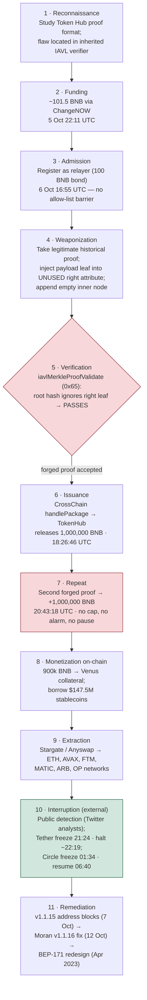
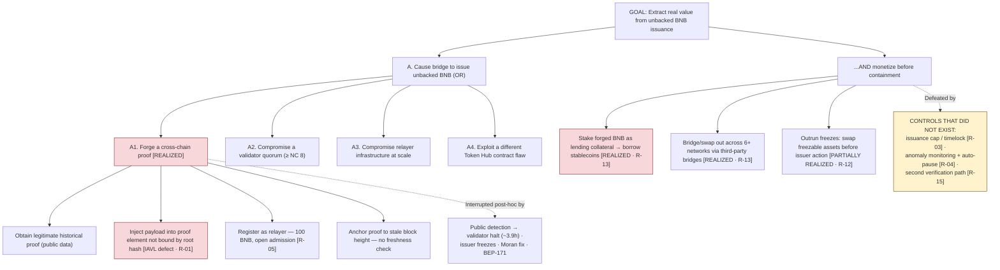

# Project BLACKSWAN

## Enterprise Cyber Risk & GRC Assessment of the 2022 BNB Chain Bridge Exploit

**Sections 1–4: Executive Summary · Organizational and Technological Background · Incident Reconstruction and Technical Root Cause · Threat Modeling and Security Analysis**

| | |
|---|---|
| **Engagement type** | Independent post-incident cybersecurity risk assessment (portfolio engagement) |
| **Prepared by** | Lead GRC Engineer — independent assessor |
| **Subject incident** | BSC Token Hub cross-chain bridge exploit, 6 October 2022 |
| **Assessment frameworks referenced** | NIST Cybersecurity Framework 2.0 · NIST SP 800-53 Rev. 5 · ISO/IEC 27001:2022 · COBIT 2019 · CIS Controls v8 |
| **Evidence basis** | Public primary and reputable secondary sources only, cited inline as (Source, date, URL). No non-public information was available to, or used by, this assessment. |
| **Status** | Sections 1–4 of the full engagement report (Sections 5–15 follow separately) |

> **A note on attribution, stated once and applied throughout.** This was a **BNB Chain protocol incident**, not a breach of the Binance centralized exchange. The compromised component — the BSC Token Hub — is native BNB Chain infrastructure: a set of genesis system contracts in BNB Smart Chain, maintained by the BNB Chain core development community and secured by its validator set. No Binance exchange accounts, custody wallets, or user deposits were involved, and the operator's settled position is that "the loss is on BNB Chain" and no user funds were affected (BNB Chain, 11 Oct 2022, https://www.bnbchain.org/en/blog/bnb-chain-a-decentralized-response). Binance the exchange's role was that of originator and sponsor — and, through its CEO, the public face of the response. Conflating the protocol with the exchange is the single most common analytical error in commentary on this incident, and this assessment avoids it deliberately: correctly identifying *who owned the control environment that failed* is the first act of competent GRC work.

---

## Section 1 — Executive Summary

### 1.1 Incident overview

On **6 October 2022 (UTC)**, an unidentified attacker exploited a proof-verification flaw in the **BSC Token Hub**, the native cross-chain bridge between **BNB Beacon Chain** and **BNB Smart Chain (BSC)**, and caused the bridge to release **2,000,000 BNB in two transactions of 1,000,000 BNB each** (18:26:46 UTC and 20:43:18 UTC) against no corresponding deposit on the Beacon Chain side (Coinbase Threat Intelligence, 31 Oct 2022, https://www.coinbase.com/en-gb/blog/bsc-token-hub-compromise-investigation-and-analysis-8). This was an **unbacked issuance (minting) event**, not a theft from a custodial pool: the bridge's verification logic was deceived into treating a forged cryptographic proof as evidence of a legitimate cross-chain transfer. The incident was limited to the bridge; the underlying blockchain was not compromised (BNB Chain, 11 Oct 2022, https://www.bnbchain.org/en/blog/bnb-chain-a-decentralized-response).

Validators coordinated the first-ever synchronized pause of BSC on the evening of 6 October, roughly 3.9 hours after the first exploit transaction. The chain resumed on the morning of 7 October with cross-chain transfers still disabled; the bridge itself remained out of service for six days, until the **Moran hard fork (BSC v1.1.16)** re-enabled it on 12 October 2022 (bnb-chain/bsc, Oct 2022, https://github.com/bnb-chain/bsc/releases/tag/v1.1.16).

### 1.2 Financial exposure — three numbers, never one

Public reporting on this incident routinely collapses three distinct quantities into a single headline figure. This assessment does not. The defensible presentation is:

| Measure | Figure | Basis |
|---|---|---|
| **Gross minted exposure** | 2,000,000 BNB, valued contemporaneously at **~$566M–$586M** depending on the BNB price used; the operator's own figure is "nearly $570 million" | 2M BNB is unanimous across sources. USD spread is a pricing artifact: $566M (Chainalysis figure reported by CoinDesk, 13 Oct 2022, https://www.coindesk.com/tech/2022/10/13/october-becomes-worst-month-for-crypto-hacks-with-two-weeks-to-go); "nearly $570M" (BNB Chain, 11 Oct 2022, https://www.bnbchain.org/en/blog/bnb-chain-a-decentralized-response); ~$586M (Coinbase Threat Intelligence, 31 Oct 2022, URL above) |
| **Value moved off BSC before containment** | **~$100M–$127M, sources conflict** | BNB Chain's first estimate was $70–80M, revised to $100–110M the same night (CoinDesk, 6 Oct 2022, https://www.coindesk.com/business/2022/10/06/binance-linked-bnb-price-falls-close-to-4-on-hack-rumors); Coinbase estimated ~$110M taken off BSC (31 Oct 2022); SlowMist tracked $127M sent to other chains (The Block, 7 Oct 2022, https://www.theblock.co/news/regulation/2022-10-07-biance-bnb-chain-is-back-up-after-bridge-exploit-175437) |
| **Operator's final unrecovered figure** | **~$100M "remain unrecovered and moved off chain"** | BNB Chain, 11 Oct 2022; restated by CZ to CNBC (24 Oct 2022, https://www.cnbc.com/2022/10/24/binance-narrowing-down-identity-of-hacker-behind-bnb-crypto-hack-ceo.html) as 80–90% frozen, actual loss ~$100M |

Two further quantities complete the picture. Approximately **$429M remained stranded on BSC** in the attacker's address, immobilized by the pause (SlowMist data reported by The Block, 7 Oct 2022, URL above), and **$33.5M was frozen by Tether and Circle** at the address level on Ethereum (Elliptic, 9 May 2023 republication of Oct 2022 analysis, https://www.elliptic.co/insights/attack-mints-569-million-worth-of-bnb-tokens-in-bsc-bridge-exploit/). Separately, the attacker converted part of the on-chain position into **$147.5M of borrowed stablecoins** (62.5M BUSD + 50M USDT + 35M USDC) by staking 900,000 BNB as collateral on Venus Protocol (Coinbase Threat Intelligence, 31 Oct 2022) — a figure that overlaps the off-chain movement numbers and must not be added to them. Whether sources count the Venus borrowing inside "moved off-chain" is one reason the $100M–$127M range cannot be responsibly collapsed. No audited final funds-flow statement was located in the public record; the operator's ~$100M figure is a settled management representation, not an independently verified loss number, and is treated as such throughout this report.

### 1.3 Operational impact

- **BSC downtime of approximately 8 hours** (halt announced ~22:19 UTC 6 October; resumption ~06:40 UTC 7 October), consistent with Coinbase's characterization that BNB Chain "halted operations for approximately 8 hours" (Coinbase Threat Intelligence, 31 Oct 2022). BNB Chain's own statement that the coordinated response "still took around 5 hours" refers to validator coordination time, not downtime, and the two figures should not be interchanged.
- **Bridge outage of six days** (6–12 October), ending only with the Moran hard fork (The Block, 12 Oct 2022; Decrypt, 12 Oct 2022, https://decrypt.co/111773/bnb-chain-upgrade-restores-cross-chain-transfers-following-binance-bridge-hack).
- **Contagion into downstream protocols within minutes:** the forged BNB was immediately usable as collateral in BSC lending markets and routable through third-party bridges, converting a single-protocol verification failure into a multi-chain, multi-protocol exposure (risk R-13).
- **No user funds lost**, per the operator, and no rollback of the chain was performed (BNB Chain, 11 Oct 2022).

### 1.4 Attack classification

**Class:** Cryptographic proof-forgery against a cross-chain bridge verification function, resulting in unauthorized asset issuance. **Root weakness class:** improper verification of a cryptographic proof due to a logic flaw in a shared upstream library (Cosmos IAVL), compounded by the absence of any issuance limit, anomaly detection, or secondary verification path on the bridge itself. **Actor:** unknown; Coinbase stated the "responsible actor(s) are still unknown" (31 Oct 2022), and no regulator attribution for this specific incident was found — a material contrast with the March 2022 Ronin bridge theft, which the FBI publicly attributed to North Korea's Lazarus Group (Chainalysis, 2 Aug 2022, https://www.chainalysis.com/blog/cross-chain-bridge-hacks-2022/).

### 1.5 Principal control weaknesses — stated with evidentiary discipline

A senior assessor's obligation is to distinguish what the evidence *proves* from what it merely *suggests*. Accordingly:

**Confirmed by technical evidence (findings):**
- **F-1 — Proof verification was defeatable (R-01).** The `iavlMerkleProofValidate` precompile computed a root hash that ignored the right leaf when the left leaf was defined, allowing an attacker-controlled payload to be injected into a legitimate proof without changing its root hash. Independently confirmed at code level by Coinbase and Immunefi (17 Mar 2023, https://immunefi.com/blog/bug-fix-reviews/hack-analysis-binance-bridge-october-2022/).
- **F-2 — No issuance bound or circuit breaker (R-03).** The bridge honored two 1M BNB release instructions — each individually exceeding any plausible routine transfer pattern — within 2 hours 17 minutes, with no per-transaction cap, velocity limit, timelock, or automatic pause trigger. The absence of a rate-limiting control is directly evidenced by the outcome.
- **F-3 — Single-path trust model (R-15).** One library, one proof format, one verification path stood between an anonymous relayer and unbounded issuance. No independent secondary verification existed to fail against.

**Evidenced by the observed response (findings, with limits noted):**
- **F-4 — Detection and escalation depended on public, informal channels (R-04, R-07).** Detection was public and community-driven on social media (PeckShield, SlowMist, and independent analysts including samczsun), in parallel with the operator's "irregular activity" messaging; no source reliably establishes a single first detector, and BNB Chain has not published a detection timeline. The halt was executed by "contacting community validators one by one" across time zones (BNB Chain Ecosystem Update, 7 Oct 2022) — effective, but an improvised coordination mechanism rather than a rehearsed emergency protocol, and the pause still took roughly 3.9 hours from the first mint.
- **F-5 — Relayer admission control was minimal (R-05).** Any party depositing 100 BNB could register as a relayer and submit cross-chain packages. This was a documented design choice, not the vulnerability itself, but it removed any allow-list barrier to presenting the forged proof. (Risk accepted by design at launch; re-rated post-incident — Moran replaced it with genesis-candidate whitelisting.)

**Assessment limitations — explicitly NOT findings of failure:**
- **Assurance evidence gap (R-08).** No published audit report scoped to the BSC Token Hub, its system contracts, or the IAVL verifier precompile was located for the pre-incident period, despite targeted research. A secondary source (Callisto Network, undated, https://docs.callisto.network/hack-investigation-dept./binance-bridge-hack) asserts the system was not audited, but that claim is unverified. **The correct GRC conclusion is narrow:** if an audit occurred, its report is not public, so the control is *insufficiently evidenced* — a governance and transparency weakness in itself for infrastructure of this value — without proving the control was absent. Commonly cited nearby audits (CertiK's 2021 assessment of the separate ETH–BSC Swap contracts; the 2020 PeckShield/CertiK ecosystem partnership) are **not** Token Hub audits and must not be represented as such.
- **Bug bounty scope ambiguity (R-09).** The 2021 Priority ONE fund ($10M, with Immunefi) targeted *projects building on BSC*, and no published evidence was found that the core bridge/client was in scope of any public bounty before the incident (BNB Chain, 30 Sept 2021, https://www.bnbchain.org/en/blog/belt-finance-pays-the-biggest-bug-bounty-1million-under-immunefi-and-bscs-priority-one). Whether the core protocol was deliberately out of scope or simply never enrolled cannot be determined from public evidence.

### 1.6 Lessons learned

1. **A bridge is a mint with extra steps, and must be governed like one.** Any component that can create assets on the strength of a proof is, in risk terms, a money-issuance system. It warrants the control rigor of a payment switch: issuance caps, dual verification, and a tested kill switch.
2. **Inherited code inherits the risk register.** The flaw was in upstream Cosmos IAVL code adopted by BSC; it affected other projects and required a Cosmos emergency patch (Coinbase, 31 Oct 2022). Dependency assurance — knowing which consensus-critical libraries you run and who assures them — is a governance control, not an engineering detail (R-02).
3. **Foreseeability was established before the fact.** By August 2022, Chainalysis had counted $2 billion stolen across 13 cross-chain bridge hacks — 69% of all crypto funds stolen that year — including Wormhole (~$320M, February) and Ronin (~$625M, March). The BNB Token Hub exploit was the fourth nine-figure bridge failure in eight months (Chainalysis, 2 Aug 2022). A risk function that had internalized that threat intelligence would have rated bridge verification failure as a top-tier, *expected* scenario rather than a tail event.
4. **Detection by the public is not a monitoring strategy.** The response succeeded because skilled external analysts happened to be watching. That is luck institutionalized as process (R-04).
5. **Containment worked — and revealed the governance trade-off honestly.** A 26-active-validator Proof-of-Staked-Authority set (Nakamoto coefficient 8) could be coordinated to halt within hours; the operator itself acknowledged BNB Chain is "less decentralized than Ethereum now" (BNB Chain, 11 Oct 2022). Emergency capability and decentralization are a governed trade-off, not a slogan (R-06, R-07).

### 1.7 Strategic recommendations (summary; full roadmap in Section 11)

- **SR-1.** Treat all asset-issuing verification paths as critical infrastructure: independent dual verification, per-transaction and velocity issuance caps, and automatic pause on forged-proof detection. (Subsequently implemented in substance by BEP-171, April 2023 — ICS23 proof verification, timelocks on massive transfers, automatic channel pause — see Section 3.7.)
- **SR-2.** Establish a **public assurance baseline** for consensus-critical components: published audit scope and reports for bridge and verification code, and unambiguous bug-bounty scope covering the core protocol.
- **SR-3.** Formalize emergency governance: documented halt authority, pre-authorized validator coordination procedures, and published detection/escalation timelines after incidents.
- **SR-4.** Maintain a dependency risk register for consensus-critical third-party libraries, with tracked upstream security advisories and patch-service-level expectations.
- **SR-5.** Publish a complete post-incident accounting standard: detection time, halt time, downtime, and final funds-flow reconciliation — the absence of which is itself a recurring finding in this assessment.

### 1.8 Executive risk statement

> The BNB Chain bridge exploit demonstrates that, in cross-chain infrastructure, **a single defective verification function in a shared library can convert directly into nine-figure enterprise loss, because nothing behind it limited, questioned, or independently re-checked the issuance it authorized.** The technical vulnerability has been fixed; the governance pattern it exposed — unbounded issuance, single-path trust, informal emergency authority, and unpublished assurance — is not specific to BNB Chain and recurs across the digital-asset industry. Any enterprise that operates, integrates with, or holds exposure through cross-chain bridges should treat proof-verification integrity, issuance containment, and evidenced independent assurance as board-visible risks with named owners, not as implementation details delegated to engineering. The residual question for every such operator is the one this report applies throughout: *if your bridge's core proof check failed silently tonight, what — specifically, measurably, and by name — would stop the loss, and how long would it take?*

---

## Section 2 — Organizational and Technological Background

### 2.1 The entities, correctly separated

**Binance (the centralized exchange).** A commercial cryptocurrency exchange and custodian for its own customers. Binance originated the BNB Chain concept and contributed early code; BNB Chain's own account is that Binance "introduced the idea and some code for BNB Chain" and "now remains solely as a sponsor," adding that "Binance is part of the BNB ecosystem, not the other way around" (BNB Chain, 11 Oct 2022, https://www.bnbchain.org/en/blog/bnb-chain-a-decentralized-response). That statement is self-interested and is flagged as such; but the operational facts support the narrower claim that matters here: the exchange did not operate the Token Hub as an exchange product, and no exchange accounts or deposits were touched. Contemporaneous reporting nonetheless uniformly described BNB Chain as "a blockchain closely linked to the crypto exchange Binance" (CoinDesk, 7 Oct 2022), and the halt was publicly announced by Binance's CEO in the first person — "we have asked all validators to temporarily suspend BSC" (CZ, 6 Oct 2022, quoted in CoinDesk and Gadgets360, 7 Oct 2022, https://www.gadgets360.com/cryptocurrency/news/bnb-chain-hacked-usd-100-million-binance-coin-stolen-changpeng-zhao-3410184). For risk purposes, Binance therefore carries **sponsor, reputational, and crisis-communications exposure (R-16)** rather than operational responsibility for the bridge control environment. (One adjacent, clearly separate action: the *exchange* later suspended BSC deposits/withdrawals around the Moran fork in support of the upgrade — an exchange operations decision, not part of the protocol halt.)

**BNB Chain (the protocol ecosystem).** At the time of the incident, a dual-chain architecture:

- **BNB Beacon Chain** — the governance and staking chain (Tendermint-based), launched with 11 validators, hosting the BEP2 token standard and validator elections.
- **BNB Smart Chain (BSC)** — the EVM-compatible execution chain where smart contracts and DeFi protocols (including Venus, and the Token Hub system contracts) run, launched with 21 validators and secured by **Proof-of-Staked-Authority (PoSA)** consensus.

All figures in this paragraph are from BNB Chain (11 Oct 2022, URL above).

**Validators.** At the incident, BSC had **44 validators in total, of which 26 were active**, plus inactive "candidate" validators introduced under the Euler hard fork (BEP-131); the operator's own stated **Nakamoto coefficient was 8** — i.e., collusion or coordination among a small number of entities could determine chain behavior. The 11 October post names infrastructure operators including Coinbase Cloud and Figment among those who executed the synchronized pause. Stated (pre-incident, May 2022 roadmap) targets were 41 active / 80–100 total BSC validators under BEP-131 and a path toward 100 Beacon Chain validators under BEP-159 (BNB Chain Tech Roadmap 2022, 31 May 2022, https://www.bnbchain.org/en/blog/bnb-chain-tech-roadmap-2022). Critics alleged the validator set was effectively Binance-controlled (an allegation reported by Cointelegraph, 17 Oct 2022); BNB Chain denied that anyone could control validator decisions. This assessment records the allegation as **unverified**, and the operator's own, sufficient concession as the finding: a validator set small and coordinated enough to halt the chain within hours is, in governance terms, a concentrated control point whether or not any single company directs it (R-06).

### 2.2 The BSC Token Hub — how the bridge was supposed to work

Cross-chain bridges exist because assets cannot natively move between independent chains. The Token Hub implemented a lock-and-release model between Beacon Chain and BSC:

1. A user locks/transfers BNB on the Beacon Chain side.
2. A **relayer** — a registered off-chain/on-chain actor — observes the Beacon Chain event and submits a **cross-chain package** to BSC's **CrossChain system contract** (`0x0000…2000`, method `handlePackage`). Only registered relayers could call it; registration required a **100 BNB deposit** and was open to anyone.
3. The package carries an **IAVL Merkle proof** purporting to demonstrate that the transfer exists in Beacon Chain state.
4. The CrossChain contract invokes the **`iavlMerkleProofValidate` precompiled contract (address 0x65)** — verification logic compiled into the BSC node client itself, derived from the Cosmos IAVL (IAVL+ tree) implementation — to validate the proof.
5. On successful validation, the **TokenHub system contract (`0x0000…1004`)** releases (in effect, issues) the corresponding BNB on BSC.

(System contract addresses and call chain: Coinbase Threat Intelligence, 31 Oct 2022; Immunefi, 17 Mar 2023.) The critical architectural fact is step 4: the bridge's entire safety property reduced to the correctness of a single inherited library routine verifying a single proof. There was no independent second check — no separate light-client verification, no issuance accounting reconciliation against observed Beacon Chain lock totals, no human or automated value threshold. Section 4 analyzes this as the single-path trust model (R-15).

### 2.3 IAVL proofs and the trust they carry

An IAVL tree is a versioned Merkle tree (from the Cosmos ecosystem) used to commit to key–value state. A proof for a key consists of a path of inner nodes from leaf to root; each inner node commits to the hashes of its **left** and **right** children. Verification recomputes the root hash from the leaf and the path and compares it against a trusted root. The security assumption is total: *if the recomputed root matches, the key–value pair is in the committed state.* The Token Hub extended that assumption one step further — *the claimed cross-chain transfer therefore occurred* — and acted on it by issuing assets. Cryptographic proofs of this kind fail in only two ways: the cryptography is broken, or the verification code does not correctly implement it. This incident was the second: the cryptography (SHA-256) was never in doubt; the implementation of the root-hash computation in one branch condition was wrong (detailed in Section 3.2).

### 2.4 Trust assumptions inventory

| # | Assumption embedded in the design | Status after the incident |
|---|---|---|
| T-1 | The IAVL verification implementation correctly binds every proof element into the root hash | **Violated** — right leaf excluded from root computation when left leaf defined (R-01) |
| T-2 | Shared upstream library code (Cosmos IAVL) is safe to embed in consensus-critical paths without independent re-verification | **Violated in effect** — the flaw was inherited and industry-wide (R-02) |
| T-3 | Open relayer registration (100 BNB bond) is a sufficient admission control for actors who can trigger issuance | **Failed as a barrier** — the attacker registered routinely (R-05) |
| T-4 | Proofs anchored to old block heights are as acceptable as recent ones | **Violated** — both forged proofs referenced block height 110217401, ~2 years old (samczsun, 6 Oct 2022) |
| T-5 | Release volume needs no independent limit because proofs cannot be forged | **Violated** — T-5 is T-1 restated as an operational control decision (R-03) |
| T-6 | Validators can be reached and coordinated ad hoc quickly enough to contain an incident | **Held, barely** — containment took ~3.9 hours and one-by-one outreach (R-07) |
| T-7 | Downstream protocols (lending markets, third-party bridges) will treat bridged BNB as sound collateral/liquidity | **Held operationally, harmfully** — it is precisely what enabled rapid value extraction (R-13) |

### 2.5 Critical assets

In descending order of loss potential: (1) the **integrity of the proof-verification path** — the asset whose failure caused everything else; (2) **bridge issuance authority** embodied in the TokenHub system contract; (3) **BNB supply integrity** on BSC (2M unbacked BNB entered circulation); (4) **validator coordination capability**, which proved to be the only effective containment asset; (5) **downstream protocol collateral integrity** (Venus and third-party bridges); (6) **the operator's and sponsor's credibility**, damaged in part by the attribution blur itself (R-16).

### 2.6 System context diagram

Trust boundaries are shown explicitly: the relayer boundary (anonymous, bond-only), the verification boundary (single precompile), and the downstream boundary (protocols that accepted BSC state at face value).

```mermaid
flowchart LR
    subgraph EXT["External actors"]
        USER["Ordinary users"]
        REL["Relayers<br/>(open registration: 100 BNB bond)"]
        ATK["Attacker<br/>(funded via ChangeNOW)"]
    end
    subgraph BC["BNB Beacon Chain (BEP2)"]
        BSTATE["Beacon Chain state<br/>(locked transfers)"]
        BVAL["Beacon validators (11 at launch)<br/>elections & staking"]
    end
    subgraph BSC["BNB Smart Chain (EVM, PoSA)"]
        CC["CrossChain contract<br/>0x0000...2000 · handlePackage"]
        VER["iavlMerkleProofValidate<br/>precompile 0x65<br/>(Cosmos IAVL library)"]
        TH["TokenHub contract<br/>0x0000...1004 · issues/releases BNB"]
        SVAL["BSC validators<br/>44 total / 26 active · NC = 8"]
    end
    subgraph DOWN["Downstream (accepts BSC state at face value)"]
        VEN["Venus lending<br/>900k BNB collateral"]
        TB["Stargate / Anyswap<br/>third-party bridges"]
        OTHER["Ethereum · Avalanche · Fantom<br/>Polygon · Arbitrum · Optimism"]
        ISS["Tether / Circle<br/>address freezes"]
    end
    USER -->|"lock / transfer BNB"| BSTATE
    REL -->|"submit cross-chain package + IAVL proof"| CC
    ATK -->|"registers as relayer; submits FORGED proof"| CC
    BSTATE -.->|"proof purports to evidence this state"| VER
    CC -->|"validate proof"| VER
    VER -->|"root hash 'verified'"| CC
    CC -->|"release instruction"| TH
    TH -->|"2 × 1M BNB, no deposit"| ATK
    ATK -->|"stake 900k BNB, borrow $147.5M stables"| VEN
    VEN --> TB --> OTHER
    ISS -.->|"USDT freeze 21:24 UTC · USDC freeze 01:34 UTC"| OTHER
    SVAL -->|"coordinated pause ~22:19 UTC 6 Oct"| BSC
    BVAL --- SVAL
```

**Reading the diagram as a risk document.** Every defensive failure in this incident is visible as a missing edge: there is no edge from any independent monitor to the TokenHub (no anomaly detection on issuance volume), no second verification edge into the CrossChain contract (single-path trust, R-15), no limit on the TokenHub→attacker edge (no issuance cap, R-03), and the only control that ultimately fired — validator coordination — is drawn where it belongs: outside the system, improvised, and slow. The components all worked as designed; the design concentrated catastrophic authority in one verification function and surrounded it with no containment.

---

## Section 3 — Incident Reconstruction and Technical Root Cause

### 3.1 Chronological narrative

**Preparation (5–6 October).** The attacker funded an address with approximately 101.5 BNB via the ChangeNOW exchange service on 5 October at 22:11:04 UTC, and on 6 October at 16:55:06 UTC registered as a bridge relayer by posting the standard 100 BNB deposit — the registration that entitled the address to call `handlePackage` and present cross-chain proofs to the Token Hub (Coinbase Threat Intelligence, 31 Oct 2022, https://www.coinbase.com/en-gb/blog/bsc-token-hub-compromise-investigation-and-analysis-8). Nothing about either step was anomalous under the system's own rules; that is the point. The attack surface was the design's normal operating surface.

**Exploit (6 October, 18:26 and 20:43 UTC).** At 18:26:46 UTC the attacker submitted the first forged-proof package and the Token Hub released **1,000,000 BNB** to attacker address `0x489a8756c18c0b8b24ec2a2b9ff3d447f79bec`. Within five minutes the extraction machinery was running: between roughly 18:31 and 18:37 UTC the attacker deposited 900,000 BNB into Venus Protocol and drew a first wave of stablecoin loans totaling **$147.5M** (62.5M BUSD, 50M USDT, 35M USDC), and began routing value off BSC through Stargate and Anyswap (Multichain) toward Ethereum, Avalanche, Fantom, Polygon, Arbitrum, and Optimism (Coinbase, 31 Oct 2022; corroborated on Venus amounts by Elliptic, https://www.elliptic.co/insights/attack-mints-569-million-worth-of-bnb-tokens-in-bsc-bridge-exploit/). At 20:43:18 UTC — 2 hours 17 minutes after the first mint — a second forged proof released a **second 1,000,000 BNB**. (Coinbase's narrative text says "four hours after"; its own timestamps, used here, show ~2h 17m.)

**Detection (6 October, evening).** Detection was public before it was official. PeckShield alerted that "two huge reward claims with each claiming 1M BNB and in total ~$586M rewards are claimed from its token hub"; SlowMist tracked the attacker spreading funds across networks; independent analyst samczsun, tipped by ZachXBT, published the decisive technical observation the same evening (PeckShield via Cointelegraph, 6 Oct 2022; samczsun, 6 Oct 2022, https://threadreaderapp.com/scrolly/1578167198203289600). One outlet (FXStreet, 7 Oct 2022) claims PeckShield notified Binance first; that claim is single-sourced and uncorroborated, and this assessment does not adopt it. The operator's first public message framed the event as "irregular activity."

**Containment (6 October, 21:24 UTC – 7 October, 06:40 UTC).** Third parties moved first at the asset level: **Tether froze the attacker's USDT address on Ethereum at 21:24:59 UTC** (Coinbase, on-chain timestamp). The attacker's last bridging transaction on BSC was at 21:43:59 UTC. At approximately **22:19 UTC** BNB Chain announced the halt — Coinbase timestamps the halt/blocklist announcement at 22:19:00 — after validators were contacted individually across time zones and agreed a synchronized pause, the first in BSC's history, executed without a rollback (BNB Chain, 11 Oct 2022, https://www.bnbchain.org/en/blog/bnb-chain-a-decentralized-response). CZ's public message the same evening confirmed the exploit and that validators had been asked to suspend BSC. **Circle froze the attacker's USDC address at 01:34:34 UTC on 7 October**, by which time most USDC had already been swapped (Coinbase). BSC validators restarted the network on the morning of 7 October — resumption at approximately **06:40 UTC**, with cross-chain transfers still disabled — yielding total chain downtime of roughly 8 hours (CoinDesk, 7 Oct 2022, https://Www.coindesk.com/markets/2022/10/07/bnb-smart-chain-resumes-operations-after-100m-exploit).

**Disclosure and remediation (7–12 October).** BNB Chain published its first official post, "BNB Chain Ecosystem Update," on 7 October, acknowledging 2M BNB withdrawn through "a sophisticated forging of the low level proof into one common library" and proposing governance votes on freezing funds, auto-burn coverage, a $1M-per-bug white-hat program, and a hacker-catcher bounty. A hotfix release (v1.1.15, 7 October) blocked attacker addresses (Messari, "State of BNB Chain Q4 2022," 5 Feb 2023, https://app.blockworks.com/report/state-of-bnb-chain-q4-2022). The substantive account, "BNB Chain: A Decentralized Response," followed on 11 October. On **12 October at ~08:00 UTC, at mainnet block 22,107,423, the Moran hard fork (v1.1.16)** re-enabled cross-chain transfers with the IAVL fix in place (The Block, 12 Oct 2022; Decrypt, 12 Oct 2022, https://decrypt.co/111773/bnb-chain-upgrade-restores-cross-chain-transfers-following-binance-bridge-hack). Neither official post states exact halt clock times or a detection timeline — a disclosure-completeness gap that independent analysis has also noted (sheng.page, checked 2 Nov 2026, https://sheng.page/en/posts/who-can-press-the-stop-button/), and which this assessment records as a finding against post-incident reporting quality rather than against the response itself.

### 3.2 The vulnerability, precisely

The Token Hub's safety rested on the `iavlMerkleProofValidate` precompile (0x65) correctly verifying IAVL Merkle proofs. Two independent code-level analyses — Coinbase Threat Intelligence and Immunefi — agree on the defect, and their agreement is the strongest technical evidence in this record:

- In the library's root-hash computation (`computeRootHash` / `Hash`), **when the left leaf of a node was already defined, the resulting hash ignored whether the right leaf was also defined.** The root hash of a proof was therefore identical with or without a right leaf (Coinbase, 31 Oct 2022).
- Immunefi's formulation is equivalent: "the right attribute of the node was not used to calculate the root hash of the tree. Since the proof was user-controllable, the hacker was able to pass the malicious right attributes, which is the hash of the malicious payload, and the proof would be considered valid" (Immunefi, 17 Mar 2023, https://immunefi.com/blog/bug-fix-reviews/hack-analysis-binance-bridge-october-2022/).

**Exploit construction.** The attacker began from a *legitimate* historical proof — per Immunefi, the proof of the very first cross-chain transaction; Coinbase demonstrates the same technique against an earlier legitimate transaction — **appended a new leaf carrying the malicious payload, plus an empty inner node to compensate for length, and placed the malicious leaf's hash in the unused `right` attribute.** Because the right attribute did not participate in root computation, the recomputed root still matched the trusted root: check one (root valid) passed. A second check — that the payload's hash appears in the proof tree — also passed, because the injected hash *was* in the tree: in the slot the verifier declined to bind into the root. The bridge therefore accepted a transfer instruction for a deposit that never existed, twice.

Two forensic signatures made the forgery identifiable in hindsight, and both were spotted by samczsun within hours (6 Oct 2022, URL above): both attack proofs referenced **the same, roughly two-year-old block height, 110217401**, where legitimate withdrawals referenced far higher heights (e.g., 270822321); and the attacker's proof was **significantly shorter** than a legitimate proof. His conclusion bears quoting because it defines the true blast radius: the bug "could have allowed attackers to forge arbitrary messages" — the 2M BNB taken was what the attacker *chose* to forge in the window available, not a ceiling imposed by the system. Absent the public detection and halt, nothing in the architecture limited further issuance.

**A correction this assessment insists on.** Some low-quality secondary explainers claim the bridge "did not verify proofs against a trusted root at all." That is false on the Coinbase and Immunefi code analyses: root verification was performed and passed — it was defeated because the injected leaf did not participate in the root computation. The distinction matters for remediation (fix the binding, don't merely "add verification") and for control classification in Section 7: this was a control that was **present but ineffective by design defect**, not an absent control.

**The fix.** Moran (v1.1.16) made three changes (bnb-chain/bsc release notes, https://github.com/bnb-chain/bsc/releases/tag/v1.1.16): **(1)** fixed the vulnerability in the IAVL hash check — per Immunefi, transactions now revert if both left and right attributes are set — with a stated eventual migration to the ICS23 specification; **(2)** added a block-header in-sequence check in the CrossChain contract (addressing stale-height proof reuse of the kind seen at height 110217401); **(3)** restricted relayers to a whitelist of genesis candidates — effective, and explicitly a centralizing interim trade-off against R-05. The longer-term redesign arrived in **BEP-171** (proposed 28 Oct 2022; implemented in the Planck hard fork, 12 Apr 2023): ICS23 proof verification, timelocks on massive cross-chain transfers, automatic channel pause on forged-proof detection, and authority for any validator to pause a channel in an emergency (BNB Chain, Planck Upgrade Announcement, 2023, https://www.bnbchain.org/tr-TR/blog/bnb-smart-chain-mainnet-planck-upgrade-announcement). BEP-171 reads, item for item, as the control set whose absence this report records — which is the strongest available validation of the gap analysis.

### 3.3 Detailed timeline (all times UTC, 2022)

| Time | Event | Source |
|---|---|---|
| 5 Oct, 22:11:04 | Attacker funded with ~101.5 BNB via ChangeNOW | Coinbase, 31 Oct 2022 |
| 6 Oct, 16:55:06 | Attacker registers as bridge relayer (100 BNB deposit) | Coinbase, 31 Oct 2022 |
| **6 Oct, 18:26:46** | **Exploit #1 — Token Hub releases 1,000,000 BNB to attacker address 0x489a…bec** | Coinbase, 31 Oct 2022 |
| 6 Oct, 18:31–18:37 | 900,000 BNB staked into Venus; $147.5M stablecoins borrowed (62.5M BUSD / 50M USDT / 35M USDC); bridging out via Stargate and Anyswap begins | Coinbase, 31 Oct 2022; Elliptic |
| **6 Oct, 20:43:18** | **Exploit #2 — second 1,000,000 BNB released** | Coinbase, 31 Oct 2022 |
| 6 Oct, evening | Public detection on social media: PeckShield alert (~$586M claimed), SlowMist fund-flow tracking, samczsun technical thread identifying stale block height 110217401 and abnormally short proof | PeckShield via Cointelegraph, 6 Oct 2022; samczsun, 6 Oct 2022 |
| 6 Oct, 21:24:59 | Tether freezes attacker's USDT address on Ethereum | Coinbase, 31 Oct 2022 (on-chain) |
| 6 Oct, 21:43:59 | Attacker's last bridging transaction on BSC | Coinbase, 31 Oct 2022 |
| 6 Oct, ~22:19 | BNB Chain announces halt ("irregular activity" → potential exploit confirmed); validators execute synchronized pause — first in BSC history, no rollback | BNB Chain tweets via CoinDesk, 6 Oct 2022; Coinbase timeline |
| 6 Oct, evening (US) | CZ tweet confirms exploit and validator suspension request; BNB Chain developer update: $100–110M taken off BSC, ~$7M frozen | CZ via CoinDesk/Gadgets360, 7 Oct 2022 |
| 7 Oct, 01:34:34 | Circle freezes attacker's USDC address on Ethereum (most USDC already swapped) | Coinbase, 31 Oct 2022 |
| 7 Oct, 05:02 | Restart of BSC validators announced | Coinbase timeline |
| 7 Oct, ~06:40 | BSC resumes operations with cross-chain transfers still disabled (~8 hours downtime) | CoinDesk, 7 Oct 2022 |
| 7 Oct | Official post #1: "BNB Chain Ecosystem Update"; v1.1.15 hotfix blocks attacker addresses | BNB Chain, 7 Oct 2022; Messari, 5 Feb 2023 |
| 11 Oct | Official post #2: "BNB Chain: A Decentralized Response" — final operator figure ~$100M unrecovered; no user funds affected | BNB Chain, 11 Oct 2022 |
| **12 Oct, ~08:00 (block 22,107,423)** | **Moran hard fork (v1.1.16)** — IAVL hash-check fix, block-header sequence check, relayer whitelisting; cross-chain transfers re-enabled | bnb-chain/bsc release; The Block, 12 Oct 2022 |
| 28 Oct 2022 / 12 Apr 2023 | BEP-171 proposed / implemented in Planck fork (ICS23, transfer timelocks, auto-pause on forged proof, validator emergency pause) | Messari, 5 Feb 2023; BNB Chain, 2023 |

### 3.4 Attack-flow diagram

### 3.5 Attack-surface analysis

| Surface | Exposure | Assessment |
|---|---|---|
| **Proof-verification precompile (0x65)** | Consensus-critical, inherited library code on the issuance path; callable indirectly by any relayer-submitted package | The decisive surface. A single implementation defect converted directly into unbounded issuance (R-01, R-02) |
| **Relayer admission** | Open registration, 100 BNB bond, no allow-list, no behavioral probation | Removed all friction from presenting a forged proof; bond (~$28k) was trivial against the value at risk (R-05) |
| **CrossChain / TokenHub system contracts** | Genesis contracts with issuance authority; no per-transaction or velocity limits; proofs accepted for ~2-year-old block heights | Authority without containment (R-03); missing freshness/sequence validation until Moran (R-10) |
| **Validator coordination channel** | Off-protocol, human, cross-time-zone, one-by-one outreach | The only containment mechanism, and it was procedural improvisation (R-07) |
| **Downstream composability** | Venus collateral acceptance; third-party bridges (Stargate, Anyswap) | Instant monetization and multi-chain dispersal within minutes; converted a BSC-local defect into ecosystem exposure (R-13) |
| **Stablecoin issuer freeze functions** | Tether/Circle address blacklists on Ethereum | Effective but third-party, discretionary, and outside the operator's control (R-12); Tether acted at 21:24 UTC, Circle at 01:34 UTC after most USDC had moved |
| **Public information surface** | Social media served as the de facto detection and broadcast channel | Detection credit belongs to external analysts; the sponsor's CEO became the authoritative crisis voice, compounding attribution blur (R-04, R-11, R-16) |

### 3.6 Root-cause analysis

**Immediate (technical) cause.** A logic defect in the Cosmos IAVL proof-verification implementation embedded in BSC's `iavlMerkleProofValidate` precompile: the root-hash computation did not bind the right leaf when the left leaf was defined, so a forged proof carrying an injected payload verified as authentic (Coinbase, 31 Oct 2022; Immunefi, 17 Mar 2023). *Classification: defective control — present, operating as coded, incorrectly designed at the implementation level.*

**Contributing causes.**
1. **Single-path verification (R-15):** no independent second verification, reconciliation, or sanity check stood behind the precompile; its output was dispositive.
2. **No containment layer (R-03):** no issuance cap, timelock, or anomaly-triggered pause meant a verification failure had unlimited, immediate financial expression — twice.
3. **Stale-proof acceptance:** proofs anchored to a two-year-old block height were accepted without a freshness or sequence check (remediated in Moran).
4. **Open relayer admission (R-05):** the actor entitled to invoke the defective verifier was anyone with 100 BNB.
5. **Monitoring gap (R-04):** two 1M BNB issuances and a nine-figure collateralization event produced no operator-side automated interruption; detection came from the public.
6. **Dependency assurance gap (R-02):** the defective code was an upstream library; its assurance status within BSC's own control environment is not publicly evidenced (R-08).

**Systemic causes.** The bridge — by 2022 the industry's demonstrably highest-loss component class, with $2B stolen across 13 bridge hacks by August of that year (Chainalysis, 2 Aug 2022, https://www.chainalysis.com/blog/cross-chain-bridge-hacks-2022/) — was operated without the control architecture its risk class demanded: no published independent assurance over the verification path (R-08), no clearly scoped public bug bounty over the core protocol (R-09), emergency authority that existed in practice but not in documented form (R-07), and a governance model in which the ability to halt depended on a validator set concentrated enough to coordinate by telephone-tree (R-06). None of these is alleged as a *proven* internal failure — internal documentation was unavailable to this assessment — but each is a place where the public record shows either an absent artifact (audit report, bounty scope, halt procedure, detection timeline) or an outcome inconsistent with the control having operated effectively. In GRC terms: the incident was a **control-design failure at the verification layer, amplified by control-absence at the containment layer, inside a governance framework whose assurance evidence cannot be inspected.**

### 3.7 Five Whys

1. **Why did the bridge release 2M BNB with no deposit?** Because it accepted two forged IAVL proofs as evidence of Beacon Chain transfers that never occurred.
2. **Why did the forged proofs pass verification?** Because the IAVL verifier's root-hash computation ignored the proof's right leaf when the left leaf was defined, letting the attacker inject a payload leaf whose hash sat outside the root computation while still satisfying the payload-membership check.
3. **Why was defective verification code on the issuance path?** Because BSC embedded the Cosmos IAVL implementation as a trusted precompile, and no public evidence shows independent assurance — audit, formal review, or differential testing — applied to that component before the incident (assessment limitation R-08 applies: absence of a *public* report is what is established).
4. **Why did one defective check produce nine-figure exposure instead of a contained error?** Because the design had no defense in depth: no second verification path (R-15), no issuance limits or timelocks (R-03), acceptance of proofs for two-year-old block heights, and monitoring that did not interrupt two 1M BNB releases (R-04).
5. **Why did those layers not exist for the industry's highest-risk component class?** Because bridge risk was governed as an engineering feature rather than as asset-issuance infrastructure: assurance was unpublished, bounty scope over the core protocol was unevidenced, emergency authority was informal, and the foreseeability signal from Wormhole and Ronin earlier in 2022 had not been converted into a bridge-specific control baseline (R-07, R-09, R-14). *This fifth level is an analytical inference from the public record, labeled as such; internal governance documents that could confirm or rebut it were not available.*

### 3.8 MITRE ATT&CK — applicability, honestly bounded

Enterprise ATT&CK describes adversary behavior against enterprise IT. Parts of this incident map; the decisive part does not, and forcing it would mislead.

| Incident phase | ATT&CK applicability | Comment |
|---|---|---|
| Reconnaissance of bridge mechanics | Partial — TA0043 Reconnaissance is a loose fit | The "recon" was reading public protocol code, not enterprise discovery |
| Funding via an exchange service; relayer registration | Weak — resembles TA0001 Initial Access only by analogy | Both were *legitimate, designed* system functions used as intended; ATT&CK has no clean technique for "abuse of open admission by design" |
| Forged-proof submission | **No adequate technique** | Closest enterprise analogues — T1133 External Remote Services, T1078 Valid Accounts, T1556 tampering — all misdescribe it. The act is a *cryptographic verification bypass in a consensus-adjacent precompile*: a protocol-semantics attack, not endpoint/network intrusion. ATT&CK for ICS and the emerging DeFi-specific matrices address fragments, none authoritatively |
| Value extraction (Venus borrowing, third-party bridging) | No fit | These are financial-transaction behaviors on public ledgers; the relevant lens is funds-flow analysis (Elliptic/Coinbase), not ATT&CK |
| Defensive timeline (detection, halt) | Not an ATT&CK matter | Belongs to incident-response frameworks (NIST SP 800-61 lifecycle), used in Section 10 |

**Assessor's position:** ATT&CK is used in this report only where it genuinely fits (the surrounding enterprise and operational context, in later sections) and is explicitly *not* used to dress the core exploit in enterprise vocabulary. The primary analytical frames for the exploit itself are the protocol's own threat model (Section 4) and funds-flow reconstruction. A portfolio or report that tags this incident with a confident string of ATT&CK technique IDs, without disclosing the mapping strain, is signaling the opposite of senior judgment.

---

## Section 4 — Threat Modeling and Security Analysis

### 4.1 Method and scope

The threat model covers the cross-chain value-transfer system as it existed on 6 October 2022: the Beacon Chain state commitment, the relayer network, the CrossChain and TokenHub system contracts, the IAVL verification precompile, the BSC validator set, and — because value exited through them within minutes — the immediately downstream lending and bridging protocols. The model is built from the architecture in Section 2 and validated against the realized incident in Section 3: a threat model that would not have surfaced the incident that actually happened is worthless, so each realized failure is traced to the model element that should have predicted it.

**Critical assets** (from §2.5): proof-verification integrity; TokenHub issuance authority; BNB supply integrity; validator coordination capability; downstream collateral integrity; operator/sponsor credibility.

**Threat actors.** (i) *Unaffiliated financially motivated attackers* — the realized case; identity unknown, capability high (protocol-level research, custom proof construction), patience evident (funding and registration preceded the exploit by ~19 hours and ~1.5 hours respectively). (ii) *State-linked actors* — not attributed here, but the class was demonstrably active against bridges in 2022: the FBI attributed Ronin to North Korea's Lazarus Group (Chainalysis, 2 Aug 2022, https://www.chainalysis.com/blog/cross-chain-bridge-hacks-2022/). (iii) *Malicious or compromised relayers* — structurally identical access to the realized attacker. (iv) *Validator collusion/compromise* — with a Nakamoto coefficient of 8, a bounded but real scenario (R-06). (v) *Insider / supply-chain compromise of upstream libraries* — realized in effect, if not by intent, through the IAVL dependency (R-02).

**Entry points.** Relayer package submission to `handlePackage` (the realized entry); any future caller path to system contracts; validator key operations; upstream library ingestion into the BSC client; downstream protocol integrations that accept BSC state.

**Trust boundaries.** TB-1: anonymous internet ↔ relayer role (crossed with only a 100 BNB bond). TB-2: relayer-supplied data ↔ consensus-adjacent verification (the proof crosses from untrusted input to dispositive evidence at the precompile). TB-3: verification result ↔ issuance authority (no human or systemic checkpoint). TB-4: BSC state ↔ downstream protocols (Venus, third-party bridges accept BSC state as ground truth). TB-5: protocol ↔ public communication channels (detection and crisis messaging occurred off-protocol, on social media).

### 4.2 STRIDE, applied per component

| Component | S — Spoofing | T — Tampering | R — Repudiation | I — Information disclosure | D — Denial of service | E — Elevation of privilege |
|---|---|---|---|---|---|---|
| **IAVL verifier precompile (0x65)** | **Realized:** forged proof accepted as genuine Beacon Chain state — the canonical spoofing of a state commitment | **Realized:** proof contents manipulated (injected leaf) without detection by root check | Proof anchored to 2-year-old height accepted; origin state never existed, yet non-repudiation of "transfer occurred" was manufactured | Library defect publicly inferable from client source; no evidence of obfuscation reliance | Verifier DoS not at issue in this incident | Injected payload elevated a data field into an issuance instruction |
| **CrossChain / TokenHub contracts** | Any registered relayer could present packages; origin assurance rested entirely on the proof | **Realized:** issuance state altered (2M BNB) without corresponding lock | Post-incident accounting depended on external analysts; no operator detection timeline published | N/A (public chain) | **Realized (defensive):** full bridge disablement for 6 days was the only containment lever | **Realized:** a 100 BNB-bonded role could trigger unbounded issuance — privilege vastly disproportionate to admission cost (R-05, R-03) |
| **Relayer network** | Open registration = identity is a deposit, not a vetting | Relayer could submit arbitrary packages for verification | Relayer actions are on-chain (good audit trail — this aided reconstruction) | N/A | Malicious-relayer spam not observed | See CrossChain row; Moran's whitelist was the corrective |
| **Validator set (PoSA, 26 active, NC 8)** | Validator identity is stake-based; no incident involvement | Collusion of ~8 entities could theoretically alter chain behavior — not realized | Halt decision-making was off-chain and undocumented in real time (R-07) | Coordination occurred over private channels, then announced publicly | **Realized (defensive):** coordinated halt = deliberate total DoS of the chain as a containment tool | Emergency halt authority existed in practice without published authorization framework |
| **Monitoring & response apparatus** | Attacker did not need to spoof monitoring — it did not interrupt | N/A | **Gap:** operator cannot evidence detection time from its own publications (R-04) | Public analysts had the same visibility as the operator — and used it first | N/A | N/A |
| **Downstream (Venus, Stargate, Anyswap, issuers)** | Downstream accepted BSC state at face value (TB-4) | Attacker's borrowed positions and swaps were valid transactions under each protocol's rules | Freeze actions by Tether/Circle are discretionary and reversible by the issuer only (R-12) | N/A | Venus retained 900k BNB collateral exposure post-incident | Attacker converted forged assets into senior claims (stablecoin borrows) across 6+ networks within minutes (R-13) |

**Model validation note.** STRIDE surfaces the realized incident cleanly at exactly two cells — Spoofing and Tampering at the verifier, Elevation of Privilege at the bridge contracts — which is where a pre-incident model should have concentrated control investment. The model's blind spot, shared by STRIDE generally, is *compositional* risk: no single component's STRIDE row predicts that forged BNB becomes multi-chain stablecoin debt in five minutes. That required the scenario analysis below.

### 4.3 Blockchain-specific threat scenarios (supplementing STRIDE)

| ID | Scenario | Realized? | Governing risks |
|---|---|---|---|
| TS-1 | Forged or replayed cross-chain proof accepted (verification defect, stale height, or cross-domain proof reuse) | **Yes — both forgery and ~2-year-old height** | R-01, R-10 |
| TS-2 | Issuance without limit converts a verification error into unbounded supply inflation | **Yes — 2 × 1M BNB, no cap intervened** | R-03 |
| TS-3 | Forged assets instantly monetized as lending collateral, laundering the defect into third-party liabilities | **Yes — $147.5M Venus borrows** | R-13 |
| TS-4 | Multi-hop dispersal across third-party bridges outruns freeze capability | **Yes — 6+ networks; Circle's freeze lagged the swaps** | R-12, R-13 |
| TS-5 | Shared-library defect propagates across every chain embedding the same code | **Yes in potential** — Coinbase confirmed other IAVL users affected; Cosmos issued an emergency patch | R-02 |
| TS-6 | Containment requires sacrificing the chain's core neutrality claim (emergency halt by a small validator set) | **Yes — first BSC pause; operator conceded limited decentralization** | R-06, R-07 |
| TS-7 | Sponsor/protocol attribution confusion misdirects stakeholder, regulatory, and media response | **Yes — coverage framed a protocol incident as an exchange hack** | R-16 |
| TS-8 | Assurance theater: nearby audits and ecosystem bounty funds create unearned confidence in an unaudited core component | **Consistent with the public record** (no Token Hub audit located; Priority ONE scoped to ecosystem projects) | R-08, R-09 |

### 4.4 Evaluation against security principles

| Principle | What conformance would have required | Observed state (evidence-based) | Verdict |
|---|---|---|---|
| **Cryptographic Verification** | Every element of a proof bound into the verified root; verification independently implemented or formally reviewed | Defective binding in the single implementation; no independent second path | **Failed** (R-01) |
| **Defense in Depth** | Verification + issuance limits + anomaly monitoring + rehearsed pause, any one of which contains a failure of the others | None of the compensating layers demonstrably present or effective on the day | **Failed** (R-15, R-03, R-04) |
| **Zero Trust** | Relayer submissions treated as hostile input; continuous verification of claims against independent state | A bonded-but-anonymous actor's data structure was dispositive evidence of another chain's state | **Not implemented** at TB-2/TB-3 |
| **Least Privilege** | Relayer role able to *propose*, not effectively *effect*, unbounded issuance; issuance authority scoped and capped | 100 BNB admission controlled unlimited issuance; privilege/cost asymmetry extreme | **Failed** (R-05, R-03) |
| **Separation of Duties** | Submission, verification, and release under independent control or independent code paths | One actor submits; one library verifies; release is automatic — no independent duty exists to separate | **Not implemented** |
| **Secure by Design** | Freshness checks on proof anchor height; fail-closed parsing of proof structure | Proofs for ~2-year-old heights accepted; ambiguous proof structure resolved in the attacker's favor (the unchecked attribute) | **Failed** — the parser failed *open* |
| **Fail Secure** | On any verification ambiguity, revert; on anomalous issuance, auto-pause | Post-fix behavior (revert when both attributes set; BEP-171 auto-pause on forged-proof detection) is precisely fail-secure — its later adoption confirms its prior absence | **Failed pre-incident; remediated after** |
| **Continuous Monitoring** | Operator-side alerting on issuance volume, stale-height proofs, and collateralization velocity, with rehearsed escalation | Detection was public and external; escalation was improvised one-by-one validator outreach | **Failed as designed control; succeeded as improvisation** (R-04, R-07) |

The pattern across eight principles is the report's central analytical finding: **the failures are not eight failures. They are one architectural decision — dispositive trust in a single verification function — observed from eight directions.** Remediation that fixes the IAVL line of code without changing that decision leaves the system one library defect away from recurrence; BEP-171's combination of a new proof specification (ICS23), timelocks, automatic pause, and distributed emergency authority is significant precisely because it changes the decision, not just the code.

### 4.5 Attack tree

### 4.6 Control interruption points — where the chain could have been broken

The decisive GRC question for any realized attack is counterfactual but disciplined: at which points would a *specific, implementable* control have interrupted the sequence, and what class of control is it? Controls are stated concretely; "monitor the bridge" is not a control.

| # | Attack stage | Preventive control (breaks the chain) | Detective / responsive control (bounds the loss) | Risk IDs |
|---|---|---|---|---|
| 1 | Relayer admission | Allow-listed relayers with identity vetting and per-relayer issuance quotas (implemented post-incident as genesis-candidate whitelisting in Moran) | New-relayer probation: heightened logging and delayed package processing for first N days | R-05 |
| 2 | Proof construction & submission | **Independent dual verification:** second, separately implemented proof check (different library/spec — as later adopted via ICS23 in BEP-171), so one library defect cannot be dispositive | Proof-structure anomaly rules: reject proofs materially shorter than the distribution for their claimed height; alert on first-seen proof shapes | **R-15**, R-01, R-02 |
| 3 | Proof freshness | Block-header sequence/freshness validation: proofs must anchor to recent, sequentially consistent Beacon Chain headers (added in Moran) | Alert on any proof referencing a header older than a defined window (the realized proofs were ~2 years stale) | R-01, R-10 |
| 4 | **Issuance (TokenHub release)** | **Per-transaction and rolling-window issuance caps with mandatory timelock above threshold** — a single control that converts *any* verification failure, known or unknown, from unbounded loss to a bounded, reviewable event | Real-time reconciliation of cumulative BSC issuance against observed Beacon Chain locks; automatic bridge pause on divergence | **R-03**, **R-15** |
| 5 | Repeat exploitation (second 1M BNB, +2h 17m) | Same as #4 — a cap or timelock makes the second transaction impossible or pending while the first is reviewed | **Issuance-velocity alerting with a staffed, pre-authorized pause path:** two nine-figure releases within hours is a page-one alert in any monitored system; the realized gap between mint #1 (18:26) and the halt (~22:19) is the measurable size of the monitoring failure | **R-04**, R-07 |
| 6 | Collateralization (Venus, +5 minutes) | None available to the bridge operator — downstream risk acceptance is Venus's governance decision (an honest boundary of this report's control claims) | Cross-protocol anomaly signals (a fresh address collateralizing 900k BNB) are detectable on-chain in near-real time; operator monitoring should consume them as bridge-incident indicators | R-13, **R-04** |
| 7 | Cross-chain dispersal | None at the source bridge | Pre-agreed issuer/law-enforcement escalation runbooks to compress freeze latency (Tether acted in ~3h; Circle in ~7h, after most USDC moved) | R-12 |
| 8 | Systemic recurrence | Assurance baseline: published audits and bounty scope over the verification path, plus dependency register with upstream patch SLAs (converts unknown defects into hunted defects) | Periodic adversarial review: scheduled forged-proof exercises against staging bridges ("chaos testing" for verification) | R-08, R-09, R-02, R-14 |

**Assessor's emphasis.** Rows 2, 4, and 5 — dual verification (R-15), issuance caps with timelock (R-03), and monitored, pre-authorized interruption (R-04) — are the three controls that matter most, because they are *failure-agnostic*: each works even if the underlying vulnerability is one nobody has discovered yet. The October 2022 incident is, in the end, a demonstration that a system protected only by the correctness of its most complex component is not protected at all. BEP-171's eventual design — new proof specification, timelocks on massive transfers, automatic pause on forged-proof detection, any-validator emergency pause — implements rows 2, 4, and 5 in recognizable form. The remediation history therefore independently corroborates this threat model's priorities, and Section 11 builds the roadmap on the same three interruption points for any enterprise operating comparable infrastructure.

---

*End of Sections 1–4. Sections 5–15 (governance assessment, quantified risk register, control gap analysis, framework crosswalk, regulatory implications, incident response review, remediation roadmap, audit testing program, KRI/KPI dashboard, board briefing, and consultant conclusion) build directly on the findings (F-1 to F-5), assessment limitations (R-08, R-09), and risk identifiers (R-01 to R-16) established above.*
