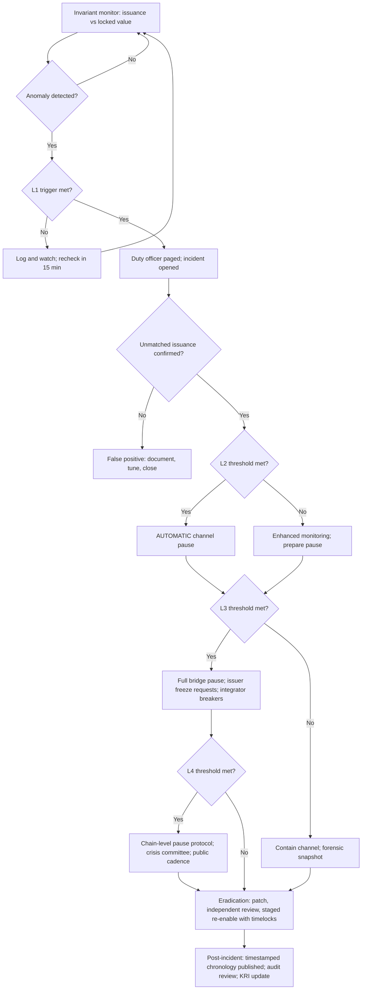

# Project BLACKSWAN — Enterprise GRC Assessment of the 2022 BNB Chain Bridge Exploit
## Sections 9–15

*Assessment role: Lead GRC Engineer (independent assessment). Subject entity: BNB Chain and the BSC Token Hub cross-chain bridge. Throughout these sections, "BNB Chain" means the decentralised protocol, its core development community and its validator set. It does not mean Binance, the centralised exchange (CEX). The bridge was native BNB Chain infrastructure — genesis system contracts on BNB Smart Chain (BSC) — and no Binance CEX accounts, custody wallets or user deposits were involved (Coinbase Threat Intelligence, 31 Oct 2022, https://www.coinbase.com/en-gb/blog/bsc-token-hub-compromise-investigation-and-analysis-8; BNB Chain, "BNB Chain: A Decentralized Response," 11 Oct 2022, https://www.bnbchain.org/en/blog/bnb-chain-a-decentralized-response). Where a statement is an analytical interpretation rather than a sourced fact, it is labelled **[Interpretation]**.*

---

## SECTION 9: REGULATORY AND COMPLIANCE IMPLICATIONS

### 9.1 Purpose and evidentiary posture

This section evaluates the *categories* of regulatory and compliance consideration that an incident of this type raises. It does **not** conclude that any law or regulation was breached. That restraint is not a stylistic choice; it is an evidentiary one. Targeted research for this assessment found **no statement by the FBI, the SEC, OFAC, or any other regulator specifically about this incident**, and **no public attribution of the attacker** — Coinbase Threat Intelligence stated that the "responsible actor(s) are still unknown" (Coinbase Threat Intelligence, 31 Oct 2022, https://www.coinbase.com/en-gb/blog/bsc-token-hub-compromise-investigation-and-analysis-8). The only law-enforcement-adjacent public statement identified is Changpeng Zhao's comment to CNBC on 24 October 2022 that Binance was "working with law enforcement around the globe" and that "in this particular instance, law enforcement gave us some tips of who they think it might be" (CNBC, 24 Oct 2022, https://www.cnbc.com/2022/10/24/binance-narrowing-down-identity-of-hacker-behind-bnb-crypto-hack-ceo.html). No arrest, indictment, seizure or sanctions action relating to this specific incident was found in the sources reviewed. Any assessment that asserted a regulatory violation on this record would be inventing a finding.

### 9.2 The binding / supervisory / voluntary distinction

Regulatory analysis of a decentralised protocol incident fails if three different kinds of obligation are collapsed into one. This assessment keeps them separate:

| Obligation class | Meaning | Relevance to this incident |
|---|---|---|
| **Legally binding requirements** | Statute, regulation or licence condition enforceable against an identified legal person | Cannot be assessed without knowing which legal persons, if any, are regulated, and in which jurisdictions (see §9.4). No violation is asserted. |
| **Supervisory expectations** | Guidance, thematic reviews and "sound practice" expectations that regulators apply to supervised firms (e.g., operational-resilience and ICT-risk expectations in financial services) | Relevant as a benchmark for how a supervised firm operating comparable infrastructure *would* be examined after such an event; not directly enforceable against a protocol with no identified licence-holder. |
| **Voluntary frameworks and industry practice** | NIST CSF 2.0, ISO/IEC 27001:2022, COBIT 2019, CIS Controls v8, bug-bounty and coordinated-disclosure norms | These are the operative benchmark for this assessment (Section 8). Non-adoption is a governance gap, not a legal breach. |

### 9.3 Category-by-category evaluation

**Financial-services cybersecurity expectations.** Supervised financial firms are generally expected to maintain board-approved cyber risk governance, tested incident-response capability, and timely regulator notification after material incidents. **[Interpretation]** Had infrastructure of this economic significance (gross forged issuance of 2,000,000 BNB, valued contemporaneously at roughly $566M–$586M depending on the price source used) been operated by a supervised firm, the public-first detection pattern and the absence of a published detection timeline would predictably attract supervisory criticism of monitoring and escalation. That is a statement about supervisory practice, not about this protocol's legal position.

**Digital-asset governance.** The incident sits in a recognised, foreseeable risk class: Chainalysis reported on 2 August 2022 — two months before this exploit — that $2 billion had been stolen across 13 cross-chain bridge hacks in 2022, representing 69% of all funds stolen that year (Chainalysis, 2 Aug 2022, https://www.chainalysis.com/blog/cross-chain-bridge-hacks-2022/). **[Interpretation]** Foreseeability matters to governance assessment: after Wormhole (February 2022) and Ronin (March 2022), bridge proof-verification was a known critical-risk surface, and a governance regime that did not demonstrably prioritise assurance over that surface would be difficult to defend to any oversight body, regardless of formal regulatory status.

**Operational resilience.** The response demonstrated one resilience capability — a coordinated validator pause executed roughly 3.9 hours after the first exploit transaction (18:26:46 UTC, 6 Oct 2022) with BSC resuming at ~06:40 UTC on 7 October 2022, approximately eight hours of chain downtime (Coinbase Threat Intelligence, 31 Oct 2022, https://www.coinbase.com/en-gb/blog/bsc-token-hub-compromise-investigation-and-analysis-8). The bridge itself remained disabled until the Moran hard fork on 12 October 2022 (bnb-chain/bsc, Release v1.1.16, Oct 2022, https://github.com/bnb-chain/bsc/releases/tag/v1.1.16). **[Interpretation]** A resilience framework would ask whether an ~8-hour full-chain halt and a 6-day bridge outage fell within pre-agreed impact tolerances. No public evidence was found that such tolerances had been defined in advance; the halt was, by the operator's own account, improvised by "contacting community validators one by one" (BNB Chain, "BNB Chain Ecosystem Update," 7 Oct 2022, as reported in Cointelegraph, 17 Oct 2022, https://cointelegraph.com/news/bnb-chain-responds-with-next-steps-for-cross-chain-security-after-network-exploit).

**Cyber incident reporting.** The operator communicated publicly and quickly via social channels (BNB Chain tweets, 6 Oct 2022, via CoinDesk, 6 Oct 2022, https://www.coindesk.com/business/2022/10/06/binance-linked-bnb-price-falls-close-to-4-on-hack-rumors). However, neither of the operator's two post-incident publications states exact halt clock times, and no consolidated, timestamped incident chronology was published — a reporting-quality gap identified independently in post-incident commentary (sheng.page, "Who can press the stop button?", checked 2 Nov 2026, https://sheng.page/en/posts/who-can-press-the-stop-button/). **[Interpretation]** Voluntary public communication is not a substitute for the structured, timestamped incident record that incident-reporting regimes (and credible self-governance) require; the absence of that record is recorded in this assessment as a documentation finding, not a legal one.

**Third-party risk.** The containment outcome depended materially on third parties outside the protocol's control: Tether froze the attacker's USDT address at 21:24:59 UTC on 6 October 2022 and Circle froze USDC at 01:34:34 UTC on 7 October 2022, with approximately $33.5M frozen by the two issuers combined (Elliptic, republished 9 May 2023, https://www.elliptic.co/insights/attack-mints-569-million-worth-of-bnb-tokens-in-bsc-bridge-exploit/; freeze timestamps per Coinbase Threat Intelligence, 31 Oct 2022). **[Interpretation]** Dependence on discretionary third-party action for loss limitation is a third-party risk concentration (risk R-12): the freezes were effective, but they were favours of architecture — properties of centralised stablecoins — not controls the protocol owned or could compel.

**Internal audit expectations.** Under mainstream internal-audit practice (and the voluntary frameworks used in Section 8), an incident of this severity should trigger an independent post-incident review with tracked remediation. The operator published two substantive public posts (7 and 11 October 2022) and a later technology update listing fixes; however, the detailed post-mortem promised on 7 October — a full incident timeline — was not located in the public record, and the 8 November 2022 technology update is a list of fixes rather than a post-mortem narrative (BNB Chain, 7 Oct 2022 and 11 Oct 2022, as cited above; Messari, "State of BNB Chain Q4 2022," 5 Feb 2023, https://app.blockworks.com/report/state-of-bnb-chain-q4-2022). The gap between announced and delivered post-incident accountability is tracked as risk R-14.

### 9.4 Facts required to determine actual applicability

No defensible applicability determination can be made from public sources alone. The following organisational and jurisdictional facts would be required, and any future engagement should obtain them before opining on compliance:

1. **Legal-entity map:** which legal persons (foundation, development company, validator operators, relayer operators) develop, govern or profit from the protocol, and their places of incorporation.
2. **Regulated-activity analysis:** whether any such entity performs a regulated activity (exchange operation, custody, money transmission, e-money issuance) in any jurisdiction in its own right — as distinct from the separate, well-known regulatory position of the Binance CEX, which is not the operator of this bridge.
3. **User and market nexus:** where affected users, integrators (e.g., lending protocols that accepted the forged BNB as collateral) and listing venues are located, which determines which consumer-protection and market-integrity regimes could be engaged.
4. **Data-protection nexus:** whether any personal data was processed or exposed. On the public record this was an asset-integrity incident, not a data breach; no evidence of personal-data compromise was found, so data-protection notification analysis cannot be completed and should not be assumed either way.
5. **Contractual undertakings:** commitments made to ecosystem partners, auditors or insurers that could convert voluntary standards into contractual obligations.

### 9.5 Section conclusion

The defensible regulatory conclusion is narrow: this incident exposes the assessed governance arrangements to supervisory-style criticism under well-established expectations for monitoring, escalation, documentation and assurance — and it creates reputational and attribution-confusion exposure (risk R-16), because contemporaneous reporting uniformly described BNB Chain as "a blockchain closely linked to the crypto exchange Binance" (CoinDesk, 7 Oct 2022, https://Www.coindesk.com/markets/2022/10/07/bnb-smart-chain-resumes-operations-after-100m-exploit). It does not, on the available evidence, establish a violation of any identified law or regulation, and this report makes no such claim.

---

## SECTION 10: INCIDENT RESPONSE AND CRISIS MANAGEMENT REVIEW

### 10.1 Evaluation method

The response is evaluated against the NIST SP 800-61 incident response lifecycle — **Preparation; Detection & Analysis; Containment, Eradication & Recovery; Post-Incident Activity** — using only timestamped public evidence. All times are UTC, October 2022.

### 10.2 Phase-by-phase evaluation

**Phase 1 — Preparation: inadequate (assessment based on absence of public evidence).**
No public evidence was found of a pre-existing bridge-compromise playbook, pre-agreed halt authority, or defined escalation thresholds. The operator's own account is the strongest evidence: "decentralized chains are not designed to be stopped, but by contacting community validators one by one, we were able to stop the incident from spreading," a process slowed by 26 active validators across time zones (BNB Chain, "BNB Chain Ecosystem Update," 7 Oct 2022, via Cointelegraph, 17 Oct 2022, https://cointelegraph.com/news/bnb-chain-responds-with-next-steps-for-cross-chain-security-after-network-exploit). Relayer admission was open to anyone depositing 100 BNB — the attacker registered at 16:55:06 UTC on 6 October, roughly 90 minutes before the first forged withdrawal (Coinbase Threat Intelligence, 31 Oct 2022, https://www.coinbase.com/en-gb/blog/bsc-token-hub-compromise-investigation-and-analysis-8). Preparation gaps map to risks R-05 (weak relayer admission) and R-07 (informal halt authority).

**Phase 2 — Detection & Analysis: weak detection; strong public analysis.**
Detection was public and community-driven. PeckShield alerted that "two huge reward claims with each claiming 1M BNB" — approximately $586M — had been claimed from the Token Hub; SlowMist flagged the attacker's cross-chain fund movements; independent analyst samczsun published the decisive technical observation — both attack transactions cited the same historical block height, 110217401, and the attacker's proof was significantly shorter than a legitimate proof (PeckShield alert as quoted in Cointelegraph, 6 Oct 2022; samczsun, Twitter thread, 6 Oct 2022, https://threadreaderapp.com/scrolly/1578167198203289600). No source reliably establishes a single first detector, and BNB Chain has not published a detection timeline; the operator's public framing began with "irregular activity" (CoinDesk, 6 Oct 2022, https://www.coindesk.com/business/2022/10/06/binance-linked-bnb-price-falls-close-to-4-on-hack-rumors). The first exploit transaction executed at 18:26:46 UTC and the second at 20:43:18 UTC — a second one-million-BNB forgery succeeded more than two hours after the first, which is the single clearest evidence that no automated control detected or interrupted the attack pattern in real time (Coinbase Threat Intelligence, 31 Oct 2022). This maps to risks R-03 (no circuit breaker) and R-04 (inadequate anomaly monitoring).

**Phase 3 — Containment, Eradication & Recovery: effective outcome, informal mechanism.**
Once mobilised, containment was genuinely fast and effective. Tether froze the attacker's USDT at 21:24:59 UTC (6 Oct); the validator-coordinated halt was announced at approximately 22:19 UTC (6 Oct), ~3.9 hours after the first exploit; Circle froze USDC at 01:34:34 UTC (7 Oct); approximately eight hours after the halt announcement, BSC resumed at ~06:40 UTC (7 Oct) with cross-chain transfers still disabled (Coinbase Threat Intelligence, 31 Oct 2022; CoinDesk, 7 Oct 2022, https://Www.coindesk.com/markets/2022/10/07/bnb-smart-chain-resumes-operations-after-100m-exploit). The result: of roughly $566M–$586M in forged value, the majority — approximately $429M — never left BSC, and the operator's settled figure for unrecovered funds moved off-chain was approximately $100M (BNB Chain, 11 Oct 2022, https://www.bnbchain.org/en/blog/bnb-chain-a-decentralized-response; SlowMist figures as reported by The Block, 7 Oct 2022, https://www.theblock.co/news/regulation/2022-10-07-biance-bnb-chain-is-back-up-after-bridge-exploit-175437). Eradication was properly conservative: the bridge stayed down until the Moran hard fork (v1.1.16, 12 Oct 2022) fixed the IAVL hash check, added a block-header sequence check, and temporarily restricted relayers to genesis candidates (bnb-chain/bsc, Release v1.1.16, https://github.com/bnb-chain/bsc/releases/tag/v1.1.16). The weaknesses are structural, not effort-based: halt authority was exercised through personal outreach and a CEO tweet — "we have asked all validators to temporarily suspend BSC" (CZ, 6 Oct 2022, as reported by CoinDesk, 7 Oct 2022) — which is an escalation path that depends on specific individuals and a concentrated validator set (26 active validators; Nakamoto coefficient of 8 per BNB Chain's own figures, 11 Oct 2022). Risks R-06, R-07, R-11, R-12.

**Phase 4 — Post-Incident Activity: partial.**
Two substantive public posts within five days (7 and 11 October), candid admissions (first-ever BSC pause; "less decentralized than Ethereum now"), governance proposals (fund freeze, auto-burn cover, a $1M-per-bug white-hat programme, a hacker-catcher bounty of up to 10% of recovered funds), and a substantive long-term technical remediation in BEP-171 — proposed 28 October 2022 and implemented in the Planck hard fork on 12 April 2023, upgrading proof verification to the ICS23 specification, adding timelocks on massive transfers, automatic channel pause on forged-proof detection, and emergency pause authority for any validator (BNB Chain, "BNB Smart Chain Mainnet Planck Upgrade Announcement," 2023, https://www.bnbchain.org/tr-TR/blog/bnb-smart-chain-mainnet-planck-upgrade-announcement; proposal date per Messari, 5 Feb 2023, https://app.blockworks.com/report/state-of-bnb-chain-q4-2022). Against that: the promised detailed post-mortem timeline was not located; the outcomes of the 7 October governance votes were not located in the sources reviewed; and neither official post records exact halt timestamps. Follow-through was real but incompletely evidenced (risk R-14).

### 10.3 Improved playbook: cross-chain bridge compromise

The following playbook is a **design recommendation** of this assessment. Threshold values are proposed calibration points for governance approval, not historical facts.

**Standing pre-conditions (Preparation)**
- Pre-authorised pause authority: named incident commander plus a defined validator quorum reachable under a tested 24×7 contact protocol; authority documented *before* an incident, not negotiated during one.
- Automated invariant monitoring: continuous reconciliation of bridge issuance on the destination chain against locked value on the source chain, with alerting independent of social-media channels.
- Pre-drafted issuer liaison pack: standing contacts and pre-agreed request formats for major stablecoin issuers and major integrators (lending markets, wrapped-asset custodians).
- Pre-approved communication templates and a designated spokesperson roster that does not depend on a single individual (addresses R-11).

**Escalation thresholds (proposed)**

| Level | Trigger (any one) | Automatic action | Human decision required |
|---|---|---|---|
| L1 — Investigate | Single cross-chain release > USD 5M equivalent without a matching source-chain lock event in the same package window; OR proof-verification anomaly alert; OR issuance rate > 3 standard deviations above the 30-day baseline for 15 minutes | Page bridge duty officer; open incident record; snapshot state | Duty officer confirms or clears within 15 minutes |
| L2 — Channel pause | Confirmed issuance > USD 10M equivalent unmatched by deposits; OR any proof that fails post-hoc ICS23 re-verification; OR two L1 triggers within 60 minutes | **Automatic pause of the affected cross-chain channel** (no human approval required); notify validator set and integrators | Incident commander decides on wider measures within 30 minutes |
| L3 — Bridge pause & freeze liaison | Confirmed unauthorised issuance > USD 25M equivalent; OR forged proofs on more than one channel; OR attacker actively bridging/lending out proceeds | Full bridge pause; issuer freeze requests dispatched; integrator circuit-breakers requested (e.g., pause markets accepting the asset as collateral) | Crisis committee convenes within 1 hour; public holding statement within 1 hour of confirmation |
| L4 — Chain-level crisis | Confirmed unauthorised issuance > USD 100M equivalent; OR consensus/validator integrity in doubt; OR contagion to a systemically important integrator | Validator coordination for chain-level pause under pre-agreed protocol; regulator/partner notifications per counsel; continuous public updates at defined cadence | Executive committee owns external posture, recovery criteria, and resumption approval |

**Decision flow**

**Recovery criteria (all required before re-enablement):** root cause identified and independently reproduced; fix deployed via governed hard-fork process with published release notes (the Moran fork of 12 October 2022 is the positive historical example, bnb-chain/bsc, Release v1.1.16, https://github.com/bnb-chain/bsc/releases/tag/v1.1.16); forged-proof regression tests passing; staged re-enablement beginning with timelocked, capped transfers; a timestamped public chronology committed to at resumption, closing the documentation gap observed in this incident.

---

## SECTION 11: REMEDIATION AND SECURITY IMPROVEMENT ROADMAP — NARRATIVE

The full roadmap is maintained as structured data in `data/remediation-roadmap.csv` (22 recommendations, REC-01 to REC-22). This section explains the prioritisation logic; the CSV is the controlling artefact for owners, steps and evidence.

**Prioritisation principle.** Sequencing is by *risk reduction per unit of time*, not by ease. The incident demonstrated a complete attack chain — open relayer admission (R-05), a proof-verification flaw in shared library code (R-01, R-02), unbounded issuance with no interruption mechanism (R-03), no automated detection (R-04), and containment that worked only because of informal authority and third-party goodwill (R-07, R-12). Remediation therefore front-loads controls that *break the chain automatically*, then controls that *prove the fix*, then structural governance change.

**Phase 1 (0–30 days) — stop the same attack happening again tomorrow.** REC-01 deploys the corrected proof verification (the historical Moran fix addressed the IAVL hash check on 12 October 2022; a modern equivalent must be ICS23-conformant from the outset). REC-02 installs the control whose absence is the incident's most expensive lesson: an automatic circuit breaker that pauses a cross-chain channel on anomalous unmatched issuance (R-03). REC-03 stands up invariant monitoring with a paged duty officer (R-04). REC-04 restricts relayer admission to an allow-list with admission criteria (R-05) — recognising, as the Moran fork's own genesis-candidate restriction showed, that this is an interim centralising control requiring a Phase 3 exit path. REC-05 documents and pre-authorises emergency halt authority (R-07). REC-06 converts the improvised Tether/Circle cooperation into a standing freeze-liaison protocol (R-12).

**Phase 2 (31–90 days) — prove it, and widen the safety net.** REC-07 commissions an independent audit of the proof-verification path and bridge system contracts *with a published report*, directly addressing the assurance evidence gap (R-08): no public audit report scoped to the Token Hub or the `iavlMerkleProofValidate` precompile was found for the pre-incident period. REC-08 places the core client and bridge explicitly in a public bug-bounty scope with critical-tier rewards (R-09) — pre-incident, the $10M Priority ONE fund's published purpose was bounties for projects building *on* BSC, not the core bridge itself (BNB Chain, 30 Sep 2021, https://www.bnbchain.org/en/blog/belt-finance-pays-the-biggest-bug-bounty-1million-under-immunefi-and-bscs-priority-one). REC-09 institutes dependency governance for shared cryptographic libraries (R-02) — the flaw was inherited Cosmos IAVL code that, per Coinbase, affected other projects and required an upstream emergency patch (Coinbase Threat Intelligence, 31 Oct 2022). REC-10 adds timelocks and rate limits to massive transfers (R-03, R-13). REC-11 formalises crisis communications (R-11). REC-12 gates consensus-critical code changes behind mandatory independent review (R-10).

**Phase 3 (3–6 months) — fix the structure, not just the code.** REC-13 pursues validator-set expansion against a published decentralisation target — the operator had already committed to 41 active validators under BEP-131 in its May 2022 roadmap and reaffirmed it post-incident (BNB Chain, "BNB Chain Tech Roadmap 2022," 31 May 2022, https://www.bnbchain.org/en/blog/bnb-chain-tech-roadmap-2022; BNB Chain, 11 Oct 2022) — reducing the concentration that made both the attack surface and the halt mechanism depend on few parties (R-06). REC-14 implements any-validator emergency channel pause with regular drills (R-07, R-03) — the design later embodied in BEP-171 (implemented 12 Apr 2023). REC-15 establishes an entity-separation and incident-attribution communications standard so a protocol incident is not publicly conflated with the affiliated exchange (R-16). REC-16 introduces cross-chain exposure limits and contagion stress testing covering integrator lending markets (R-13) — the attacker converted forged BNB into $147.5M of borrowed stablecoins on Venus Protocol within minutes (Coinbase Threat Intelligence, 31 Oct 2022). REC-17 creates a remediation tracking function with quarterly public attestation (R-14).

**Phase 4 (6–12 months) — defence in depth as the steady state.** REC-18 engineers a second, independent verification path so no single proof implementation is a single point of trust failure (R-15). REC-19 converts one-off audit into continuous assurance, including formal verification of proof code (R-08, R-01). REC-20 institutionalises incident-response exercises with published performance metrics (R-07, R-14). REC-21 evaluates long-term architectures that retire the single-bridge trust path (R-15, R-13) — recorded as an evaluation commitment only; no source reviewed presents any later architecture change as a direct, announced response to this exploit, and none is claimed here. REC-22 establishes an independent security governance committee with a public risk-reporting cadence (R-16, R-14).

Every risk rated High or Extreme in the register (Section 6) is addressed by at least one recommendation; the CSV's "Related Risk IDs" column provides the traceability, and Section 12 defines how completion claims are independently tested rather than accepted on management assertion.

---

## SECTION 12: INTERNAL AUDIT AND CONTROL TESTING PROGRAM — NARRATIVE SUMMARY

The detailed program is at `audit/audit-test-plan.md`. This section states the approach and the reasoning a Chief Audit Executive would expect to see defended.

**Objective.** The audit program exists to answer one question with evidence: *would the controls that failed in October 2022 — and the controls installed since — actually operate under attack conditions?* It is an assurance engagement over control design and operating effectiveness, conducted on a risk-based cycle, reporting to a governance body independent of the engineering organisation being audited.

**Scope philosophy.** Testing concentrates where the incident proved consequence concentrates: the proof-verification path, shared cryptographic dependencies, privileged admission (relayers, validators), consensus-critical change management, monitoring, and incident-response readiness. Lower-risk administrative controls are tested on a rotational basis; the seven areas in the test plan are tested at least annually, and the proof-validation and change-management tests are repeated after any consensus-critical release.

**Sampling philosophy.** For high-volume automated controls (proof verification, invariant monitoring), sampling is attribute-based over the full population of relevant transactions in the period, with 100% inspection of items above defined value thresholds (e.g., every cross-chain release above USD 1M equivalent) and statistical samples below them. For low-frequency governance controls (halt-authority drills, access reviews), the population is small enough that 100% examination is expected and sampling would be a red flag. Exceptions are never netted: a single forged-proof acceptance in any sample is a critical exception by definition, because the October 2022 incident required only two.

**Penetration testing vs GRC control testing — the distinction that matters.** A penetration test asks *"can a skilled adversary break this today?"* and produces point-in-time, exploit-focused findings. GRC control testing asks *"is the control, as designed, capable of preventing or detecting the defined risk, and is there evidence it operated throughout the period?"* The October 2022 incident illustrates why both are needed and neither substitutes for the other: the vulnerable IAVL code path could plausibly have survived years of conventional penetration testing scoped to application contracts, because the flaw lived in an inherited library's hash computation; conversely, no amount of control documentation would have caught it without adversarial technical testing of the proof path itself. The audit plan therefore pairs every critical control test with a defined *technical validation dependency* (e.g., independent re-verification of sampled proofs, forged-proof regression suites) while keeping the assurance conclusion — design adequacy and operating effectiveness over time — with Internal Audit.

**Reporting discipline.** Every test in the plan carries pre-agreed exception criteria and reporting lines, so that findings cannot be negotiated after the fact. Critical exceptions (any accepted forged proof; any unreviewed privileged admission; any consensus-critical change deployed without the mandated review) escalate to the governance body within five business days, not at cycle end.

---

## SECTION 13: KEY RISK INDICATORS AND KEY PERFORMANCE INDICATORS

All targets, warning thresholds and critical thresholds below are **PROPOSED** by this assessment for governance approval. They are not historical values, and no historical performance against them is implied. Baselines should be established in the first two reporting cycles and the thresholds re-approved thereafter.

| # | Metric | Definition | Calculation | Target (PROPOSED) | Warning Threshold (PROPOSED) | Critical Threshold (PROPOSED) | Reporting Frequency | Owner |
|---|---|---|---|---|---|---|---|---|
| 1 | Unresolved critical findings in consensus-critical code | Count of open findings rated Critical affecting proof verification, system contracts or consensus code | Open critical findings at period end | 0 | 1 open > 14 days | Any open > 30 days, or ≥ 2 open | Monthly | Head of Protocol Security |
| 2 | Independent audit coverage of critical components | Share of consensus-critical components (bridge, proof verifier, system contracts) with an independent audit completed in the trailing 12 months | Audited components ÷ total critical components × 100 | 100% | 80–99% | < 80% | Quarterly | Chief Audit Executive |
| 3 | Mean time to detect anomalous issuance (MTTD) | Elapsed time from an unmatched-issuance event to a confirmed internal alert | Mean of event-to-alert intervals in period (exercises included, flagged separately) | ≤ 15 minutes | 16–60 minutes | > 60 minutes, or any event detected first by a public/third-party channel | Monthly | Head of Security Operations |
| 4 | Mean time to contain (MTTC) | Elapsed time from confirmed forged-proof incident to channel pause | Mean of confirm-to-pause intervals (incidents and drills) | ≤ 30 minutes | 31–120 minutes | > 120 minutes | Per incident + quarterly drill report | Incident Response Lead |
| 5 | Privileged access review completion | Share of relayer and validator privileged entitlements reviewed and re-certified in the quarter | Reviewed entitlements ÷ total privileged entitlements × 100 | 100% | 90–99% | < 90%, or any unreviewed relayer admission | Quarterly | IAM Governance Lead |
| 6 | Bug bounty scope coverage | Share of consensus-critical components explicitly listed in the published public bug-bounty scope | In-scope components ÷ total critical components × 100 | 100% | Core client in scope but bridge component missing | Any period with no published core-scope bounty | Quarterly | Security Assurance Manager |
| 7 | Consensus-critical change exceptions | Count of consensus-critical changes deployed without the full mandated review gate | Exceptions per quarter | 0 | 1 (with documented emergency justification) | ≥ 2, or any without justification | Monthly | Head of Engineering Governance |
| 8 | Validator concentration (Nakamoto coefficient) | Minimum number of validators whose collusion/compromise could halt or control consensus, as publicly computed | Published coefficient at period end | Rising trend toward approved target (e.g., ≥ 15) | Flat for 2 consecutive quarters | Declining, or active validator count below approved floor | Quarterly | Head of Ecosystem Governance |
| 9 | Timelock coverage of massive transfers | Share of cross-chain transfers above the "massive transfer" threshold that executed under timelock | Timelocked transfers ÷ transfers above threshold × 100 | 100% | 95–99% | < 95% | Monthly | Head of Protocol Security |
| 10 | Upstream dependency vulnerability SLA | Share of critical vulnerabilities disclosed in inventoried shared libraries (proof, cryptography, consensus dependencies) assessed for applicability within 14 days | Assessed within SLA ÷ critical disclosures × 100 | ≥ 95% | 85–94% | < 85%, or any applicable critical unpatched > 30 days | Monthly | Dependency Risk Owner (TPRM) |
| 11 | Incident response exercise performance | Share of objectives met in scheduled bridge-compromise tabletop/functional exercises | Objectives met ÷ objectives tested × 100 | ≥ 90% | 75–89% | < 75%, or no exercise held in 2 consecutive quarters | Semi-annual | Incident Response Lead |
| 12 | Remediation attestation currency | Share of accepted remediation actions with in-date, evidence-backed status attestation from the control owner | Current attestations ÷ total accepted actions × 100 | 100% | 90–99% | < 90%, or any Phase 1 action unattested | Quarterly | GRC Programme Lead |

*Reading note:* Metric 3's critical threshold deliberately includes the qualitative trigger "detected first by a public channel." In October 2022, detection was public and community-driven while a second forged withdrawal succeeded over two hours after the first (Coinbase Threat Intelligence, 31 Oct 2022, https://www.coinbase.com/en-gb/blog/bsc-token-hub-compromise-investigation-and-analysis-8; samczsun, 6 Oct 2022, https://threadreaderapp.com/scrolly/1578167198203289600). A dashboard that cannot turn red on that fact is decoration, not governance.

---

## SECTION 14: BOARD AND EXECUTIVE REPORTING

A standalone board briefing for this incident is maintained at `board/board-briefing.md`. This section addresses the reporting discipline itself: what the board or risk committee of the responsible governance structure should have been told, when, and what it should be asked to decide — because the quality of board reporting is itself a control, and in this incident it is one of the things that cannot be evidenced from the public record at all.

### 14.1 What the board should have been told, and when

Within 24 hours of confirmation: the nature of the event in one paragraph a non-technical director can repeat accurately (unauthorised issuance through forged proofs — not a custody breach, not a user-funds loss); the three-number financial picture, kept permanently separate (gross forged value ~$566M–$586M; value moved off-chain, estimated $70M–$127M across sources; operator's settled unrecovered figure ~$100M, with ~$33.5M frozen by stablecoin issuers) (BNB Chain, 11 Oct 2022, https://www.bnbchain.org/en/blog/bnb-chain-a-decentralized-response; Elliptic, https://www.elliptic.co/insights/attack-mints-569-million-worth-of-bnb-tokens-in-bsc-bridge-exploit/); the containment status and what remained unknown (attribution unknown — Coinbase Threat Intelligence, 31 Oct 2022, https://www.coinbase.com/en-gb/blog/bsc-token-hub-compromise-investigation-and-analysis-8); and the explicit statement that **no user funds were affected and the loss sits with the chain** (BNB Chain, 11 Oct 2022). Within seven days: root cause, the control failures in Sections 5–7, the remediation phases, and the residual-risk position. Quarterly thereafter: KRI dashboard (Section 13) and attested remediation status (risk R-14). The public record shows the substance of the first two communications was handled publicly and candidly; what cannot be evidenced is whether any equivalent structured reporting reached a governing body — there is no public evidence of a board-level risk reporting line for the protocol at all, which this assessment records as a governance design gap (R-16, R-14), not as a proven failure of a specific meeting.

### 14.2 The three risks to escalate first

**1. R-01 / R-15 — The proof-verification trust path can fail again in a new form.** Business framing: the entire economic integrity of cross-chain transfers rested on one verification implementation of inherited library code; the attacker needed only two transactions to create ~$570M of value from nothing, and the same code lineage was used by other projects (Coinbase Threat Intelligence, 31 Oct 2022). A repeat — in any component with a single-path trust model — is an existential, not an operational, event for the ecosystem. This is escalated first because no other risk on the register can produce nine-figure losses in under three hours.

**2. R-03 / R-04 — Nothing automatic stands between detection and loss.** Business framing: the difference between the ~$570M gross figure and the ~$100M final figure was produced by human improvisation and third-party goodwill over roughly four hours, while a second forged withdrawal succeeded mid-incident. The organisation was one unavailable-CEO, one asleep-validator-set, or one uncooperative issuer away from a materially worse outcome. Boards understand single points of failure; this is one, and it is removable by engineering (circuit breakers, invariant monitoring, any-validator pause — the design later adopted in BEP-171, implemented 12 Apr 2023, BNB Chain, https://www.bnbchain.org/tr-TR/blog/bnb-smart-chain-mainnet-planck-upgrade-announcement).

**3. R-16 / R-08 — Assurance and attribution exposure compounds the technical risk.** Business framing: no public audit report for the bridge code could be produced after the fact, and the incident was publicly absorbed into the reputation of an affiliated exchange that did not operate the bridge — contemporaneous coverage described BNB Chain as "closely linked to the crypto exchange Binance," and the exchange's CEO was the public face of a protocol incident (CoinDesk, 7 Oct 2022, https://Www.coindesk.com/markets/2022/10/07/bnb-smart-chain-resumes-operations-after-100m-exploit). The business consequence is that the next incident — anywhere in the ecosystem — will be priced by markets, partners and regulators against an assurance record the organisation currently cannot evidence.

### 14.3 Decisions required of executives

1. **Approve and fund** the four-phase remediation programme (Section 11), including the automatic circuit breaker and invariant monitoring as non-deferrable Phase 1 items.
2. **Accept or reject, explicitly and on the record,** the residual risk of operating cross-chain infrastructure before Phase 3 structural controls (validator expansion, multi-path verification design work) complete — including whether bridge value limits apply in the interim.
3. **Mandate publication standards:** independent audit reports for consensus-critical components, a timestamped incident chronology for any future L3+ event, and quarterly KRI reporting — converting the transparency shown in this incident's public posts from a voluntary act into a standing obligation.
4. **Set the decentralisation target** (active validator count and Nakamoto coefficient) and the date by which interim centralising controls (relayer allow-listing) must be retired or re-justified.
5. **Assign a single accountable executive** for remediation delivery, with the remediation tracking function (REC-17) reporting to the risk committee rather than to the engineering organisation it tracks.

---

## SECTION 15: CONCLUSION

### 15.1 Principal technical lessons

**A verification routine is a control, and it failed as one.** The exploit was not a failure of cryptography in the abstract: two independent code analyses (Coinbase Threat Intelligence, 31 Oct 2022, https://www.coinbase.com/en-gb/blog/bsc-token-hub-compromise-investigation-and-analysis-8; Immunefi, 17 Mar 2023, https://immunefi.com/blog/bug-fix-reviews/hack-analysis-binance-bridge-october-2022/) agree that in the IAVL proof implementation the root-hash computation ignored whether the right leaf was defined, letting an attacker inject an arbitrary payload whose hash never participated in the root computation it was checked against. Root verification was performed; it was defeated by construction. The lesson generalises beyond this codebase: any single-implementation verification path over value issuance is a single point of catastrophic failure, and inherited library code carries the same assurance burden as first-party code.

**Unbounded issuance is a design flaw, not an operational one.** Two forged packages released 2,000,000 BNB because nothing in the system limited how much value a valid-looking proof could release, paused on anomaly, or required a delay on massive transfers. The controls that eventually embodied the correct design — ICS23-conformant verification, timelocks on massive transfers, automatic pause on forged-proof detection, any-validator emergency pause — arrived in BEP-171, implemented 12 April 2023, roughly six months after the incident (BNB Chain, 2023, https://www.bnbchain.org/tr-TR/blog/bnb-smart-chain-mainnet-planck-upgrade-announcement). They were knowable, and largely known, before it: bridge exploits had taken $2 billion in 2022 before October (Chainalysis, 2 Aug 2022, https://www.chainalysis.com/blog/cross-chain-bridge-hacks-2022/).

**Detection that depends on the public will eventually arrive too late.** The attack was visible on-chain within minutes and was characterised technically by independent researchers the same evening; the protocol's own automated defences, on the public evidence, detected nothing — a second million-BNB forgery succeeded 2 hours 17 minutes after the first (Coinbase timeline, 31 Oct 2022).

### 15.2 Principal GRC lessons

**Assurance that cannot be evidenced does not exist for governance purposes.** No public audit report scoped to the Token Hub bridge or its proof-verification precompile was found for the pre-incident period, and no published evidence placed the core bridge in a public bug-bounty scope. This assessment does not assert that no private audit occurred — it asserts that, after a ~$570M gross incident, the organisation could not *demonstrate* its assurance position from the public record, and that demonstrability is the governance requirement (R-08, R-09).

**Informal authority is a control gap even when it works.** The containment succeeded *because of*, not independently of, specific people: validators contacted one by one, a CEO's public request, issuers' discretionary freezes. Every element that saved ~$470M of the forged value was unrehearsed and unowned in advance (R-07, R-11, R-12). Governance maturity is measured by whether the outcome survives the absence of the individuals involved.

**Attribution discipline is a risk control.** The sustained public conflation of a BNB Chain protocol failure with Binance the exchange — an entity that did not operate the bridge — shows that unclear organisational boundaries convert a contained technical incident into an enterprise-wide reputational and regulatory exposure (R-16). The operator's corrective framing ("Binance is part of the BNB ecosystem, not the other way around," BNB Chain, 11 Oct 2022, https://www.bnbchain.org/en/blog/bnb-chain-a-decentralized-response) was published five days after the event; boundaries asserted in a crisis are worth less than boundaries documented before one.

### 15.3 Risks requiring executive attention

R-01 (proof-verification integrity), R-15 (single-path trust model), R-03/R-04 (absence of automatic interruption and detection), and R-08 (assurance evidence) require standing executive attention until independently closed. R-06 (validator concentration) and R-16 (attribution/reputational-regulatory exposure) require strategic, not operational, ownership: they are properties of the ecosystem's design and public positioning, and no engineering ticket closes them.

### 15.4 Prioritisation

If resources force a choice, the order is: (1) automatic interruption of anomalous issuance (REC-02, REC-03) — because it caps the loss from *any* future verification failure, known or unknown; (2) independent, published assurance over the verification path (REC-07, REC-19) — because every other claim about the system depends on it; (3) formalised emergency authority and freeze liaison (REC-05, REC-06, REC-14) — because the 2022 outcome proved both the value and the fragility of the improvised version; (4) structural decentralisation and multi-path verification (REC-13, REC-18) — highest long-term value, longest delivery time, and therefore the items most likely to be quietly dropped without board-level tracking.

### 15.5 How management demonstrates remediation effectiveness

Management demonstrates effectiveness with evidence, not assertion, in four ways. **First, independent closure:** each roadmap item closes only on evidence tested by Internal Audit under Section 12 — a deployed circuit breaker is evidenced by a drill in which a forged-proof simulation is paused automatically within the MTTC target, not by a configuration screenshot. **Second, outcome metrics:** the Section 13 dashboard trends over at least four quarters, with Metric 3's critical trigger (public-first detection) treated as an automatic escalation if it ever fires. **Third, published artefacts:** audit reports, the timestamped chronology standard, and quarterly attestation are public by default, so external parties can verify the assurance position the organisation could not evidence in 2022. **Fourth, regression discipline:** the specific 2022 attack pattern — forged proof at an anomalous historical block height, proof shorter than legitimate proofs, burst issuance followed by lending-market collateralisation — is encoded as permanent regression tests and red-team scenarios, re-run at every consensus-critical release (REC-12, REC-20).

### 15.6 Maturity assessment (qualitative, with methodology caveat)

**Caveat.** This assessment is based exclusively on public sources: operator statements, independent technical analyses, reputable reporting and public code artefacts. No internal policies, audit reports, tickets, or interviews were available. A maturity judgement formed on public evidence can describe *demonstrable* maturity — what an organisation can prove about itself — and must not be read as a complete measure of internal capability. **No numeric maturity score is assigned**, because the evidence base cannot support one defensibly.

On that basis, the qualitative assessment is as follows. **Incident response execution** demonstrated genuine capability under pressure — fast validator coordination, conservative eradication, candid public communication — consistent with a *practised but informal* level of maturity: effective people, undocumented system. **Preventive control design** for the highest-consequence component in the ecosystem was *immature at the time of the incident*: unbounded issuance, no automated interruption, open privileged admission. **Assurance and governance evidence** was *immature*: the audit, bounty-scope, chronology and follow-through records that a mature governance function produces by default were absent or incomplete in the public record. **Post-incident learning** showed the strongest trajectory: BEP-171's design (BNB Chain, implemented 12 Apr 2023, https://www.bnbchain.org/tr-TR/blog/bnb-smart-chain-mainnet-planck-upgrade-announcement) addresses the actual failure modes rather than the symptoms, which is the characteristic that distinguishes an organisation that improves from one that merely recovers. The gap this engagement ultimately identifies is not competence — the response and the redesign both show competence — it is the distance between competence exercised in a crisis and governance that makes the crisis outcome independent of who happens to be awake, reachable, and willing to help.

*— End of Sections 9–15. Prepared as an independent assessment for portfolio purposes; all factual assertions are cited to public sources as catalogued in `evidence/evidence-and-sources.md`, and analytical interpretations are labelled as such.*
